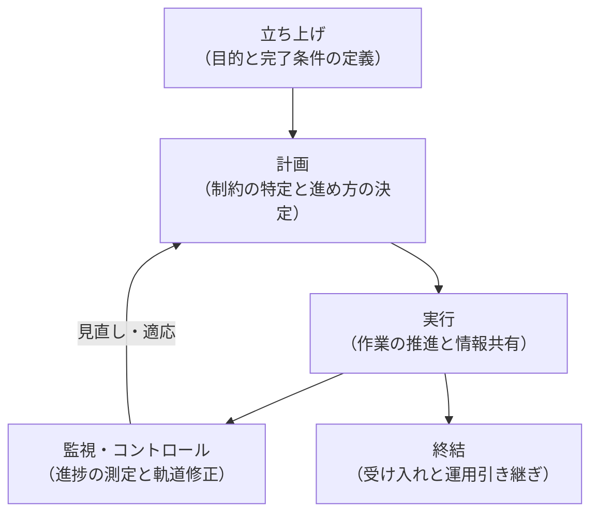

進捗管理表を更新して、遅れている人に「まだですか？」と催促する。プロジェクトマネジメント（PM）と聞くと、そんな退屈なイメージを持つかもしれない。

だが PM の本来の目的は、先が見えない状況の中でゴールまでの道筋を描き、行く手を阻む障害を取り除いて、開発を滞りなく進めることだ。

ここでは、プロジェクトの基本的な性質と 5 つの活動プロセスを整理し、エンジニアが日々の現場で迷わず動くための共通認識を作っていこう。

# プロジェクトの基本特性

プロジェクトは、一般的に次の 2 つの性質を持つ活動とされる。

1. 有期性（始まりと終わりがある）
   明確なスタートとゴールが存在し、目標としていた成果物を作り終えた時点で完了する。
2. 独自性（毎回条件が違う）
   似たような機能を作った経験があったとしても、関わるメンバー、技術スタック、制約条件、業務要件の組み合わせは毎回異なる。

## プロダクト開発の中にある「有期のプロジェクト」

自社プロダクトの開発や改善そのものには終わりがない。しかし、その中で動く個別の取り組み、たとえば「新機能の追加」「決済基盤のリプレイス」「認証システムの移行」などは、すべて明確な始まりと終わりを持つプロジェクトだ。

日々のプロダクト運用の流れから、明確な境界を持つプロジェクトを切り出し、期間と目標を定めて進めることが、開発の肥大化やずるずるとした遅延を防ぐ第一歩になる。

# 5 つの活動プロセス

PMBOK（プロジェクトマネジメント知識体系）では、プロジェクトの活動を次の 5 つのプロセス群に分類している。これらは一度通ったら終わりの一方通行（ウォーターフォール）ではなく、開発サイクルの中で何度も行き来しながら反復する活動だ。

### 1. 立ち上げ（Initiating）

開発の背景、解決したい課題（Why）、そして何をもって完成とするか（完了条件/Definition of Done）を決める。目的が曖昧なまま走り出すと、終盤になって「そもそもこれ何のために作っているんだっけ？」と根本的な見直しに巻き込まれることになる。

### 2. 計画（Planning）

技術的な難所や他チームとの依存関係といったリスクを洗い出し、スコープ、スケジュール、担当、検証手順を決める。最初からすべての計画を作り込むことではなく、「後戻りできないリスク」を早い段階で見つけ出し、検証タスクを仕込んでおくことが肝心だ。

### 3. 実行（Executing）

決めた方針に沿って実装を進め、判断が必要なタイミングで関係者に情報を提供する。技術検証（スパイク）でわかった事実をもとに、後続の実装方針を調整していく。

### 4. 監視・コントロール（Monitoring & Controlling）

日々の進捗、残りの課題、見えてきたリスク、そして何より「待ち時間」を観察する。当初の見通しからのズレや前提の崩れを察知したら、関係者と相談してスコープや日程を安全に軌道修正する。

### 5. 終結（Closing）

成果物の動作確認、本番への安全なリリース、サポート担当への引き継ぎを行う。そして開発のふりかえりを行い、得られた学びをチームの知見として残す。

# 専任 PM への依存リスクと、意思決定の分散

## 情報と判断が集中する危うさ

外部との利害調整が複雑な場面では、専任 PM の存在は心強い。しかし、細かな仕様調整や技術的な判断まで PM 1 人に抱え込ませてしまうと、次のような問題が起きる。

- エンジニアが「PM の返事待ち」で手が止まる
- PM が体調不良や会議続きで不在になると、チームの開発全体が止まる
- 現場のコードやアーキテクチャの実態から外れた決定が下される

## 現場で決めていいこと、相談すべきことの線引き

PM への依存をなくし、自律的に動くチームを作るには、「自分たちで決めてよい範囲」と「上位者へ相談すべき基準」をあらかじめ言葉にしておく必要がある。

| 分類 | 対象となる判断 | 対応方針 |
| :--- | :--- | :--- |
| 現場の裁量範囲 | コード設計、内部リファクタリング、すぐ戻せる UI/UX の微調整、単体テストの方針 | エンジニア自身がその場で判断・決定し、あとからチームに共有する |
| エスカレーション対象 | リリース日の延期、スコープの削りや追加、外部サービス連携の仕様、セキュリティや認証の要件 | 背景・選択肢・おすすめの案を整理したうえで、意思決定者に相談する |

あらかじめこの境界線を揃えておくだけで、判断待ちで手が止まる時間は劇的に減る。

# CSV 出力機能における具体例

前章で挙げた CSV 出力機能を例に、立ち上げ段階で整理すべき要件を見てみよう。

| 観点 | 定義内容 |
| :--- | :--- |
| 目的の定義 | 単に画面にボタンを追加することではなく、「顧客が月次報告を作る際の手作業と転記の手間を減らすこと」をゴールとする。 |
| 完了条件（DoD）の定義 | 直近 3 か月分のデータが 10 秒以内にダウンロードできること。 テナント分離と権限チェックがテストで保証されていること。 カスタマーサポート向けのマニュアルと、エラー時の問い合わせ手順が揃っていること。 |
| 役割と判断主体の明確化 | 出力項目の優先順位：プロダクトマネージャー（PdM） 大量データの処理方式とクエリ性能の担保：エンジニア 個人情報の取り扱いと監査ログ要件：セキュリティ・法務担当 |

目的と完了条件をしっかり分けて定義しておくだけで、実装が終わったあとの「思っていたのと違う」「これではリリースできない」といった手戻りを未然に防ぐことができる。
