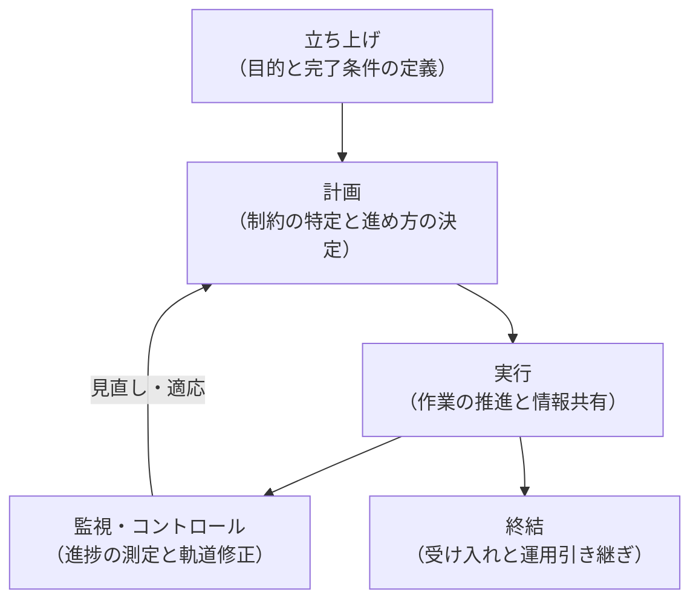

プロジェクトマネジメント（PM）の本質は、進捗表の更新や遅れの催促ではありません。不確実な状況でゴールまでの道筋を描き、障害を取り除いて開発を前に進めることです。

ここでは、プロジェクトの特性と 5 つの活動プロセスを整理し、エンジニアが現場で自律的に動くための枠組みをまとめます。

# プロジェクトの基本特性

プロジェクトは、次の 2 つの性質を持ちます。

1. 有期性：明確な始まりと終わりがある
2. 独自性：関わる人、技術、要件の組み合わせが毎回異なる

## プロダクト開発の中にある「有期プロジェクト」

プロダクト開発自体に終わりはありませんが、その中で動く「新機能の追加」「決済基盤のリプレイス」「認証システムの移行」などは、すべて明確な期日や目標を持つ有期のプロジェクトです。

定常運用の流れからプロジェクトを切り出し、期間と目標を定めて進めることで、開発の肥大化やずるずるとした遅延を防げます。

# 5 つの活動プロセス

PMBOK では、プロジェクトの活動を次の 5 つのプロセス群に分類しています。一方通行（ウォーターフォール）ではなく、反復しながら進める活動です。

### 1. 立ち上げ（Initiating）

開発の背景、解決したい課題（Why）、何をもって完成とするか（完了条件/Definition of Done）を決めます。目的が曖昧なまま走り出すと、終盤で根本的な手戻りが発生します。

### 2. 計画（Planning）

技術的な難所や他チームとの依存関係を洗い出し、スコープ、スケジュール、担当、検証手順を決めます。最初からすべての計画を作り込むことではなく、「後戻りできないリスク」を早期に見つけ、検証タスクを仕込むことが狙いです。

### 3. 実行（Executing）

方針に沿って実装を進めます。技術検証（スパイク）でわかった事実をもとに、後続の実装方針を調整します。

### 4. 監視・コントロール（Monitoring & Controlling）

進捗、残課題、リスク、そして「待ち時間」を観察します。見通しからのズレや前提の崩れを察知したら、スコープや日程を軌道修正します。

### 5. 終結（Closing）

動作確認、安全なリリース、サポート担当への引き継ぎを行います。ふりかえりを行い、得られた学びをチームの知見として残します。

# 専任 PM への依存リスクと意思決定の分散

## 情報と判断が集中する危うさ

外部との利害調整が複雑な場面では専任 PM が役立ちます。しかし、細かな仕様調整や技術判断まで PM 1 人に抱え込ませると、次の問題が起きます。

- エンジニアが「PM の返事待ち」で手が止まる
- PM の不在や過負荷で開発全体が止まる
- コードやアーキテクチャの実態から外れた決定が下される

## 現場で決めていいこと、相談すべきことの線引き

PM への依存をなくすには、「自分たちで決めてよい範囲」と「上位者へ相談すべき基準」をあらかじめ明確にしておきます。

| 分類 | 対象となる判断 | 対応方針 |
| :--- | :--- | :--- |
| 現場の裁量範囲 | コード設計、内部リファクタリング、すぐ戻せる UI/UX の微調整、単体テスト方針 | エンジニア自身がその場で判断し、事後に共有する |
| エスカレーション対象 | リリース日の延期、スコープの増減、外部サービス連携の仕様、セキュリティ・認証要件 | 背景・選択肢・推奨案を整理したうえで、意思決定者に相談する |

この境界線を揃えておくだけで、判断待ちによる待機時間は激減します。

# CSV 出力機能における具体例

管理画面の CSV 出力機能を例に、立ち上げ段階で整理すべき要件を示します。

| 観点 | 定義内容 |
| :--- | :--- |
| 目的の定義 | 画面にボタンを追加することではなく、「顧客が月次報告を作る際の手作業と転記の手間を減らすこと」をゴールとする。 |
| 完了条件（DoD）の定義 | 直近 3 か月分のデータが 10 秒以内にダウンロードできること。 テナント分離と権限チェックがテストで保証されていること。 カスタマーサポート向けのマニュアルと、エラー時の問い合わせ手順が揃っていること。 |
| 役割と判断主体の明確化 | 出力項目の優先順位：プロダクトマネージャー（PdM） 大量データの処理方式とクエリ性能の担保：エンジニア 個人情報の取り扱いと監査ログ要件：セキュリティ・法務担当 |

目的と完了条件を分けて定義することで、実装後の手戻りや期待値のズレを防げます。
