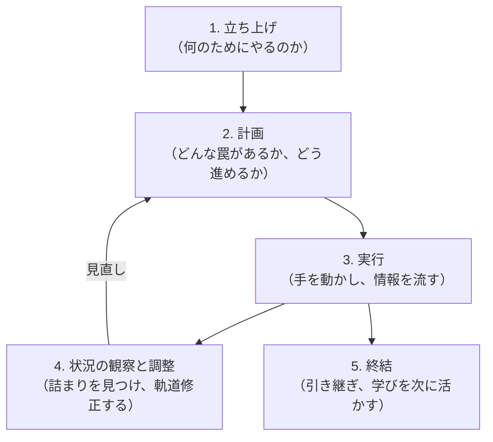

「プロジェクトマネジメント（PM）」と聞くと、ガントチャートを更新し、毎日の進捗会議で「あのタスク、予定通り終わる？」と進捗を問い詰めるような光景を思い浮かべる人も多いかもしれない。

だが、本来の PM はそんな息苦しい監視業務ではない。

PM の本質を一言で表すなら、**「目的を定め、そこにたどり着くまでの『もったいない』を減らし、チームが迷わず動ける道筋をつくること」** だ。

決して難しい資格を取らなければできないことではない。日々の開発でエンジニアが当たり前にやっている「下調べ」「段取り」「相談」を、少し解像度を上げて捉え直すだけでいい。

# プロジェクトとは「毎回条件が違う、一点モノの仕事」

そもそも「プロジェクト」とは何だろうか。教科書的には「独自の成果を生み出す、始まりと終わりがある活動」と定義される。

日常の言葉に噛み砕けば、次の 2 つの特徴を持った仕事のことだ。

1. **終わりがある（有期性）**：目的を達成したら、その取り組みは解散・終了する。
2. **毎回条件が違う（独自性）**：過去に似たようなものを作ったことはあっても、対象ユーザー、関わるメンバー、技術基盤、スケジュールの組み合わせは毎回異なる。まったく同じ仕事は二度とない。

## 自社プロダクト開発も「小さなプロジェクト」の連続

自社プロダクトの運営そのものには「終わり」がない。サービスが続く限り、改善や運用は永遠に続く。

しかし、その中で日々行われている開発を見てみよう。「新規の決済基盤をつなぎ込む」「CSV 出力機能を追加する」「認証基盤を Auth0 に移行する」といった取り組みは、すべて「始まりと終わりがあり、毎回条件が違う」プロジェクトだ。

つまり、自社開発のエンジニアであっても、私たちは常にプロジェクトマネジメントの真っ只中にいる。

# 仕事を前に進める「5つの活動」

プロジェクトマネジメントの標準体系である PMBOK では、仕事を 5 つの活動（プロセス）に分けている。
これは一度順番に通って終わりの「滝（ウォーターフォール）」ではなく、開発中に何度もぐるぐると行き来する道具箱だ。

現場の言葉で言い換えると、それぞれ次のような「ダンドリ」を指している。

- **立ち上げ（Initiating）**：「そもそも何のためにやるのか（目的）」「何ができたら終わりなのか（完了条件）」をハッキリさせる。ここが曖昧なまま走り出すと、作ったあとに「思っていたのと違う」とひっくり返る。
- **計画（Planning）**：ゴールまでの道のりに潜む「罠（リスク）」を洗い出し、進め方と役割を決める。最初から完璧なスケジュールを引くことではなく、「どこから手を付ければ安全か」を見極める作業だ。
- **実行（Executing）**：実際に手を動かしながら、必要な人に情報を流し、必要な判断をもらう。技術検証（スパイク）で分かった新しい事実を進め方にフィードバックする。
- **状況の観察と調整（Monitoring & Controlling）**：予定通りに進んでいるかを監視するのではなく、「どこかで作業が詰まっていないか」「前提が崩れていないか」を観察する。ズレが見つかったら、関係者と相談して柔軟に予定やスコープを調整する。
- **終結（Closing）**：コードをマージして終わりにせず、本番での動作確認、サポート窓口への引き継ぎ、そして「今回の進め方で何が良かったか・悪かったか」をチームでふりかえる。

# 開発現場でぶつかる「3つの難所」

エンジニアがプロジェクトを進めるとき、必ず次の 3 つの壁にぶつかる。

1. **前提条件が毎回違う**
   「前回の機能開発でうまくいったやり方」が、今回もそのまま通用するとは限らない。関わる関係者が違えば、求めるスピード感も、セキュリティ基準も、暗黙の了解も違う。毎回「今回の前提条件は何か」を確かめるダンドリが欠かせない。
2. **四天王（時間・予算・スコープ・品質）の衝突**
   「納期は来週」「予算（工数）は増やせない」「仕様は全部盛り」「バグはゼロで」――これは絶対に成り立たない。何かを優先するなら、何かを調整しなければならない。
3. **最初からすべては見通せない**
   着手前には見えていなかったライブラリのバグや、仕様の抜け漏れが、開発途中で必ず顔を出す。「最初に入念な計画を立てる」ことよりも、「早く小さく試して、想定外を早めに見つける」ことのほうが圧倒的に大切だ。

# 専任マネージャーに頼り切ると、チームが止まる

プロジェクトが大規模になり、多数の部署や社外ベンダーとの利害調整が必要なときは、専任の PM がいると心強い。

しかし、「日々の細かい判断や進捗管理まで、すべて専任 PM に預ける」という状態は、チームにとって非常に危険だ。

- PM の返事や承認を待つ時間で、エンジニアの手が止まる
- PM が体調を崩したり打ち合わせで捕まらないと、開発全体が麻痺する
- 現場のエンジニアが「言われたチケットを消化するだけ」の受け身になる

本来、情報や判断は 1 箇所に集約させるべきではない。
理想的なのは、**「現場のエンジニアが自分でダンドリを組み、自律して判断できるチーム」** だ。

もちろん、何でもかんでもエンジニアが勝手に決めていいわけではない。「どこまでは自分の裁量で即決してよくて、どこからが相談（エスカレーション）すべきことなのか」という境界線をあらかじめチームで合意しておく。

- **現場の裁量で決めること**：設計の選択、ライブラリの選定、可逆ですぐ直せる小さな仕様の詰め。
- **関係者に相談すべきこと**：リリース日の変更、大きく工数が膨らむ仕様追加、セキュリティや個人情報に関わる判断。

この境界線さえクリアになっていれば、専任 PM の判断待ちで手が止まることはなくなる。

# CSV出力機能の例：目的と完了条件をハッキリさせる

ここで、第 1 章で挙げた「管理画面の CSV 出力機能」の立ち上げを、ダンドリの視点から考えてみよう。

依頼者は「CSV 出力ボタンが欲しい」と言ってきた。しかし、言われた通りにボタンを作るだけでは、プロジェクトとしては落第だ。

- **目的の確認（なぜやるのか）**
  目的は「CSV 出力機能を作ること」ではない。「顧客が毎月の報告書を作るために、管理画面の数値を手作業で Excel に転記している手間をなくすこと」だ。
  目的がここにあると分かっていれば、「そもそも画面から手動ダウンロードさせるより、月次で自動集計した結果をメールで送るほうが喜ばれるのでは？」といった別の筋の良い提案もできるようになる。
- **完了条件（何ができたら終わりなのか）**
  「コードを書き終えて PR を出した」では終わらない。「合意した項目が正しく出力され、本番環境で一般ユーザーがダウンロードでき、CS（カスタマーサポート）への引き継ぎ手順書が揃っている状態」を完了条件（DoD: Definition of Done）として関係者と事前に握っておく。
- **誰が何を判断するのか**
  - 出力する項目の優先順位や、誰に使わせるかの判断：PdM
  - 大量データでもサーバーが落ちないようにするアーキテクチャの判断：エンジニア
  - 顧客の個人情報が漏れないかどうかの判断：セキュリティ・法務担当

最初の一歩として、「目的」「完了条件」「役割」の 3 つを言葉にして関係者と目線を合わせる。たったこれだけのダンドリをするだけで、開発終盤の「こんなはずじゃなかった」という巨大な手戻りは激減する。
