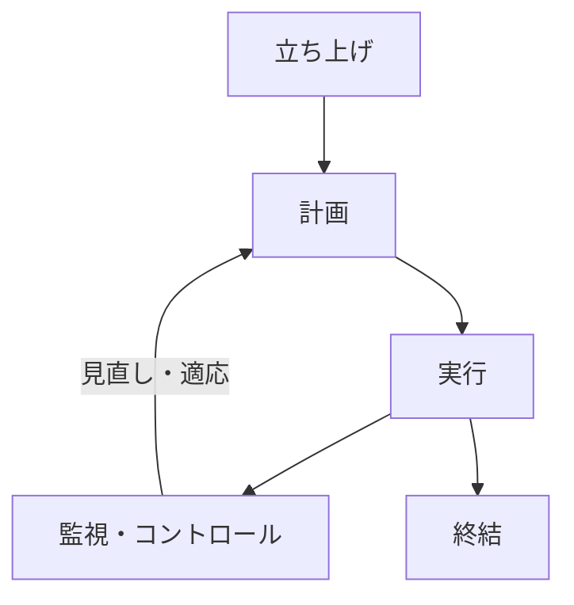

プロジェクトマネジメント（PM）と聞くと、「進捗管理表を更新し、会議を開いて遅れを問い詰める仕事」というイメージを持つかもしれません。しかし本来の PM は、不確実な状況の中で目的達成に向けた道筋を描き、チームが前に進める状態をつくる支援活動です。

本章では、PM の基本概念と 5 つの活動を整理し、エンジニアが日常で使える考え方に落とし込みます。

# プロジェクトとは「独自の成果を生み出す有期の活動」

プロジェクトには 2 つの特徴があります。

1. 有期性（始まりと終わりがある）：特定の結果や成果物を生み出したら活動は終了します。
2. 独自性（過去に全く同じものはない）：過去の類似事例は参考にできますが、対象ドメイン、関係者、技術スタック、制約条件の組み合わせは毎回異なります。

## 機能開発はプロジェクトとして扱える

自社プロダクトの運営全体は終わりのない継続的な活動ですが、その中で行われる新機能のリリースや決済基盤の移行、認証システムの刷新といった個々の取り組みは、有期のプロジェクトとして扱えます。

# 仕事を前に進める「5つの活動プロセス」

PMBOK（プロジェクトマネジメント知識体系）では、プロジェクトの活動を 5 つのプロセス群に整理しています。これは順番に一度だけ通る工程ではなく、開発中に何度も行き来する活動の分類です。

- 立ち上げ（Initiating）：なぜやるのかという背景や目的、何をもって成功とするかという成功基準、責任者を明らかにします。
- 計画（Planning）：制約と障害を洗い出し、方針、スコープ、依存関係、役割分担、進め方を決めます。リスクへの予防と検証もあらかじめ組み込みます。
- 実行（Executing）：作業を進め、関係者に必要な情報を届け、必要な判断を獲得します。技術検証（スパイク）で得た知見を進め方に反映します。
- 監視・コントロール（Monitoring & Controlling）：成果の進捗、残作業、顕在化したリスク、待ち時間を観察します。進捗の遅延やリスクの兆候が見られた場合は、方針や予定を調整します。変更の影響範囲と承認者を明確にします。
- 終結（Closing）：成果物の受け入れ、本番運用への引き継ぎ、残課題の確認、ふりかえりを行います。

# プロジェクトマネジメントの3つの難所

エンジニアが開発を進める際、直面する難所は次の 3 点に集約されます。

1. 前提条件が毎回異なる：前回の案件で成功した進め方が、今回の案件でも通用するとは限りません。「今回の関係者は誰か」「今回の制約は何か」という前提条件の確認が不可欠です。
2. 制約のトレードオフ（四天王の衝突）：時間、予算、スコープ、品質のすべてを理想通りに固定できません。どれかを優先すれば、どれかを調整しなければなりません。
3. 最初からすべては見通せない：着手前には見えていなかった仕様の曖昧さや技術的難所が、後から必ず現れます。「事前の緻密な計画」にとらわれるのではなく、早く小さく試して軌道修正する進め方が求められます。

# 専任PMの役割と「全員ダンドリ」

## なぜ情報と判断を一箇所に集めてはいけないのか

複数チームや社外との複雑な利害調整が必要な場合、専任 PM の存在は効果的です。しかし、あらゆる情報共有や日常的な判断まで専任 PM 一人に集中させると、次のような問題が生じます。

- PM の判断待ちによって開発の手が止まる
- PM が休暇や体調不良で不在の際、現場が判断できず開発が停滞する

## 「全員ダンドリ」の設計

全員ダンドリとは、責任の所在を曖昧にすることではありません。各人が決めてよい裁量範囲、相談すべき相手、最終判断を下す人をルールとして明示することです。

- 現場の裁量範囲：実装方針、コード設計、可逆な小さな仕様調整などはエンジニア自身が即断します。
- エスカレーション対象：納期や予算への影響、外部連携、セキュリティ要件などは速やかに責任者へ相談します。

# CSV出力機能の例：目的と完了条件を分ける

第 1 章の CSV 出力機能を、ダンドリの視点で立ち上げてみましょう。

- 目的の整理：目的は CSV 出力ボタンを作ることではなく、顧客の月次報告作成にかかる手入力工数を削減することです。
- 完了条件（有期の終わり）：合意した出力項目とユーザーロールに応じた閲覧権限に基づき、指定期間のデータが CSV 出力できること。本番環境での動作確認と運用引き継ぎが完了している状態を指します。
- 効果測定（別軸での確認）：リリース後、実際に顧客の転記作業時間が減ったかを PdM やカスタマーサクセス（CS）と協力して計測します。
- 役割と判断の整理：
  - 対象顧客と出力項目のスコープ判断はプロダクトマネージャー（PdM）が担います。
  - 技術的な実現性と性能担保はエンジニアが担当します。
  - 個人情報や権限管理の確認はセキュリティ担当や法務担当と協議します。

機能の完成と目的の達成を切り分けておくことで、作って満足して終わりにせず、関係者と合意しながらブレずに開発を進められます。
