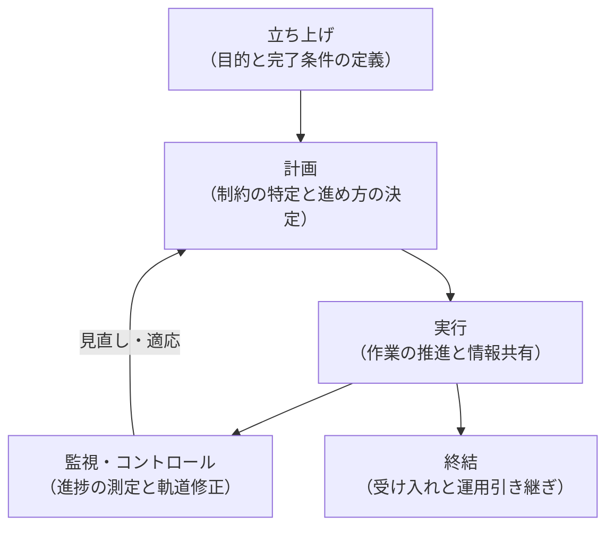

プロジェクトマネジメント（PM）は、単に進捗管理表を更新し、遅延を催促するための手段ではない。本来の目的は、不確実な状況下において目的達成までの道筋を定義し、障害を排除して開発を円滑に進行させることである。

本章では、プロジェクトの基本特性と 5 つの活動プロセスを整理し、エンジニアが日常業務の中で自律的に判断・遂行するための枠組みを確立する。

# プロジェクトの基本特性

プロジェクトは、一般に以下の 2 つの特性を持つ活動と定義される。

1. **有期性（Definite beginning and end）**：明確な開始点と終了点が存在し、所期の成果物や目標を達成した時点で終了する。
2. **独自性（Unique output）**：過去に類似の開発経験があったとしても、関与する関係者、技術スタック、制約条件、業務要件の組み合わせは個々に異なる。

## プロダクト開発における有期プロジェクトの存在

自社プロダクトの運用・改善自体は終わりのない継続的な活動であるが、その内部で実行される個別の取り組み――「新機能の追加」「外部決済基盤の移行」「認証システムの刷新」などは、すべて有期のプロジェクトとして定義できる。

日々のプロダクト運用の中に明確な境界を持つプロジェクトを切り出し、適切なマネジメントを適用することが、開発の肥大化や曖昧な遅延を防ぐ前提となる。

# 5つの活動プロセス

PMBOK（プロジェクトマネジメント知識体系）では、プロジェクトの活動を以下の 5 つのプロセス群に分類している。これらは一度きりの順次工程（ウォーターフォール）ではなく、開発サイクルの中で反復して実行される活動分類である。

1. **立ち上げ（Initiating）**
   - 開発の背景、解決すべき課題（Why）、何をもって完了とするか（完了条件 / Definition of Done）を定義する。
   - 目的が曖昧なまま着手すると、実装終盤で仕様の根本的な見直しが発生する原因となる。
2. **計画（Planning）**
   - 技術的難所や外部依存関係といったリスクを洗い出し、スコープ、スケジュール、体制、検証手順を決定する。
   - 初期に完全な計画を立てることではなく、後戻り不能なリスクを早期に特定し、検証タスクを組み込むことが目的である。
3. **実行（Executing）**
   - 計画に基づいて実装を進め、関係者に必要な情報を適切なタイミングで提供する。
   - 技術検証（スパイク）によって得られた事実を、後続の実装方針へ反映する。
4. **監視・コントロール（Monitoring & Controlling）**
   - 作業実績、残課題、顕在化したリスク、工程間の待ち時間を測定する。
   - 計画からの乖離や前提条件の崩壊を検知した場合、関係者と調整の上でスコープや日程の軌道修正を行う。
5. **終結（Closing）**
   - 成果物の動作検証、本番環境への安全なデプロイ、運用担当者やカスタマーサポートへの引き継ぎを実施する。
   - 開発プロセスのふりかえりを行い、得られた知見をチームの資産として記録する。

# 専任 PM の集約リスクと意思決定の分散

## 情報と判断の集中による弊害

外部折衝やステークホルダー間の利害調整が複雑な場合、専任 PM の配置は有効である。しかし、技術的判断や細かな仕様調整まで PM 1 名に集約させると、以下の問題が生じる。

- **判断待ちによるエンジニアの待機時間増大**
- **PM の不在（体調不良、会議重複など）に伴う開発の完全停止**
- **現場の実態と意思決定の乖離**

## 現場裁量とエスカレーションの明確化

専任 PM への依存を解消し、自律的な開発チームを維持するためには、各自が決めてよい裁量範囲と、上位者へ相談すべき判断基準をルールとして明示しておく必要がある。

| 分類 | 対象となる判断 | 対応方法 |
| :--- | :--- | :--- |
| **現場の裁量範囲** | コード設計、内部リファクタリング、可逆な UI/UX の微調整、単体テスト方針 | エンジニア自身が即座に判断・決定し、事後共有する |
| **エスカレーション対象** | リリース日の延期、スコープの増減、外部サービス連携仕様、セキュリティ・認証要件 | 背景・選択肢・推奨案を整理した上で、意思決定者へ相談する |

この境界線をあらかじめ合意しておくことで、判断待ちの発生を最小限に抑えることができる。

# CSV出力機能における具体例

前章の CSV 出力機能を例に、立ち上げ段階で整理すべき要件を以下に示す。

- **目的の定義**：
  画面上のボタン追加そのものではなく、「顧客の月次報告作成に伴う手入力・転記工数を削減すること」を目的とする。
- **完了条件（DoD）の定義**：
  - 指定期間（過去 3 ヶ月分）のデータが 10 秒以内にダウンロード可能であること。
  - テナント分離および権限チェックが単体・結合テストで検証されていること。
  - カスタマーサポート向けのマニュアルおよびエラー時の問い合わせ対応フローが整備されていること。
- **役割と判断主体の明確化**：
  - 出力項目の取捨選択および業務優先度：プロダクトマネージャー（PdM）
  - 大量データ処理アーキテクチャおよびクエリ性能の担保：エンジニア
  - 個人情報保護方針およびログ監査要件：セキュリティ・法務担当

目的と完了条件を分離して定義することで、実装完了後の手戻りや期待値のズレを未然に防止する。
