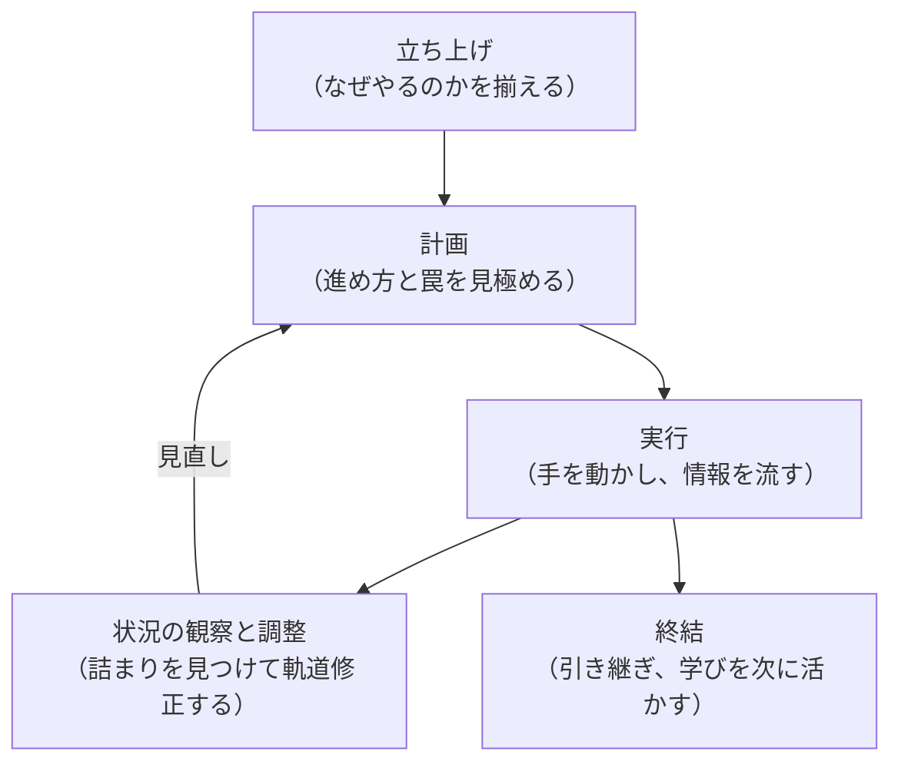

「プロジェクトマネジメント（PM）」という言葉を聞くと、ガントチャートを作って毎日の進捗を管理し、「あのタスク、予定通り終わりそう？」と進捗を問い詰めるような光景を思い浮かべる人もいるかもしれません。

ですが、本来の PM はそうした監視業務ではありません。

PM の本質を一言で表すなら、**「目的を定め、そこにたどり着くまでの『もったいない』を減らし、チームが迷わず動ける状態をつくること」** です。

難しい資格を取らなければできないことではありません。日々の開発でエンジニアが当たり前にやっている「下調べ」「段取り」「相談」を、少し解像度を上げて捉え直すだけで十分です。

# プロジェクトとは「毎回条件が違う、一点モノの仕事」

そもそも「プロジェクト」とは何でしょうか。教科書的には「独自の成果を生み出す、始まりと終わりがある活動」と定義されます。

日常の言葉に噛み砕けば、次の 2 つの特徴を持った仕事のことです。

1. **終わりがある（有期性）**：目的を達成したら、その取り組みは終了します。
2. **毎回条件が違う（独自性）**：過去に似たようなものを作った経験はあっても、関わるメンバー、技術基盤、制約条件の組み合わせは毎回異なります。まったく同じ仕事は二度とありません。

## 自社プロダクト開発も「小さなプロジェクト」の連続

自社プロダクトの運営そのものには「終わり」がありません。サービスが続く限り、改善や運用はずっと続きます。

しかし、その中で日々行われている開発を見てみてください。「新しい決済基盤をつなぎ込む」「CSV 出力機能を追加する」「認証基盤をリプレイスする」といった個々の取り組みは、すべて「始まりと終わりがあり、毎回条件が違う」プロジェクトです。

つまり、自社開発の現場にいる私たちエンジニアも、日常的にプロジェクトマネジメントの真っ只中にいます。

# 仕事を前に進めるための5つの活動

プロジェクトマネジメントの国際標準である PMBOK では、プロジェクトの活動を 5 つのプロセス群に整理しています。
これは一度順番に通って終わりのウォーターフォールではなく、開発中に何度も行き来する活動の分類です。

現場の言葉で言い換えると、それぞれ次のような「ダンドリ」を指しています。

- **立ち上げ**：「そもそも何のためにやるのか（目的）」「何ができたら終わりなのか（完了条件）」をハッキリさせます。ここが曖昧なまま走り出すと、作ったあとに「思っていたのと違う」とひっくり返ってしまいます。
- **計画**：ゴールまでの道のりに潜む「罠（リスク）」を洗い出し、進め方と役割を決めます。最初から完璧なスケジュールを引くことではなく、「どこから手を付ければ安全か」を見極める作業です。
- **実行**：実際に手を動かしながら、必要な人に情報を流し、必要な判断をもらいます。技術検証で分かった新しい事実を進め方にフィードバックしていきます。
- **状況の観察と調整**：予定通りに進んでいるかを監視するのではなく、「どこかで作業が詰まっていないか」「前提が崩れていないか」を観察します。ズレが見つかったら、関係者と相談して柔軟に予定やスコープを調整します。
- **終結**：コードをマージして終わりにせず、本番での動作確認、サポート窓口への引き継ぎ、そして「今回の進め方で何が良くて何が悪かったか」をチームでふりかえります。

# 専任マネージャーに頼り切ると、チームが止まる

プロジェクトが大規模になり、多数の部署や社外との利害調整が必要なときは、専任の PM がいると心強いものです。

しかし、「日々の細かい判断や進捗管理まで、すべて専任 PM に預ける」という状態は、チームにとって大きなボトルネックになります。

- PM の返事や承認を待つ時間で、エンジニアの手が止まる
- PM が不在だと、現場が判断できずに開発全体が麻痺する
- 現場のエンジニアが「言われたタスクをこなすだけ」の受け身になる

本来、情報や判断は 1 箇所に集約させるべきではありません。
目指したいのは、**「現場のエンジニアが自分でダンドリを組み、自律して判断できるチーム」** です。

もちろん、何でもかんでも勝手に決めていいわけではありません。「どこまでは自分の裁量で即決してよくて、どこからが相談すべきことなのか」という境界線をあらかじめチームで合意しておきます。

- **現場の裁量で決めること**：設計の選択、ライブラリの選定、可逆ですぐ直せる小さな仕様の詰め
- **関係者に相談すべきこと**：リリース日の変更、大きく工数が膨らむ仕様追加、セキュリティや個人情報に関わる判断

この境界線さえクリアになっていれば、誰かの判断待ちで現場の手が止まることはなくなります。

# 例で考える：CSV 出力機能の「目的」と「完了条件」

第 1 章で挙げた「管理画面の CSV 出力機能」の立ち上げを、ダンドリの視点で考えてみましょう。

依頼者から「CSV 出力ボタンが欲しい」と言われたとき、言われた通りにボタンを作るだけでは、手戻りのリスクが高くなります。

- **目的の確認（なぜやるのか）**
  目的は「CSV 出力ボタンを作ること」ではなく、「顧客が毎月の報告書を作るために、管理画面の数値を手作業で Excel に転記している手間をなくすこと」です。
  目的がここにあると分かっていれば、「そもそも画面から手動ダウンロードさせるより、月次で自動集計した結果をメールで送るほうが喜ばれるのでは？」といった、より筋の良い提案ができる可能性も出てきます。
- **完了条件（何ができたら終わりなのか）**
  「コードを書き終えて PR を出した」では終わりません。「合意した項目が正しく出力され、本番環境で一般ユーザーがダウンロードでき、CS（カスタマーサポート）への引き継ぎが済んでいる状態」を完了条件（DoD: Definition of Done）として関係者と事前に握っておきます。
- **誰が何を判断するのか**
  - 出力する項目の優先順位や、対象ユーザーの判断：PdM
  - 大量データでもサーバーが落ちないようにするアーキテクチャの判断：エンジニア
  - 顧客の個人情報が漏れないかどうかの判断：セキュリティ・法務担当

最初の一歩として、「目的」「完了条件」「役割」を言葉にして関係者と目線を合わせる。たったこれだけのダンドリをするだけで、開発終盤の「こんなはずじゃなかった」という大きな手戻りはぐっと減らせます。
