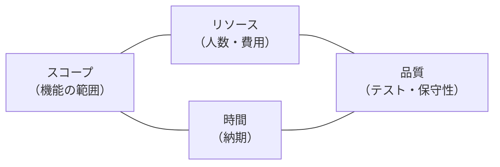

世の中には数多くのプロジェクトマネジメントの理論やフレームワークがあります。

ですが、それらを教科書通りにすべて導入しようとすると、ドキュメントの作成や報告会議ばかりが増えて、肝心の開発が息切れしてしまいます。

大切なのは、理論を丸暗記することではありません。**「開発で困ったときに、道具箱からどの道具を取り出せば手戻りを防げるか」** という引き出しを持っておくことです。

この章では、日々の開発で迷ったときの道しるべとなる基本的な考え方を整理してみましょう。

# 「計画」と「願望」を取り違えない

プロジェクトが混乱するとき、多くの現場では「計画がない」のではなく、「願望」を計画だと思い込んでしまっています。

- 「気合で予定通り全機能を作り切る」
- 「データが増えたときの負荷は心配だけど、まずは画面から作る」
- 「どれも重要だから、すべてのタスクを最優先にする」

これらは計画ではなく、単なる願望や先送りに過ぎません。
本当の戦略や計画とは、**「最大の難所を見極め、そこに集中するために、今回は何をあきらめる（捨てる）かを決めること」** です。

1. **状況を見極める**：今、目の前にある一番の障害や不安要素は何なのかを特定する。
2. **基本方針を決める**：その障害を乗り越えるために、どこに力を集中させ、何を後回しにするかを決める。
3. **具体的な行動に落とす**：決めた方針と矛盾しないように、日々の作業やタスクを組み立てる。

「あれもこれも全部やる」ではなく、「今回はここが一番の難所だから、他は削ってここに集中しよう」と関係者と合意することが、ダンドリの出発点になります。

# 分からないこと（不確実性）を「安く」潰す

ソフトウェア開発は、本質的に「やってみなければ分からないこと」との戦いです。
漠然と「なんか不安だな……」と悩んでいても時間は過ぎていきます。分からないことは、次の 3 つに切り分けると、驚くほど安く安全に対処できるようになります。

## 1. 「何を作るべきか」が分からないとき

- **起きがちな問題**：作ったあとで「欲しかったのはこれじゃない」と言われる。
- **安く潰すダンドリ**：コードをいきなり書かないことです。手書きの画面イメージを見せたり、ダミーの CSV ファイルをスプレッドシートで作って見せたりして、「これで業務の課題は解決しそうか？」をヒアリングします。これだけで、数日かけて作った機能が全ボツになる悲劇を防げます。

## 2. 「どう作るべきか」が分からないとき

- **起きがちな問題**：いざ実装してみたら性能が出ない、ライブラリが要件を満たせない。
- **安く潰すダンドリ**：時間を区切った検証タスク（スパイク）を挟みます。「明日までの 1 日間で、10 万件のダミーデータから抽出できるかだけを試す」といった小さな検証を行います。動かしてみてダメだと分かれば、別の設計に切り替えるコストは最小限で済みます。

## 3. 「同じ認識を持っているか」が分からないとき

- **起きがちな問題**：完成間際になって、PdM や QA と仕様の解釈が違っていたと気づく。
- **安く潰すダンドリ**：「受け入れ条件（Acceptance Criteria）」をあらかじめ文章にして握っておきます。「〇〇ボタンを押したとき、△△のステータスのデータだけが出力されること」など、具体的な入力と期待する結果を例示して事前に合意します。

# トレードオフの現実を受け入れる

開発には、常にせめぎ合う 4 つの要素があります。

- **スコープ**：何を作り、何を削るか
- **時間**：いつまでにリリースするか
- **リソース**：何人のメンバーで開発するか
- **品質**：どこまでテストし、堅牢にするか

この 4 つすべてを理想通りに固定することはできません。

- **すべてを固定しようとすると現場が壊れる**
  予期せぬトラブルが起きたとき、調整の余地がなくなってしまいます。「今回は納期が固定だから、スコープを調整弁にする」「今回は品質が最優先だから、納期を柔軟にする」といった力関係を、あらかじめ関係者と握っておく必要があります。
- **品質を安易に削ってはいけない**
  納期に追われて「テストを省く」「設計を妥協する」といった選択をすると、本番障害や後からの手戻りで何倍ものツケを払うことになります。品質の最低ラインは死守しなければなりません。
- **納期が動かせないなら、削れるのは「スコープ」だけ**
  遅れている開発に人を急に追加しても、引き継ぎや連絡のコストでかえって遅れてしまいます。締め切りを動かせないときに唯一現実的なのは、「初回リリースに含める機能を絞る（スコープを削る）」ことです。

# 見積もりは「約束手形」ではなく「天気予報」

見積もりで一番やってはいけないのは、「3 日で終わります！」と言い切ってしまうことです。
未知の要素がある作業において、最悪の所要時間を事前に正確に当てることはできません。見積もりは約束ではなく、「現時点の前提情報に基づく予測（天気予報）」として扱います。

- **前提条件と幅を持たせる**
  「仕様に変更がなければ 3 日、もし権限管理の改修が必要なら 5 日かかります」と、前提とブレ幅をセットで伝えます。
- **タスクを半日〜1日サイズに割る**
  「CSV 機能の実装：1 週間」では何が起きるか見えません。「クエリの検証：0.5 日」「CSV 変換処理：1 日」「ダウンロード API：1 日」と細かく割ることで、どこに不確実性があるかが浮き彫りになります。
- **予備日（バッファ）を隠さない**
  隠れて作業時間を水増しするのではなく、「未知の技術検証で何か起きたときの予備として 1 日取っています」とオープンに合意します。

# 例で考える：CSV 出力機能の難所と方針

CSV 出力機能の開発で、この考え方をどう使うかを見てみましょう。

- **一番の難所（診断）**：
  機能自体はシンプルですが、本番 DB には数百万件のレコードがあります。月初のピーク時に重いクエリを一斉に叩かれたら、DB の負荷が跳ね上がり、通常業務の画面まで巻き添えでダウンしてしまいます。ここが最大の地雷です。
- **方針（捨てるものと集中するもの）**：
  サービスの安定性を最優先とし、納期と初回機能の範囲を柔軟に扱います。画面上での即時ダウンロードはあきらめ、非同期処理によるバックグラウンド生成に絞ります。
- **具体的な行動**：
  いきなり画面やボタンの実装に入りません。まず 1 日の検証枠を取り、ステージング環境で 10 万件のデータに対するクエリ負荷を測定します。初回は「直近 1 ヶ月分のみ出力可能」という制限をつけて小さくリリースし、負荷に耐えられることを確認してから期間を拡張します。
