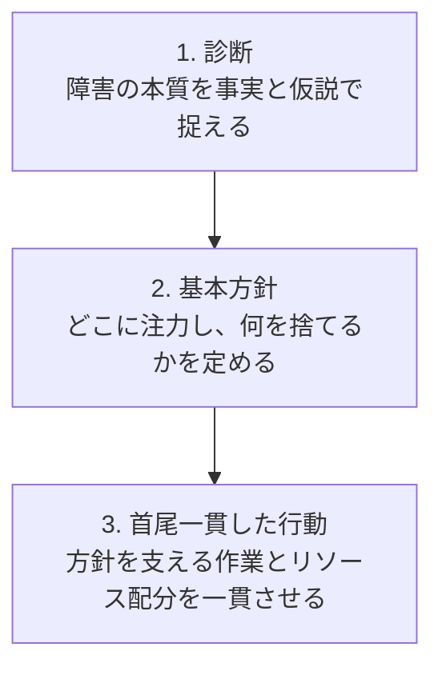
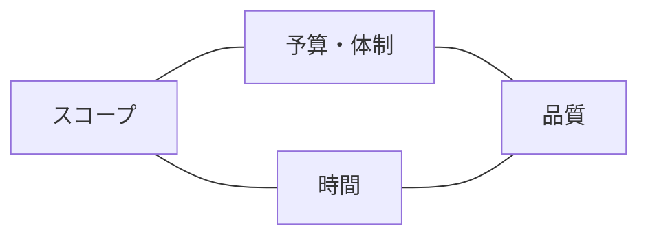

プロジェクトマネジメントを実践する際、教科書に出てくるすべてのフレームワークを導入する必要はありません。体系を「見落としを防ぐための道具箱」として扱い、現在の困りごとに応じて必要な道具を取り出します。

本章では、開発の状況を正しく把握し、次の一手を決めるための骨格（思考のマップ）を整理します。

# 体系を「点検のインデックス」として使う

- PMBOK（Project Management Body of Knowledge）：スコープ、スケジュール、コスト、品質、リソース、コミュニケーション、リスクなどの知識エリアを網羅した世界標準です。重要なのは、現場の規模や不確実性に合わせて必要な要素だけを選ぶ「テーラリング（適合化）」です。書類作成が目的ではなく、考慮漏れがないかを確認するチェックリストとして使います。
- P2M（Project & Program Management）：個々の単発プロジェクトだけでなく、複数の取り組みを会社のビジョンや価値創造に結びつけるための体系です。プロダクトの長期ビジョンと個別の機能開発を連動させる視点を得られます。

# 戦略のカーネル：次の一手をどう絞るか

リチャード・P・ルメルト『良い戦略、悪い戦略』で提唱された「戦略のカーネル（核）」は、日々の開発の意思決定に役立ちます。

避けるべき「悪い戦略」の典型例には以下のようなものがあります。

- 単なる願望の表明（「納期までに全機能を作り切る」と掲げる）
- 核心にある難所の無視（大量データでの負荷問題を直視しない）
- すべての優先度を「高」にする（優先順位をつけていないのと同じ）
- 方針と矛盾する作業配分（品質重視といいながらテストコード作成を省く）

# 不確実性を3つに分けて安く解消する

ソフトウェア開発における「分からないこと」は、大きく 3 つに分類できます（広木大地『エンジニアリング組織論への招待』の視点を参考）。

## 1. 目的不確実性（何を作るべきかが分からない）

誰のどんな課題を解くのか、本当に価値があるのかを問います。顧客ヒアリング、ペーパープロトタイプ、出力見本を提示し、動くコードを書く前に安く素早く検証します。

## 2. 方法不確実性（どう作るべきかが分からない）

技術的に実現可能か、非機能要件（性能やセキュリティ）を満たせるかを問います。時間を区切った調査・試作タスク（スパイク）を活用します。「2 日間で接続検証だけを行う」などタイムボックスを切り、作成した検証用コードは捨てても判断材料が得られたら成功とみなします。

## 3. 通信不確実性（同じ認識を持っているかが分からない）

チームや関係者の間で、言葉の解釈や期待値がズレていないかを問います。受け入れ基準（Acceptance Criteria）の言語化、用語集の整備、具体例を用いたシナリオ確認をします。

# 押さえるべき「4つのコア情報」

開発を進めるうえで、チーム内で常に最新の状態に保つべき情報は次の 4 点です。大掛かりな仕様書ではなく、課題管理ツール（Jira、GitHub Issues 等）の数行でも十分です。

1. 目的と制約（プロジェクト憲章やチケットの記述）：背景、解決したい課題、成功基準、期限、やってはいけないこと（対象外スコープ）。
2. 役割と関係者（体制と責任）：作業の担当者、最終判断者（Decider）、相談先（Consulted）、共有先（Informed）。
3. 課題とリスク（課題管理）：すでに発生して対応が必要な問題と、起きるかもしれない不確実なリスクを区別して記録します。
4. 認識と実態（進捗共有）：完了した事実、残作業、前提の変化、直面している困りごと、求めている判断。

# 4つの制約とトレードオフ（荒ぶる四天王）

開発には常に 4 つの制約が存在します。

- スコープ：作るものの範囲（何を作り、何を削るか）
- 時間：納期（いつまでに必要か、延期可能か）
- 予算や体制：使える人員やインフラ費用
- 品質：バグの少なさ、保守性、セキュリティ、パフォーマンス

## トレードオフの鉄則

- すべてを固定すると破綻する：予期せぬトラブルが起きたとき、調整の余地がなくなります。着手前に「何が固定で、どこを動かせるか」の関係者合意を取ります。
- 品質の最低条件は下げてはいけない：セキュリティ、データ整合性、基盤の保守性を安易に犠牲にすると、将来の手戻りコストが跳ね上がります。
- 納期が固定の場合、主要な調整弁はスコープの縮小：人員を急に追加しても、引き継ぎやコミュニケーションのオーバーヘッドでかえって遅延します（ブルックスの法則）。

# 見積もりと判断

見積もりはコミットメント（約束）ではなく、「現時点の前提情報に基づく予測」です。

- 幅と前提を持たせる：「3 日で終わります」ではなく、「外部 API の仕様に変更がなければ、3 日〜5 日を見込んでいます」と前提とブレ幅を伝えます。
- 作業を細分化する：大きくて不透明なタスクは、半日〜1 日程度で完了条件が分かるサイズに分解します。
- バッファを隠さない：バッファをサバ読みとして隠すのではなく、「技術検証で想定外が出た場合の予備日」として明示し、合意を得ます。

# CSV出力機能の例：診断と基本方針の設計

- 診断：大量データ抽出時の DB 負荷とレスポンス遅延が最大の技術的懸念点です。
- 基本方針：本番サービスの安定性を最優先とし、納期とスコープを柔軟に扱います。まずは少数の社内テストユーザーに限定してリリースし、技術的難所を早期に検証します。
- 首尾一貫した行動：1 日間のスパイクで現行 DB に対する 10 万件抽出のクエリ性能を検証し、非同期処理とバックグラウンドダウンロードを採用します。初回スコープは直近 1 か月分に絞って早期提供し、段階的に期間を拡張します。
