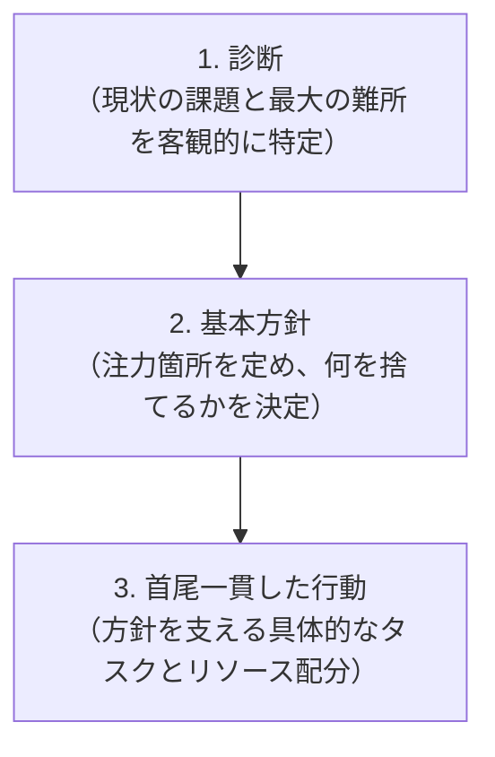
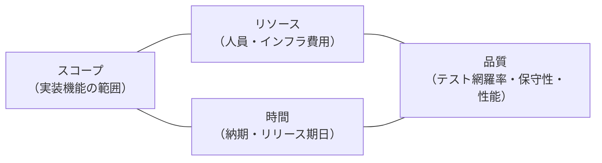

プロジェクトマネジメントのフレームワークを導入する際、すべての理論や形式を網羅的に適用する必要はない。重要なのは、現場の規模や不確実性の度合いに応じて必要な手法を選択・適用することである。

本章では、開発状況を客観的に把握し、適切な意思決定を行うための基礎的な構造を整理する。

# 戦略のカーネルによる意思決定

プロジェクトにおける「戦略」とは、単なる願望や努力目標ではない。リチャード・P・ルメルトが提唱する「戦略のカーネル（核）」は、開発方針の策定において実効性の高い指針となる。

- 1. 診断（Diagnosis）：現状の障害や課題の本質を、推測ではなく測定可能な事実に基づいて特定する。
- 2. 基本方針（Guiding Policy）：障害に対処するためのアプローチを定める。限られたリソースの中で「何に注力し、何を捨てるか（スコープ外とするか）」を明確にする。
- 3. 首尾一貫した行動（Coherent Actions）：基本方針を実行に移すための具体的なタスク群を定義する。個々のタスクが方針と矛盾しないよう整合性を保つ。

「全機能を予定期日通りに実装する」といった全方位的な要求は戦略ではなく願望にすぎない。最大の難所を特定し、そこにリソースを集中投下することがプロジェクト遂行の基本となる。

# 不確実性の3分類と削減アプローチ

ソフトウェア開発における不確実性は、その性質に応じて以下の 3 つに分類できる。不確実性の種類に応じた検証手段を採用することで、手戻りコストを最小化できる。

| 不確実性の種類 | 主な問い | 最小コストで解消する手法 |
| :--- | :--- | :--- |
| 目的不確実性 （何を作るべきか） | 誰のどのような課題を解決するのか？ 本当にこの仕様で目的を達成できるか？ | ワイヤーフレーム、画面モックアップ、ダミーデータ出力例を用いた事前ヒアリング。コード実装前に要求妥当性を検証する。 |
| 方法不確実性 （どう作るべきか） | 採用するライブラリや技術スタックで要件を満たせるか？ スケーラビリティや性能は担保できるか？ | タイムボックス（例：1 日間）を設けた技術検証（スパイク）。本実装とは切り離した検証コードで技術的成立性を確認する。 |
| 通信不確実性 （共通認識があるか） | 開発者、PdM、QA の間で仕様の解釈にズレはないか？ 例外条件や境界値の扱いは揃っているか？ | 受け入れ基準（Acceptance Criteria）の言語化。具体的な入出力例（Given-When-Then）を定義し、事前合意を形成する。 |

# 4つの制約とトレードオフ

プロジェクトには、相互に制約し合う 4 つの要素が存在する。

1. スコープ（Scope）：実装する要件や機能の範囲
2. 時間（Time）：リリース期日やマイルストーン
3. リソース（Resources）：投入可能なエンジニア人員、開発環境、インフラ予算
4. 品質（Quality）：テストカバレッジ、保守性、セキュリティ、パフォーマンス

## トレードオフの力学

- 全要素の固定は破綻を招く
  予期せぬ技術的障害や仕様変更が生じた際、すべての変数を固定していると逃げ場がなくなり、品質の劣化やスケジュールの破綻につながる。着手前に「何が固定（制約）で、何が可変（調整弁）か」を合意しておく必要がある。
- 品質を調整弁にしてはならない
  納期遅延を避けるためにテストコードの記述を省略したり、設計を妥協したりすると、リリース後のバグ修正や運用保守コストが増大し、長期的な開発速度を著しく低下させる。
- 納期固定時の実効的な調整弁はスコープの縮小
  進行中のプロジェクトへ人員を追加投入しても、コミュニケーションコストや引き継ぎ工数の増大によって納期はさらに遅延する（ブルックスの法則）。納期が固定されている場合、唯一の安全な調整弁は「初回リリースに含めるスコープの限定」である。

# 見積もりの性質とバッファ管理

ソフトウェア開発における見積もりは、確定した確約（コミットメント）ではなく、**「現時点の前提情報に基づく確率的予測」** である。

### 前提条件の明示と幅の提示

不確実性が存在する作業に対して単一の数値を提示することは避ける。「外部 API の仕様に制限がなければ 3 日、追加の認証フローが必要な場合は 5 日」のように、前提条件とブレ幅を明示して提示する。

### 作業の細分化

所要時間が 2 日を超える大きなタスクは、0.5〜1 日単位で完了判定が可能な粒度まで分解する。粒度を細かくすることで、方法不確実性が潜んでいる箇所を早期に特定できる。

### バッファの可視化

不測の事態に備える予備期間（バッファ）は、個々のタスク工数に隠蔽（サバ読み）するのではなく、「プロジェクト全体の統合バッファ」として計画上に明示し、合意を形成する。

# CSV出力機能における適用例

| 観点 | 内容 |
| :--- | :--- |
| 診断 | 大量データ（100 万件規模）を Web リクエスト内で同期処理した場合、DB コネクションの枯渇および Web サーバーのメモリ圧迫により、システム全体の可用性が損なわれるリスクがある。 |
| 基本方針 | システムの安定稼働を最優先事項とし、初回リリース時のスコープを厳格に限定する。画面からの即時同期ダウンロードは採用せず、バックグラウンド非同期処理を採用する。 |
| 首尾一貫した行動 | 1. 1 日間のスパイク期間を設け、対象テーブルに対する EXPLAIN の実行計画確認とクエリ性能測定を実施する。 2. 初回リリースの対象範囲を「直近 1 ヶ月分かつ最大 5 万件」に制限するバリデーションを設ける。 3. バックグラウンドワーカーでの非同期生成と S3 からの署名付き URL ダウンロード方式を採用する。 |
