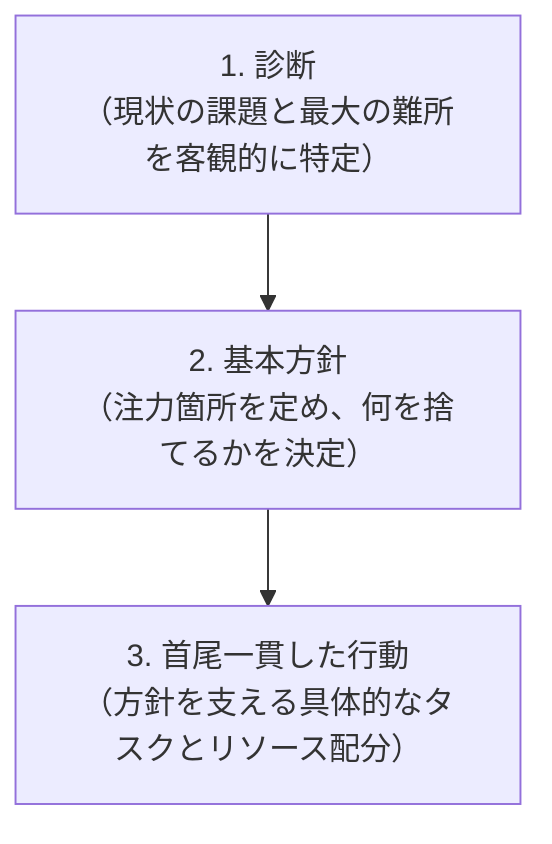
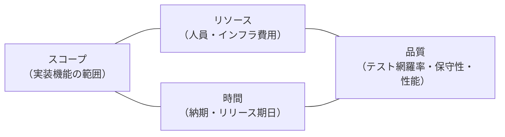

教科書の理論をすべて適用する必要はない。開発規模や状況に合わせて、必要な道具を選べば十分だ。

ここでは、開発状況を客観的に見極め、迷わず判断するための骨格を整理する。

# 戦略のカーネルによる意思決定

プロジェクトの「戦略」とは、スローガンや努力目標ではない。リチャード・ルメルトの「戦略のカーネル」は、方針決定の優れた指針になる。

- 1. 診断（Diagnosis）：推測ではなく事実に基づき、現状の障害や課題の本質を見極める。
- 2. 基本方針（Guiding Policy）：障害に対処する方針を決める。「何に注力し、何を捨てるか」を明確にする。
- 3. 首尾一貫した行動（Coherent Actions）：基本方針に沿った具体的なタスクを整え、足並みを揃える。

「全機能を期日通りに作る」は戦略ではなく願望だ。最大の難所を見極め、そこにリソースを集中投下することがプロジェクトを前進させる。

# 不確実性の 3 分類と削減アプローチ

ソフトウェア開発の不確実性は、次の 3 つに分類できる。性質に合った手法で検証すれば、手戻りを最小限に抑えられる。

| 不確実性の種類 | 主な問い | 最小コストで解消する手法 |
| :--- | :--- | :--- |
| 目的不確実性 （何を作るべきか） | 誰のどんな課題を解決するのか？ この仕様で本当に目的を達成できるか？ | ワイヤーフレームや画面モックによる事前ヒアリング。コードを書く前に需要を確かめる。 |
| 方法不確実性 （どう作るべきか） | このライブラリで要件を満たせるか？ 性能や拡張性は担保できるか？ | タイムボックス（1 日など）を切った技術検証（スパイク）。本番から切り離したコードで実現性を確かめる。 |
| 通信不確実性 （共通認識があるか） | 開発者、PdM、QA の間で仕様の解釈にズレはないか？ 境界値の扱いは揃っているか？ | 受け入れ基準（Acceptance Criteria）の言語化。具体的な入出力例（Given-When-Then）を合意しておく。 |

# 4 つの制約とトレードオフ

プロジェクトには、互いに制約し合う 4 つの要素がある。

1. スコープ（Scope）：実装する要件や機能の範囲
2. 時間（Time）：リリース期日やマイルストーン
3. リソース（Resources）：投入できる人員や予算
4. 品質（Quality）：テストカバレッジ、保守性、セキュリティ、パフォーマンス

## トレードオフの力学

- 全要素の固定は破綻する
  予期せぬトラブルが起きたとき、すべてを固定していると逃げ場がなくなり破綻する。着手前に「何が制約で、何が調整弁か」を握っておく必要がある。
- 品質を調整弁にしてはならない
  納期を守るためにテストや設計を省くと、リリース後の障害対応に追われ、中長期の開発速度を大きく落とす。
- 納期固定時の現実的な調整弁は「スコープの縮小」
  遅れているプロジェクトに人を追加しても、かえって遅れる（ブルックスの法則）。納期を動かせない場合、安全な調整弁は「初回リリースのスコープを削ること」だけだ。

# 見積もりの性質とバッファ管理

見積もりは確定した約束（コミットメント）ではなく、**「現時点の前提に基づく確率的な見立て」** だ。

### 前提条件と幅の提示

不確実な作業に単一の数字を断定して伝えるのは避ける。「外部 API の制限がなければ 3 日、追加認証が必要なら 5 日」のように、前提条件と幅を示す。

### タスクの細分化

2 日以上かかるタスクは、0.5〜1 日単位で完了判定できる粒度に分解する。未知の要素を早期にあぶりだすためだ。

### バッファの可視化

予備期間（バッファ）は各タスクに隠すのではなく、「全体の統合バッファ」として計画に明示して合意する。

# CSV 出力機能における適用例

| 観点 | 内容 |
| :--- | :--- |
| 診断 | 大量データ（100 万件規模）を Web リクエスト内で同期処理すると、DB コネクション枯渇やサーバーのメモリ圧迫でシステムが止まる恐れがある。 |
| 基本方針 | システムの安定稼働を最優先とし、初回リリースのスコープを絞る。即時ダウンロードは見送り、バックグラウンドでの非同期処理を採用する。 |
| 首尾一貫した行動 | 1. 1 日間のスパイクで EXPLAIN 実行計画とクエリ性能を確認する。 2. 初回リリースは「直近 1 か月分かつ最大 5 万件」に制限する。 3. ワーカーでの非同期生成と S3 署名付き URL ダウンロード方式を採用する。 |
