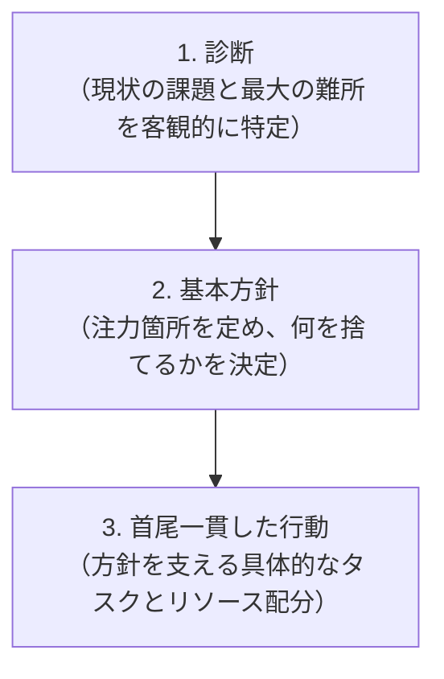
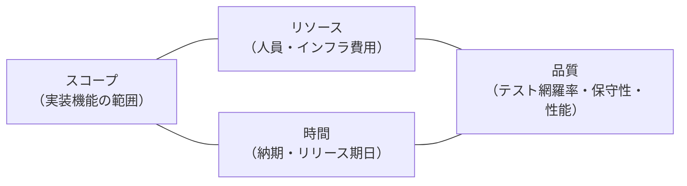

プロジェクトマネジメントのフレームワークを導入するとき、教科書の理論をすべて真面目に適用する必要はない。開発の規模やチームの状況に合わせて、必要な道具をつまみ食いすれば十分だ。

ここでは、開発状況を客観的に見極め、迷わず判断するための骨組みを押さえておこう。

# 戦略のカーネルによる意思決定

プロジェクトにおける「戦略」とは、単なるスローガンや努力目標ではない。リチャード・P・ルメルトの提唱する「戦略のカーネル（核）」は、開発方針をブレずに決めるための頼もしい道具になる。

- 1. 診断（Diagnosis）：推測ではなく測定可能な事実をもとに、現状の障害や課題の本質を見極める。
- 2. 基本方針（Guiding Policy）：その障害に対処するためのアプローチを決める。限られたリソースの中で「何に注力し、何を捨てるか（スコープ外とするか）」を明確にする。
- 3. 首尾一貫した行動（Coherent Actions）：基本方針を実行に移すための具体的なタスク群を整える。タスク同士が方針と矛盾しないよう足並みを揃える。

「全部の機能を期日通りに作る」というのは戦略ではなく、ただの願望だ。一番の難所はどこかを見定め、そこにリソースを集中させることこそがプロジェクトを前に進める基本になる。

# 不確実性の 3 分類と削減アプローチ

ソフトウェア開発でぶつかる不確実性は、その性質によって次の 3 つに分けられる。種類に合った検証手法をぶつけることで、手戻りを最小限に抑えることができる。

| 不確実性の種類 | 主な問い | 最小コストで解消する手法 |
| :--- | :--- | :--- |
| 目的不確実性 （何を作るべきか） | 誰のどのような課題を解決するのか？ 本当にこの仕様で目的を達成できるか？ | ワイヤーフレーム、画面モックアップ、ダミーデータ出力例を使った事前ヒアリング。コードを書く前に、本当に求められているかを確かめる。 |
| 方法不確実性 （どう作るべきか） | 採用するライブラリや技術スタックで要件を満たせるか？ スケーラビリティや性能は担保できるか？ | タイムボックス（例：1 日間）を設けた技術検証（スパイク）。本番コードとは切り離した捨てコードで、技術的に実現できるか確かめる。 |
| 通信不確実性 （共通認識があるか） | 開発者、PdM、QA の間で仕様の解釈にズレはないか？ 例外条件や境界値の扱いは揃っているか？ | 受け入れ基準（Acceptance Criteria）の言語化。具体的な入出力例（Given-When-Then）を書き出し、事前に合意しておく。 |

# 4 つの制約とトレードオフ

プロジェクトには、互いに引っ張り合う 4 つの要素が存在する。

1. スコープ（Scope）：実装する要件や機能の範囲
2. 時間（Time）：リリース期日やマイルストーン
3. リソース（Resources）：投入できるエンジニア人員、開発環境、インフラ予算
4. 品質（Quality）：テストカバレッジ、保守性、セキュリティ、パフォーマンス

## トレードオフの力学

- すべての要素を固定すると破綻する
  予期せぬ技術トラブルや仕様変更が起きたとき、すべての変数を固定していると逃げ場がなくなり、品質の劣化やスケジュールの破綻につながる。着手前に「何が固定（制約）で、何が動かせるか（調整弁）」を握っておく必要がある。
- 品質を調整弁にしてはならない
  納期を守るためにテストコードを書くのを省いたり、設計を妥協したりすると、リリース後のバグ対応や運用保守に追われ、中長期の開発スピードを大きく落とすことになる。
- 納期固定時の現実的な調整弁は「スコープの縮小」
  進んでいるプロジェクトに人を途中から追加しても、コミュニケーションコストや引き継ぎの負担が増えて納期はかえって遅れる（ブルックスの法則）。納期を動かせない場合、唯一安全に調整できるのは「初回リリースに含めるスコープを削ること」だけだ。

# 見積もりの性質とバッファ管理

ソフトウェア開発における見積もりは、確定した約束（コミットメント）ではなく、**「現時点でわかっている前提に基づく確率的な見立て」** だ。

### 前提条件の明示と幅の提示

不確実性がある作業に対して、単一の数字を断定して出すのは避けたい。「外部 API の仕様に制限がなければ 3 日、追加の認証フローが必要なら 5 日」のように、前提条件とブレ幅をセットで提示しよう。

### 作業の細分化

作業に 2 日以上かかりそうな大きなタスクは、0.5〜1 日単位で終わったかどうかが判定できる粒度まで分解する。粒度を細かくすることで、「どこに技術的な未知が潜んでいるか」を早い段階で見つけられる。

### バッファの可視化

不測の事態に備える予備期間（バッファ）は、個々のタスク工数にこっそりサバを読むのではなく、「プロジェクト全体の統合バッファ」として計画に見える形で置き、合意をとる。

# CSV 出力機能における適用例

| 観点 | 内容 |
| :--- | :--- |
| 診断 | 大量データ（100 万件規模）を Web リクエストの中で同期処理すると、DB コネクションの枯渇やサーバーのメモリ圧迫により、システム全体の稼働を脅かすリスクがある。 |
| 基本方針 | システムの安定稼働を最優先とし、初回リリースのスコープを思い切って絞る。画面からの即時ダウンロードは見送り、バックグラウンドでの非同期処理を採用する。 |
| 首尾一貫した行動 | 1. 1 日間のスパイク期間を設け、対象テーブルに対する EXPLAIN の実行計画確認とクエリ性能測定を行う。 2. 初回リリースの対象範囲を「直近 1 か月分かつ最大 5 万件」に制限するバリデーションを設ける。 3. バックグラウンドワーカーでの非同期生成と S3 からの署名付き URL ダウンロード方式を採用する。 |
