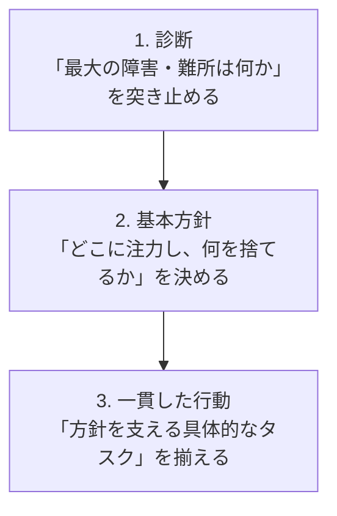
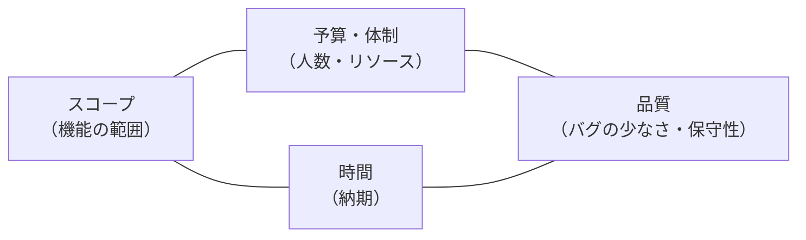

世の中には数多くのプロジェクトマネジメントのフレームワークや理論が存在する。PMBOK、スクラム、TOC、各種の戦略論……。

だが、これらを教科書通りにすべて導入しようとすると、ドキュメント作成や会議ばかりが増えて開発が息切れしてしまう。

大切なのは、理論を丸暗記することではない。**「今、自分たちが直面している問題に対して、どの道具を取り出せば手戻りを防げるか」** というインデックス（引き出し）を持っておくことだ。

本章では、開発の迷いをなくし、次の一手をスパッと決めるための「思考の地図」を整理しよう。

# 戦略とは「願望」ではなく「捨てて集中すること」

プロジェクトが混乱するとき、多くの現場では「計画がない」のではなく、「悪い計画（願望）」に振り回されている。

リチャード・P・ルメルトは名著『良い戦略、悪い戦略』の中で、良い戦略の核（カーネル）は次の 3 つの要素から成ると説いた。

- **1. 診断**：今、目の前にある一番の障害は何なのか。事実と仮説を分けて現状を見極める。
- **2. 基本方針**：その障害を乗り越えるために、どこにリソースを集中させ、何をあきらめる（捨てる）のか。
- **3. 一貫した行動**：決めた方針に沿って、矛盾のない具体的な作業に落とし込む。

逆に、現場でよく見かける「悪い戦略」とは次のようなものだ。

- 「気合で予定通り全機能を作り切る」（単なる願望の表明）
- 「大量データでの負荷が心配だが、まずは画面の実装から進める」（核心にある難所の先送り）
- 「すべて最優先で対応してください」（優先順位を決めていないのと同じ）
- 「品質第一と言いながら、スケジュール優先でテストコードを書かせない」（方針と行動の矛盾）

「あれもこれも全部やる」は戦略ではない。「最大の難所はここだから、今回はそれ以外を捨ててここに集中する」と腹を括ることが、ダンドリの第一歩になる。

# 不確実性を3つに分けて「安く」潰す

ソフトウェア開発は、本質的に「やってみなければわからないこと（不確実性）」との戦いだ。
漠然と「なんか不安だな……」と悩んでいても時間は過ぎていく。『エンジニアリング組織論への招待』で整理されているように、不確実性は次の 3 つに切り分けると、驚くほど安く安全に対処できるようになる。

## 1. 目的不確実性（そもそも何を作るべきか分からない）

- **問い**：誰のどんな痛みを解決するのか？ 本当にこの機能で解決するのか？
- **安く潰すダンドリ**：コードをいきなり書かない。手書きのワイヤーフレームを見せる、ダミーの CSV ファイルを作って顧客に見てもらう、業務の流れをヒアリングする。これだけで「あ、この項目いらないです」といった致命的な手戻りを事前に防げる。

## 2. 方法不確実性（技術的にどう作るべきか分からない）

- **問い**：このライブラリで性能は足りるか？ 既存の DB 構造のままで抽出できるか？
- **安く潰すダンドリ**：時間を区切った「スパイク（技術検証）」を行う。「明日までの 1 日間で、10 万件のダミーデータから SELECT してメモリ使用量だけ測る」といったタイムボックス付きの検証タスクを挟む。動かしてダメだと分かれば、設計をやり直すコストは最小限で済む。

## 3. 通信不確実性（同じ認識を持っているか分からない）

- **問い**：自分と相手（PdM、デザイナー、QA、他チーム）の間で、言葉の解釈や前提がズレていないか？
- **安く潰すダンドリ**：「受け入れ基準（Acceptance Criteria）」を文章で残す。「〇〇ボタンを押したとき、ステータスが△△のデータだけが取得されること」など、具体的な入力と期待する結果を例示して事前に合意する。

# 荒ぶる四天王：トレードオフの現実を受け入れる

開発の現場には、常にせめぎ合う 4 つの制約が存在する。『アジャイルサムライ』で言うところの「荒ぶる四天王」だ。

1. **スコープ**：何を作り、何を削るか
2. **時間**：いつまでにリリースするか
3. **予算・体制**：何人で開発するか
4. **品質**：どこまでテストし、堅牢にするか

## トレードオフの鉄則

- **4 つすべてを固定しようとすると必ず破綻する**
  予期せぬトラブルが起きたとき、逃げ場がなくなってデスマーチに突入する。開発を始める前に「今回は納期が固定で、スコープが調整弁」「今回は品質とスコープが最優先で、納期は伸ばせる」といった力関係を合意しておく。
- **品質を調整弁にしてはいけない**
  納期に追われて「テストコードを省く」「型定義を any にする」「セキュリティチェックを後回しにする」といった妥協をすると、本番障害や後からの手戻りで何倍もの利息を払う羽目になる。品質の最低ラインは下げてはならない。
- **納期固定なら、削るべきは「スコープ」一択**
  遅れているプロジェクトに人を投入しても、引き継ぎやコミュニケーションのコストでさらに遅れる（ブルックスの法則）。納期を動かせないなら、初回リリースに含める機能をバッサリ削るのが唯一の現実的な解だ。

# チームで共有すべき「4つのコア情報」

プロジェクトを健全に保つために必要な情報は、分厚い Word 文書ではない。課題管理ツール（GitHub Issues や Jira 等）に、次の 4 つが数行ずつ書かれていれば十分だ。

1. **目的と制約**：なぜやるのか、期限はいつか、何をやらないのか（スコープ外）。
2. **体制と相談先**：誰が手を動かし、誰が判断し、誰に相談すべきか。
3. **課題とリスク**：すでに起きている「問題」と、起きるかもしれない「リスク」の区別。
4. **事実と困りごと**：どこまで完了していて、何に詰まっているか（助けが必要なポイント）。

# 見積もりは「約束」ではなく「天気予報」

見積もりで一番やってはいけないのは、「3 日で終わります！」と言い切ってしまうことだ。
ソフトウェア開発において、未知の要素がある作業の最悪時間は理論上「無限大」になり得る。見積もりはコミットメント（約束手形）ではなく、「現時点の前提情報に基づく予測（天気予報）」として扱う。

- **前提条件と幅を持たせる**
  「外部 API の仕様に変更がなければ 3 日。もしレート制限の対応が必要になったら 5 日かかります」と、前提とブレ幅をセットで伝える。
- **大きなタスクは半日〜1日サイズに割る**
  「CSV 出力機能の実装：5 日」では何が起きるか見えない。「クエリ検証：0.5 日」「CSV 生成ロジック：1 日」「ダウンロード API 実装：1 日」と細かく割ることで、どこに不確実性があるかが浮き彫りになる。
- **バッファを堂々と明示する**
  隠れて作業時間を水増し（サバ読み）するのではなく、「技術検証で想定外の事態が起きたときの予備として 1 日取っています」とオープンに合意する。

# CSV出力機能の例：診断から方針を導く

第 1 章の CSV 出力機能で、この骨格をどう使うかを見てみよう。

- **診断（最大の難所）**：
  機能そのものは単なる CSV 書き出しだが、本番 DB には数百万件のレコードがある。月初のピーク時に重いクエリを一斉に叩かれたら、DB の CPU が跳ね上がり、一般ユーザーの画面表示が巻き添えでダウンする。ここが最大の地雷だ。
- **基本方針（捨てるものと集中するもの）**：
  本番運用の安定性を最優先とし、納期と初回機能スコープを柔軟に扱う。画面上での即時ダウンロードはあきらめ、非同期処理によるバックグラウンド生成に絞る。
- **一貫した行動（次の一手）**：
  いきなりフロントエンドやボタンの実装に入らない。まず 1 日のスパイクを切り、ステージング環境で 10 万件のダミーデータを使ったクエリ負荷を測定する。初回は「直近 1 ヶ月分のみ出力可能」という制限をつけてスコープを小さくリリースし、負荷に耐えられることを確認してから期間制限を緩和する。
