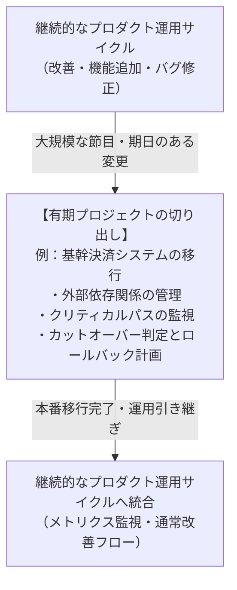

私たちが日々向き合う開発には、時間の進み方や目標の性質が異なる 2 つの場面がある。

1. 有期の取り組み（プロジェクト型）
2. 継続的なプロダクト開発（プロダクト型）

これは「ウォーターフォールかアジャイルか」という手法の優劣や対立の話ではない。スクラムなどのアジャイル開発を取り入れているチームであっても、期日やゴールが決まった有期のプロジェクトは日常的に発生する。この 2 つの場面の違いを理解して、状況に合わせて進め方を切り替えていこう。

# 場面 1：有期の取り組み（プロジェクト型）

あらかじめ決めた成果物を作り上げたり、特定のゴールに到達した時点で完了する活動だ。

新機能のメジャーリリース、クラウドインフラの刷新、データベースのバージョンアップ、セキュリティ認証（ISMS や SOC2 など）の取得対応などがこれに当たる。固定された期日があるか、明確な完了条件が設定されている。

## プロジェクト型で鍵となる進め方

### 完了条件（DoD）の合意

「コードを書き終えた」だけで満足せず、ステージング環境でのテスト、負荷検証、監視アラートの設定、マニュアルの作成、カスタマーサポートへの共有までを「完了条件（DoD: Definition of Done）」としてチームで合意しておく。

### 外部への依存関係を早めに見つけて先手を打つ

他チームの API 開発、外部ベンダーの審査、法務による規約チェックなど、自分たちの裁量だけでは動かせない依存関係を最初の段階で洗い出す。相手側の所要時間を逆算して、できるだけ早く声をかけておくことが欠かせない。

### クリティカルパスの見極め

タスクの順序関係から決まる、「全体の完了期日を左右する最長経路（クリティカルパス）」を特定する。クリティカルパスに乗っているタスクの遅れは、そのままプロジェクト全体の遅れに直結する。ここにある作業を最優先で進め、詰まりが生じていないか目を光らせる必要がある。

# 場面 2：継続的なプロダクト開発（プロダクト型）

仮説検証、開発、リリース、計測、改善のサイクルをぐるぐると回し続ける活動だ。

既存機能の改善、パフォーマンスチューニング、日々のバグ修正などが該当する。リリースはゴールではなく単なる通過点であり、本番環境で動かしたあとの数値やユーザーの反応を見ながら改善を重ねていく。

## プロダクト型で鍵となる進め方

### 仕掛かりタスク（WIP）を制限する

同時に手をつけるタスクの数を、チームのキャパシティに合わせて厳格に制限する。手元のタスク（WIP: Work In Progress）が増えすぎると、コンテキストスイッチの嵐になり、結果として 1 つあたりのリードタイムが大きく伸びてしまう。

### 日常の待ち時間を削る

コードレビューが何日も放置される、CI の実行に何十分も待たされる、検証環境が 1 つしかなくて取り合いになる。こうした日常的な待ち時間を、運用の見直しや自動化によって徹底的に潰していく。

### 段階的に詳細化する（Rolling Wave Planning）

何ヶ月も先の不確実な仕様まで細かく設計しようとしても、どうせ後から変わって無駄になる。直近 1〜2 スプリントで手をつけるタスクだけを具体化し、先の予定は粗い粒度のままにしておくのが賢いやり方だ。

# 2 つの形態の相互関係

この 2 つは対立するものではない。普段の継続的なプロダクト運用の大きな流れの中に、一時的な有期プロジェクトが立ち上がり、完了したらまた定常フローへと溶け込んでいく。開発現場は、こうした入れ子構造で動いている。

# CSV 出力機能における適用例

| フェーズ | 進め方のポイント |
| :--- | :--- |
| 初回リリースまで（プロジェクト型） | 「直近 1 か月分のデータを安全に非同期出力できる初回版を本番稼働させる」までを有期のプロジェクトとして管理する。ライブラリ選定、DB 負荷検証、サポート対応手順の策定をクリティカルパスとして追跡し、リリース判定基準（DoD）をクリアした段階でプロジェクトを完了とする。 |
| リリース後（プロダクト型） | 本番リリース後は、日常のバックログ管理へと移行する。利用頻度、エラー率、処理時間の推移を Datadog などの監視ログで見守り、「出力期間の拡張」「項目のカスタマイズ」といった要望を費用対効果で優先順位づけし、通常のスプリントの中で順次実装していく。 |
