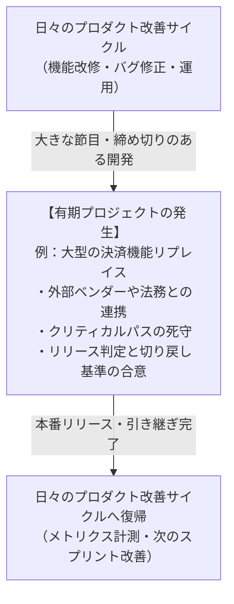

エンジニアが仕事でダンドリを考えるとき、まず押さえておきたいのが「いま自分が向き合っている仕事の時間軸」だ。

開発の現場には、性質の異なる 2 つの場面がある。

1. **有期の取り組み（プロジェクト型）**：終わりがあり、特定のゴールを達成したら解散する仕事。
2. **継続的なプロダクト開発（プロダクト型）**：終わりがなく、仮説検証と改善をぐるぐると回し続ける仕事。

これは「ウォーターフォールかアジャイルか」という開発手法の話ではない。スクラムなどのアジャイル開発を取り入れている現場であっても、この両方は日常的に混ざり合って発生する。

この 2 つを区別せずに同じ頭で進めようとすると、「いつまで経ってもリリース判定が出ずにダラダラ続く」か、逆に「リリースしただけで満足して効果検証が放置される」という落とし穴にハマってしまう。

# 場面1：有期の取り組み（プロジェクト型）

「特定の結果を出したら完了する」仕事だ。

たとえば、新機能の大型リリース、クラウドインフラの移行、データベースのメジャーバージョンアップ、セキュリティ認証（ISMS 等）の取得対応、さらにはチーム内の勉強会や採用イベントの運営などもこれに当たる。

明確な締め切りがあるか、「これができたら終わり」という明確な終了条件が存在する。

## ここで効いてくるダンドリ

- **「終わり（完了条件）」を事前に握る**
  コードを書き終えただけではプロジェクトは終わらない。ステージング環境での動作確認、リリース判定、ヘルプページの作成、営業やサポートチームへの事前共有、ロールバック手順の確認まで含めて「何をもって完了とするか（DoD: Definition of Done）」を関係者と合意しておく。
- **自分たちで動かせない「外部の待ち時間」を先回りする**
  「他チームの API 実装待ち」「法務による利用規約のチェック」「外部決済代行業者のアカウント審査」など、自分たちの裁量だけではコントロールできない依存関係は、開発が佳境に入ってから慌てても間に合わない。最初期に洗い出し、真っ先に根回しと打診を済ませておく。
- **クリティカルパス（一番長いタスクの鎖）を見極める**
  すべてのタスクを同時に急ぐ必要はない。全体の完了予定日を決定づけている「最も一本道の長いタスク経路（クリティカルパス）」がどこかを把握し、その線上にあるタスクの遅れや待ち時間を徹底的に見張る。

# 場面2：継続的なプロダクト開発（プロダクト型）

「作って終わり」ではなく、改善と運用を永遠に回し続ける仕事だ。

日常の UI 改善、表示速度のチューニング、細かな機能追加、日々のバグ修正などが該当する。
ここではリリースはゴールではなく、「ユーザーの反応を測定し、本当に役に立ったかを確かめるスタート地点」に過ぎない。

## ここで効いてくるダンドリ

- **仕掛かり作業（WIP: Work In Progress）を厳しく絞る**
  あれもこれもと同時にタスクをつまみ食いすると、文脈の切り替え（コンテキストスイッチ）ばかりが増えて、どれも完成しない。「1 人 1 タスク」「チームで同時に着手するのは 3 つまで」のように仕掛かり数を制限し、着手したタスクを最速で終わらせる。
- **毎日の「プチ詰まり」を仕組みで解消する**
  「PR を出してもレビューが 2 日放置される」「CI のテスト実行に毎回 40 分かかる」「開発用ステージング環境が 1 つしかなくて取り合いになる」――こうした日々の開発ループで何度も踏む小さな待ち時間を、自動化やルール作りで潰していく。
- **先々の計画を細かく作り込みすぎない（段階的詳細化）**
  数ヶ月先の仕様を今から緻密に設計しても、ユーザーの反応や市場環境が変わればすべて無駄になる。「直近 1〜2 週間でやることは具体的に詰め、その先は大きなテーマだけ決めておく」というメリハリをつける。

# 2つの場面はどう行き来するのか

この 2 つは対立するものではない。日々の「継続的なプロダクト開発」という大きな川の中に、時おり「有期のプロジェクト」という小島が立ち現れ、それを乗り越えたらまた元の川の流れに戻る、という関係にある。

# CSV出力機能の例：有期から継続へのバトンタッチ

CSV 出力機能の開発も、この 2 つのフェーズに分けることでスムーズに進められる。

- **フェーズ 1：初回リリースまでの「有期プロジェクト」**
  「指定期間のデータを、サーバーを落とさずにダウンロードできる初回版を本番に出す」までを 1 つのプロジェクトとして扱う。CS への操作マニュアルの共有や、リリース当日の監視体制など、コード実装以外の依存関係をしっかり段取って、安全に本番稼働させる。
- **フェーズ 2：リリース後の「継続的な改善」**
  無事に本番リリースできたら、定常の改善サイクルにバトンを渡す。「実際に顧客は使ってくれているか？」「ダウンロードに何秒かかっているか？」をログで追跡し、「出力項目に〇〇を追加してほしい」という顧客からのフィードバックをバックログに積み、優先順位を見ながら次のスプリントで改善していく。

「今はプロジェクトとしてゴールをきっちり閉じるフェーズなのか」「それとも継続サイクルの中で素早く仮説検証を回すフェーズなのか」。この意識の切り替えができるだけで、チームの動きはぐっとシャープになる。
