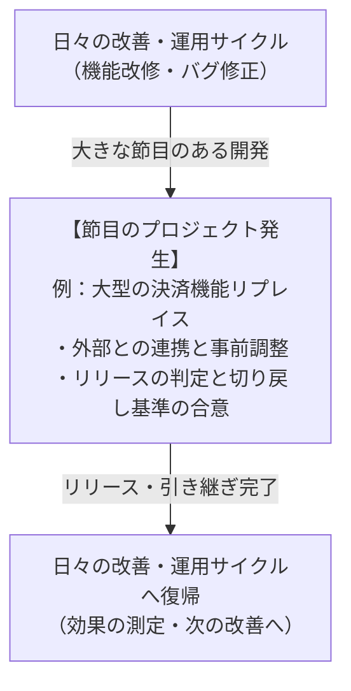

エンジニアが仕事でダンドリを考えるとき、まず押さえておきたいのが「いま自分が向き合っている仕事の時間軸」です。

開発の現場には、性質の異なる 2 つの場面があります。

1. **終わりのある仕事（プロジェクト型）**：特定のゴールを達成したら解散・完了する取り組み。
2. **終わりのない仕事（プロダクト型）**：仮説検証と改善をぐるぐると回し続ける取り組み。

これは「ウォーターフォールかアジャイルか」という開発手法の話ではありません。スクラム開発を取り入れている現場であっても、この両方は日常的に混ざり合って発生します。

この 2 つを区別せずに進めてしまうと、「いつまで経ってもリリース判定が出ずにダラダラ続く」か、逆に「リリースしただけで満足して、その後の効果検証が放置される」という落とし穴にハマってしまいます。

# 場面1：終わりのある仕事（プロジェクト型）

「特定の結果を出したら完了する」仕事です。

新機能の大型リリース、インフラのクラウド移行、データベースのバージョンアップ、セキュリティ認証の取得対応、さらにはチーム内の勉強会や採用イベントの運営などもこれに当たります。

明確な締め切りがあるか、「これができたら終わり」という終了条件が存在します。

## ここで効いてくるダンドリ

- **「終わり（完了条件）」を事前に握る**
  コードを書き終えただけでは仕事は終わりません。ステージング環境での動作確認、リリース判定、ヘルプページの作成、サポート窓口への引き継ぎまで含めて「何をもって完了とするか」を関係者と合意しておきます。
- **自分たちで動かせない「外部の待ち時間」を先回りする**
  「他チームの API 実装待ち」「法務による利用規約のチェック」「外部決済代行業者の審査」など、自分たちの裁量だけでは動かせない依存関係は、開発が佳境に入ってから慌てても間に合いません。初期の段階で洗い出し、真っ先に打診を済ませておきます。
- **全体の納期を決めている「一本道（クリティカルパス）」を見極める**
  すべての作業を同時に急ぐ必要はありません。タスクの連鎖の中で、全体の完了予定日を決定づけている「一番長いタスクの経路」がどこかを把握し、その線上にあるタスクの遅れや待ち時間を優先的に見張ります。

# 場面2：終わりのない仕事（プロダクト型）

「作って終わり」ではなく、改善と運用をずっと回し続ける仕事です。

日常の UI 改善、表示速度のチューニング、細かな機能追加、日々のバグ修正などが該当します。
ここではリリースはゴールではなく、「ユーザーの反応を測定し、本当に役に立ったかを確かめるスタート地点」に過ぎません。

## ここで効いてくるダンドリ

- **同時に手をつける作業（仕掛かりタスク）を厳しく絞る**
  あれもこれもと同時にタスクをつまみ食いすると、文脈の切り替えばかりが増えて、どれも完成しません。「1 人 1 タスク」「チームで同時に着手するのは 3 つまで」のように仕掛かり数を制限し、着手したタスクを最速で終わらせていきます。
- **毎日の「プチ詰まり」を仕組みで解消する**
  「PR を出してもレビューが 2 日放置される」「CI のテスト実行に毎回 40 分かかる」「開発用の検証環境が 1 つしかなくて取り合いになる」――こうした日々の開発ループで何度も踏む小さな待ち時間を、自動化やルール作りで潰していきます。
- **先々の計画を細かく作り込みすぎない**
  数ヶ月先の仕様を今から緻密に設計しても、ユーザーの反応や市場環境が変わればすべて無駄になってしまいます。「直近 1〜2 週間でやることは具体的に詰め、その先は大きなテーマだけ決めておく」というメリハリをつけます。

# 2つの場面はどう行き来するのか

この 2 つは対立するものではありません。日々の「終わりのない改善サイクル」という大きな川の中に、時おり「終わりのあるプロジェクト」という節目が現れ、それを乗り越えたらまた元の改善サイクルに戻る、という関係にあります。

# 例で考える：CSV 出力機能のバトンタッチ

CSV 出力機能の開発も、この 2 つのフェーズに分けることでスムーズに進められます。

- **フェーズ 1：初回リリースまでの「プロジェクト」**
  「指定期間のデータを、サーバーを落とさずにダウンロードできる初回版を本番に出す」までを 1 つのプロジェクトとして扱います。サポート窓口への事前共有や、リリース当日の監視体制など、コード実装以外の依存関係をしっかり整えて安全に本番稼働させます。
- **フェーズ 2：リリース後の「継続的な改善」**
  無事に本番リリースできたら、日々の改善サイクルにバトンを渡します。「実際に顧客は使ってくれているか？」「ダウンロードに何秒かかっているか？」をログで追跡し、「出力項目に〇〇を追加してほしい」という要望をバックログに積み、優先順位を見ながら次のスプリントで改善していきます。

「今はプロジェクトとしてゴールをきっちり閉じるフェーズなのか」「それとも継続サイクルの中で素早く仮説検証を回すフェーズなのか」。この意識の切り替えができるだけで、チームの動きはぐっとシャープになります。
