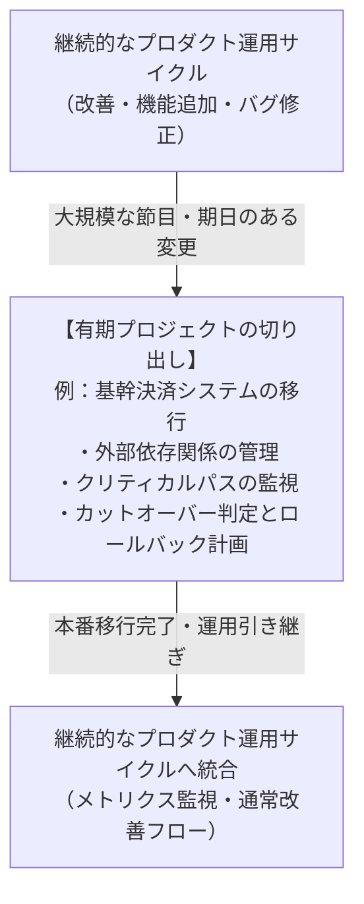

ソフトウェアエンジニアが直面する開発活動には、時間軸と目標の性質が異なる 2 つの形態が存在する。

1. **有期の取り組み（プロジェクト型）**
2. **継続的なプロダクト開発（プロダクト型）**

これらは開発手法（ウォーターフォールかアジャイルか）の対立ではない。アジャイル開発を採用しているチームであっても、有期のプロジェクトは定常的に発生する。両者の特性を把握し、適用すべき管理手法を切り替える必要がある。

# 場面1：有期の取り組み（プロジェクト型）

特定の結果（成果物や到達点）を達成した時点で完了する活動である。

新機能のメジャーリリース、クラウドインフラの刷新、データベースのバージョンアップ、セキュリティ認証（ISMS や SOC2 等）の取得対応などが該当する。固定された期日が存在するか、明確な終了条件が設定されている。

## プロジェクト型で重点となる管理手法

- **完了条件（DoD: Definition of Done）の合意**：
  コードの実装完了のみをゴールとせず、ステージング環境での結合テスト、負荷検証、運用監視設定、マニュアル作成、CS への事前共有までを完了条件として定義する。
- **外部依存関係の早期特定と先行着手**：
  他チームの API 開発、外部ベンダーの審査、法務による規約チェックなど、自チームの裁量外にある依存関係を初期段階で洗い出し、所要リードタイムを逆算して先行打診を行う。
- **クリティカルパスの把握**：
  タスクの順序関係から算出される、全体の終了期日を決定づける最長経路（クリティカルパス）を特定する。クリティカルパス上に存在するタスクの遅延は全体の遅延に直結するため、優先的なリソース配分と進捗監視を行う。

# 場面2：継続的なプロダクト開発（プロダクト型）

仮説検証、開発、リリース、計測、改善のサイクルを継続的に反復する活動である。

既存機能の改善、パフォーマンスチューニング、定常的なバグ修正などが該当する。リリースは通過点であり、本番稼働後のメトリクス計測とユーザーフィードバックの収集が重視される。

## プロダクト型で重点となる管理手法

- **仕掛かり作業（WIP: Work In Progress）の制限**：
  同時に進行させるタスク数をチームの処理能力以下に厳格に制限する。仕掛かりタスクの過大化はコンテキストスイッチを増大させ、全体のリードタイムを悪化させる。
- **定常プロセスの待ち時間削減**：
  コードレビューの滞留、CI パイプラインの実行遅延、検証環境の競合など、開発サイクル内で反復して発生する待ち時間を自動化や運用ルールの見直しによって排除する。
- **段階的詳細化（Rolling Wave Planning）**：
  数ヶ月先の不確実な仕様を事前に細かく設計することを避け、直近 1〜2 スプリントに着手するタスクのみを具体化し、先々のタスクは粗い粒度にとどめる。

# 2つの形態の相互関係

2 つの形態は排他的なものではない。継続的なプロダクト運用の流れの中に、一時的な有期プロジェクトが立ち上がり、完了後に再び定常運用へ統合されるという入れ子構造をとる。

# CSV出力機能における適用例

- **フェーズ 1：初回リリースまでのプロジェクト管理**
  「1 ヶ月分のデータを安全に非同期出力できる初回版を本番稼働させる」までを有期プロジェクトとして管理する。外部ライブラリ選定、DB 負荷検証、サポート対応フローの策定をクリティカルパスとして管理し、リリース判定基準（DoD）を満たした段階でプロジェクトを終了させる。
- **フェーズ 2：リリース後のプロダクト運用サイクル**
  本番稼働後は、通常のバックログ管理へ移行する。利用頻度、出力エラー率、処理時間の推移を Datadog 等の監視ログで継続観測し、「出力期間の拡張」「項目のカスタマイズ」といった追加要件を費用対効果に基づいて優先順位付けし、通常のスプリント内で順次実装する。
