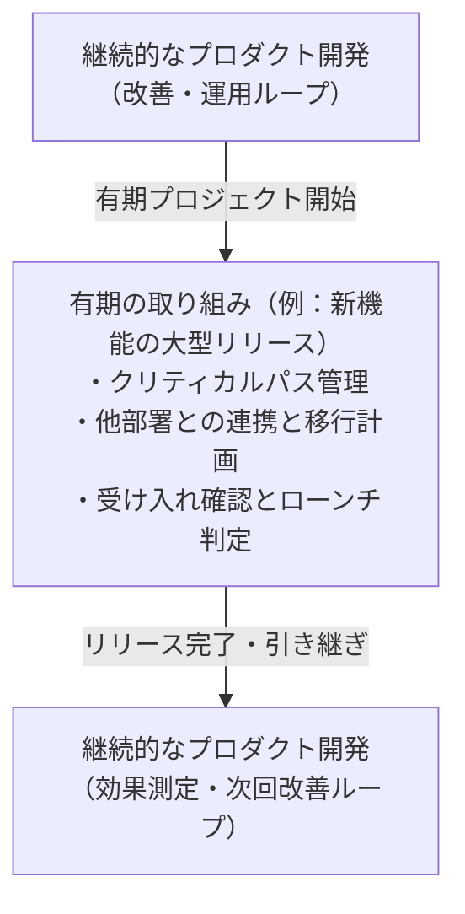

ソフトウェアエンジニアが直面する開発活動には、時間的な性質が異なる 2 つの場面があります。

1. 有期の取り組み（プロジェクト型）
2. 継続的なプロダクト開発（プロダクト型）

これは開発手法（アジャイルかウォーターフォールか）の違いではありません。アジャイル開発を採用しているチームでも有期の取り組みは頻繁に発生します。2 つの性質の違いを理解し、それぞれに適したダンドリを使い分けることが肝要です。

# 場面1：有期の取り組み（プロジェクト型）

特定の結果（ゴール）を達成したら完了する活動です。

新機能のメジャーリリース、クラウド移行、データベースのバージョンアップ、ISMS 等のセキュリティ認証取得などが該当します。固定の期限があるか、あるいは達成すべき終了条件が明確に定義されています。

## 有期の取り組みで必須となるダンドリ

- 明確な終了条件の合意：何をもって完了とするのか、コードの実装だけでなく、ステージング検証、マニュアル作成、CS や営業への共有、運用引き継ぎまでを完了条件（DoD: Definition of Done）に含めます。
- 外部依存関係の早期洗い出し：他チームの API 開発待ちや法務による利用規約のチェック、外部ベンダーの審査など、自分たちの裁量で動かせない依存関係と所要リードタイムを特定します。
- クリティカルパス（最長経路）の管理：作業の依存関係から計算される、全体の完了を決定づける最長のタスク経路を把握します。クリティカルパス上にあるタスクの遅延は、そのまま全体の納期遅延に直結します。外部依頼は仕様が固まり次第、早めに打診しておく必要があります。

# 場面2：継続的なプロダクト開発（プロダクト型）

仮説検証、開発、リリース、運用、効果測定を終わることなく回し続ける活動です。

既存機能の UI や UX の改善、パフォーマンスチューニング、定常的な機能追加、バグ修正などが該当します。リリースはゴールではなく「ユーザーの反応を測定し、価値を確かめる出発点」です。

## 継続的な開発で必須となるダンドリ

- 仕掛かり作業（WIP: Work In Progress）の制限：同時に着手するタスクの数を厳格に絞ります。着手中のタスクが多すぎると、コンテキストスイッチが増大し、どのタスクも完了しない状態に陥ります。
- 定常プロセスの待ち時間削減：コードレビューの放置、CI の実行遅延、検証環境の取り合いなど、日々の開発で繰り返し発生する待ちを仕組みで解消します。
- 段階的詳細化（Rolling Wave Planning）：数か月先の不確実な未来を細かく計画する無駄を避け、直近 1〜2 スプリントの作業は具体的に詳細化し、先々のタスクは粗い粒度にとどめる進め方を徹底します。

# 2つの場面の共存と切り替え

2 つの場面は相反するものではなく、継続的なプロダクト開発の流れの中に個別の有期プロジェクトが立ち上がり、完了したらまた定常の流れに戻るという関係にあります。

# CSV出力機能の例：有期から継続への移行

- フェーズ 1（初回リリースまでの有期の取り組み）：初回版の CSV 出力機能を本番環境に安全に届けるまでを有期のプロジェクトとして管理します。営業や CS への事前案内、データ閲覧権限の仕様確定、移行テストなどの依存関係を並行して整え、リリース判定を行います。
- フェーズ 2（リリース後の運用と改善）：リリース完了後は、定常のプロダクト開発サイクルに戻します。実際の利用頻度やユーザーからの要望（出力項目の追加や対象期間の拡張など）をメトリクスや問い合わせから収集し、バックログ上で優先順位をつけて次のスプリントで改善していきます。

有期と継続の境界線を意識することで、プロジェクトがいつまでも終わらない問題や、リリース後の検証が放置される問題を防ぐことができます。
