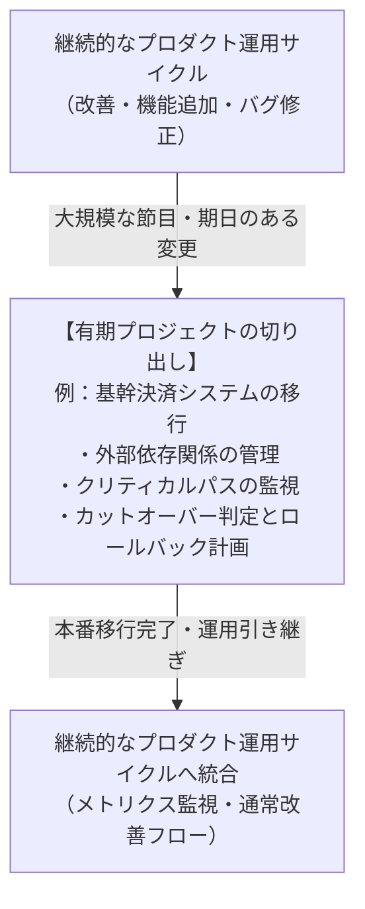

ソフトウェア開発には、性質の異なる 2 つの場面があります。

1. 有期の取り組み（プロジェクト型）
2. 継続的なプロダクト開発（プロダクト型）

これは「ウォーターフォールかアジャイルか」の議論ではありません。アジャイル開発の現場でも、期日やゴールが決まった有期プロジェクトは頻繁に発生します。両者の違いを理解し、状況に合わせて進め方を切り替える必要があります。

# 場面 1：有期の取り組み（プロジェクト型）

特定の成果物やゴールに到達した時点で完了する活動です。

新機能リリース、インフラ刷新、DB バージョンアップ、セキュリティ認証（ISMS や SOC2 等）の取得などが該当します。固定期日や明確な完了条件が設定されています。

## プロジェクト型の要点

### 完了条件（DoD）の合意

実装完了だけでなく、結合テスト、負荷検証、監視設定、マニュアル作成、CS 連携までを完了条件（DoD: Definition of Done）としてチームで合意します。

### 外部依存関係の早期特定と先行着手

他チームの API 開発、外部ベンダーの審査、法務チェックなど、自チームで制御できない依存関係を初期に洗い出し、逆算して先行打診します。

### クリティカルパスの見極め

タスクの順序関係から決まる最長経路（クリティカルパス）を特定します。クリティカルパス上の遅れは全体の遅れに直結するため、最優先で進めます。

# 場面 2：継続的なプロダクト開発（プロダクト型）

仮説検証、開発、リリース、計測、改善のサイクルを回し続ける活動です。

機能改善、パフォーマンスチューニング、日常のバグ修正などが該当します。リリースは通過点であり、本番稼働後のメトリクス計測と改善が重視されます。

## プロダクト型の要点

### 仕掛かりタスク（WIP）の制限

同時に進めるタスク数をチームの処理能力以下に制限します。WIP（Work In Progress）の肥大化はコンテキストスイッチを生み、リードタイムを悪化させます。

### 定常プロセスの待ち時間を削る

レビュー待ち、CI 実行待ち、検証環境の競合など、開発サイクル内で反復する待ち時間を自動化や運用改善で潰します。

### 段階的な詳細化（Rolling Wave Planning）

数か月先の不確実な仕様を今設計しても無駄になります。直近 1〜2 スプリントで着手するタスクのみ具体化し、先々のタスクは粗い粒度にとどめます。

# 2 つの形態の相互関係

両者は対立するものではありません。日常のプロダクト運用の流れから一時的な有期プロジェクトが立ち上がり、完了後に定常フローへ戻るという入れ子構造をとります。

# CSV 出力機能における適用例

| フェーズ | 進め方のポイント |
| :--- | :--- |
| 初回リリースまで（プロジェクト型） | 「直近 1 か月分のデータを安全に非同期出力できる初回版の本番稼働」を有期プロジェクトとして管理します。ライブラリ選定、DB 負荷検証、サポート対応手順をクリティカルパスとして追跡し、DoD を満たした段階で完了とします。 |
| リリース後（プロダクト型） | 本番稼働後は通常のバックログ管理へ移行します。利用頻度、エラー率、処理時間の推移を Datadog で監視し、「出力期間の拡張」「項目の追加」を費用対効果で優先順位付けして順次実装します。 |
