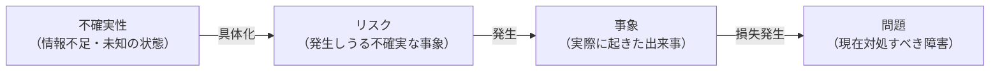

ソフトウェア開発で、未知の要素やトラブルをすべて事前に見抜いて防ぐのは不可能に近い。リスク管理の本当の狙いは、未来を予知することではなく、**「致命傷になるトラブルを避け、何かが起きても安全にリカバリーできる余白を確保すること」** だ。

ここでは、混同しがちな言葉の違いをすっきり整理し、手戻りや手痛い障害を防ぐための実践的なリスク管理を見ていこう。

# 概念の整理：不確実性・リスク・事象・問題

開発の流れに沿って、次の 4 つを明確に区別しておこう。

1. 不確実性（Uncertainty）
   情報や知識が足りず、先が読めない状態。「外部 API のレート制限の仕様をまだ確認できていない」など。
2. リスク（Risk）
   起きるかどうかはわからないが、もし起きたら痛手を被る具体的なシナリオ。「外部 API のレート制限に引っかかって、夜間バッチが朝までに終わらないかもしれない」など。
3. 事象（Event）
   実際に起きてしまった客観的な出来事。「深夜バッチの実行中に外部 API から HTTP 429 Too Many Requests が返ってきた」など。
4. 問題（Problem/Issue）
   すでに起きてしまい、今まさに足を引っ張られている障害。「夜間バッチが止まったせいで、今朝の顧客データが画面に反映されていない」など。

火事になってから消火するコストは、火種（不確実性やリスク）の段階で手を打つコストと比べて何倍にも跳ね上がる。

# タスク管理だけではプロジェクトが破綻する理由

Jira や GitHub Issues に並ぶタスクは、あくまで「すでに見えている作業」を管理するための道具にすぎない。水面下に潜む不確実性に目を向けず、ただ目の前のチケットを消化しているだけでは、予期せぬトラブルによる炎上は防げない。

## 1. 依存関係による遅延のドミノ倒し

タスクの遅れは、単純な足し算ではなく掛け算で広がっていく。仕様の決定が半日遅れたせいで、API 実装の着手がずれ込み、レビュワーの空き時間を逃して 2 日間放置され、QA の検証枠を逃してテストが翌週送りになる。こうした依存関係の連鎖によって、わずかな遅れがあっという間に数日〜数週間の致命的な遅れへと膨らんでいく。

## 2. 戻しにくい決定（One-way door）の後回し

意思決定には、後戻りできるかどうかで 2 種類ある。

- 行って戻れる決定（Two-way door）
  間違えてもすぐにやり直せる決定。UI の文言、関数の命名、ログのフォーマットなど。現場の判断ですぐに決めて、どんどん試せばよい。
- 戻りにくい決定（One-way door）
  一度決めて進んでしまうと、後から変えるのに膨大な工数と痛みを伴う決定。DB スキーマの設計、外部決済基盤の選定、マルチテナントの分離方式など。

プロジェクトの終盤になって「このスキーマでは要件を満たせない」と発覚したら、それまで書いたコードの大半を捨てる羽目になる。だからこそ、**「戻りにくい決定ほど、最初のうちに小さく検証して裏を取る」** ことが鉄則だ。

## 3. 開発中の「嫌な予感」を見逃さない

「このテーブル構造だと将来詰まる気がする」「このバリデーション、境界値で不整合が起きないだろうか」――実装中にふと感じる違和感は、潜在的なリスクを知らせる大事なアラートだ。これを「気のせいだろう」と流さず、客観的な事実と自分の懸念を切り分けて、早めにチームに共有しよう。

# リスクを言葉にする 3 つの要素

リスクを検討するときは、次の 3 つの要素に分解して書くと、打つべき手が自然と見えてくる。

> **「【原因・条件】によって【事象】が起きた場合、【目的への悪影響】が生じる可能性がある」**

| 区分 | 記述例 |
| :--- | :--- |
| 曖昧な書き方 | 大量アクセスの負荷が心配だ |
| 構造化した書き方 | 月末のアクセス集中時に複数ユーザーが同時に CSV を出力すると（原因）、API サーバーのメモリと DB コネクションが枯渇し（事象）、通常業務の画面までタイムアウトしてシステムが止まる恐れがある（影響） |

# リスク対応の 5 つの戦略

見つかったリスクに対しては、次の 5 つの戦略から現実的な手を選ぼう。

| 戦略 | 内容 | 具体例 |
| :--- | :--- | :--- |
| 回避（Avoid） | リスクの原因そのものをやめる | セキュリティ要件の確認に時間がかかるため、初回リリースでは個人情報を含む項目を出力対象から外す |
| 軽減（Mitigate） | 起きる確率や影響の大きさを小さくする | タイムボックスを切って負荷テスト（スパイク）を行い、遅いクエリのインデックスを事前に最適化しておく |
| 移転・分担（Transfer / Share） | 外部のサービスに任せる | ファイル生成の基盤を自前で作らず、AWS Batch などのマネージドな非同期ジョブ基盤に任せる |
| 受容（Accept） | リスクを受け入れたうえで、安全弁を用意する | 構成は現状のままリリースするが、メモリ使用率のアラートを設定し、異常が起きたらプロセスを自動再起動して Slack に通知する仕組みを入れておく |
| エスカレーション（Escalate） | 現場の裁量を超える判断を上位者に委ねる | 納期を延ばすか、機能を削るかをプロダクトマネージャーに判断してもらう |

# CSV 出力機能における適用例

| 項目 | 内容 |
| :--- | :--- |
| 不確実性 | 10 万件を超えるデータを集計して出力するとき、サーバーにどれくらい負荷がかかるかがわからない |
| リスクの構造化 | 月末の締め日に大量ダウンロードが重なると、DB リソースが枯渇して本番の通常業務に遅れが出るリスクがある |
| 対策：軽減 | Web リクエストでの即時レスポンスをやめ、キューを介した非同期ワーカーで処理する |
| 対策：回避 | 出力期間の上限を「最大 3 か月」に制限し、想定外の巨大クエリが走らないようにする |
| 対策：受容と安全弁 | ワーカーのメモリ上限を設定し、処理が 60 秒を超えたら安全に打ち切ってログを通知する |
