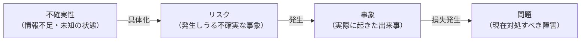

ソフトウェア開発で未知のトラブルをすべて予見するのは不可能だ。リスク管理の目的は未来予知ではなく、**「致命傷を避け、トラブル時にも安全にリカバリーできる余白を確保すること」** にある。

ここでは、手戻りや障害を防ぐための実践的なリスク管理を整理する。

# 概念の整理：不確実性・リスク・事象・問題

開発の流れに沿って、次の 4 つを明確に区別する。

1. 不確実性（Uncertainty）：情報不足で先が読めない状態（例：外部 API のレート制限仕様が未確認）
2. リスク（Risk）：起きたら痛手を被るシナリオ（例：レート制限で夜間バッチが朝までに終わらない可能性）
3. 事象（Event）：実際に起きた出来事（例：バッチ実行中に HTTP 429 が返ってきた）
4. 問題（Problem/Issue）：今まさに足を引っ張られている損失状態（例：バッチ停止で今朝のデータが反映されていない）

火事になってから消火するコストは、火種の段階で手を打つコストより桁違いに大きい。

# タスク管理だけではプロジェクトが破綻する理由

チケット管理ツールに並ぶタスクは「すでに見えている作業」にすぎない。水面下の不確実性を放置したままチケットを消化しても、プロジェクトの破綻は防げない。

## 1. 依存関係による遅延の連鎖

タスクの遅れは掛け算で波及する。仕様決定が半日遅れただけで、実装が遅れ、レビュー待ちで数日止まり、QA の検証枠を逃して翌週送りになる。わずかな遅れがドミノ倒しのように拡大する。

## 2. 戻しにくい決定（One-way door）の後回し

意思決定には 2 種類ある。

- 行って戻れる決定（Two-way door）：UI 文言や関数名など。間違えてもすぐ直せるため、現場で即決すればよい。
- 戻りにくい決定（One-way door）：DB スキーマや決済基盤選定など。後戻りに膨大な工数を要する。

プロジェクト終盤で One-way door の誤りが発覚すると、コードの大半を捨てることになる。**戻りにくい決定ほど、初期に小さく検証して裏を取る**必要がある。

## 3. 違和感の早期共有

「このテーブル構造だと将来詰まる気がする」といった違和感は潜在リスクの兆候だ。放置せず、客観的事実と懸念を分けて早期にチームへ共有する。

# リスクを言葉にする 3 つの要素

リスクは次の 3 要素で整理すると、打つべき手が明確になる。

> **「【原因・条件】によって【事象】が起きた場合、【目的への悪影響】が生じる可能性がある」**

| 区分 | 記述例 |
| :--- | :--- |
| 曖昧な書き方 | 大量アクセスの負荷が心配だ |
| 構造化した書き方 | 月末にアクセスが集中して複数ユーザーが同時に CSV を出力すると（原因）、サーバーのメモリと DB 接続が枯渇し（事象）、通常業務の画面まで止まる恐れがある（影響） |

# リスク対応の 5 つの戦略

見つかったリスクには、次の 5 つの戦略から現実的な手を打つ。

| 戦略 | 内容 | 具体例 |
| :--- | :--- | :--- |
| 回避（Avoid） | 原因そのものをやめる | 仕様確認に時間がかかるため、初回は個人情報項目を出力対象から外す |
| 軽減（Mitigate） | 確率や影響度を下げる | タイムボックスを切って負荷テストを行い、遅いクエリを事前に最適化する |
| 移転・分担（Transfer / Share） | 外部基盤に任せる | ファイル生成を自前で作らず、AWS Batch などの非同期ジョブ基盤に任せる |
| 受容（Accept） | 安全弁を用意して許容する | メモリ使用率のアラートを設定し、異常時は自動再起動と Slack 通知を行う |
| エスカレーション（Escalate） | 上位者に判断を委ねる | 納期を延ばすか機能を削るかを PdM に判断してもらう |

# CSV 出力機能における適用例

| 項目 | 内容 |
| :--- | :--- |
| 不確実性 | 10 万件超のデータ集計時のサーバー負荷が未知数 |
| リスクの構造化 | 月末に大量ダウンロードが重なると DB が枯渇し、本番の通常業務に遅れが出るリスクがある |
| 対策：軽減 | Web リクエストの即時レスポンスをやめ、キューを介した非同期ワーカーで処理する |
| 対策：回避 | 出力期間の上限を「最大 3 か月」に制限し、巨大クエリを防ぐ |
| 対策：受容と安全弁 | ワーカーのメモリ上限を設定し、60 秒を超えたら安全に打ち切って通知する |
