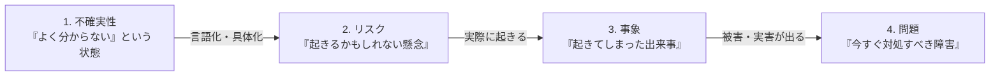

プロジェクトマネジメントの一番の目的は、未来を 100% 予知してトラブルをゼロにすることではない。

そもそも、ソフトウェア開発において「何が起きるか完全に予測できる」なんてことはあり得ない。未知のコード、未知のライブラリ、変化する要望の海を泳ぐ以上、トラブルを完全に防ぐことなど不可能だ。

目指すべきは、**「致命傷を避けること」** だ。

想定外のことが起きても、チームが即死せず、すばやく立て直せるように地雷を先回りして見つけておく。そのためのダンドリを見ていこう。

# 言葉の整理：不確実性・リスク・事象・問題

開発の会話で「リスク」という言葉は曖昧に使われがちだ。「不確実性」「リスク」「事象」「問題」は、時間の流れに沿って次のように区別すると頭がスッキリする。

1. **不確実性（Uncertainty）**：まだ情報が足りず、将来どうなるか確信が持てないモヤモヤした状態。「外部 API の仕様、まだドキュメント読めてないんだよね……」
2. **リスク（Risk）**：起きるかどうかは分からないが、もし起きたら痛い目を見る具体的なシナリオ。「外部 API に厳しいレート制限があったら、バッチ処理が終わらないかもしれない」
3. **事象（Event）**：実際に起きた出来事。「深夜バッチで外部 API を叩いたら、429 Too Many Requests が返ってきた」
4. **問題（Problem / Issue）**：実害が出ており、今すぐ対応しなければならない状態。「バッチが停止して、今朝の顧客データが反映されていない。問い合わせが殺到している」

この関係を見れば分かる通り、**「問題」になってから大慌てで火消しをするのが一番高くつく。**
まだ実害が出ていない「不確実性」や「リスク」の段階で小さく手を打っておくことこそが、最もコスパの良いダンドリなのだ。

# なぜ「チケット管理」だけだとプロジェクトは炎上するのか

多くの現場では、Jira や GitHub Projects などのチケット一覧（WBS やカンバン）を見て「よし、進捗 60% だな」と安心しようとする。

だが、チケット管理で見えているのは「すでに分かっている作業」に過ぎない。水面下に沈んでいる巨大な氷山（不可視領域の不確実性）は、チケットの行数には現れない。

## 1. 遅延は「足し算」ではなく「掛け算」で広がる

タスクが半日遅れたとき、「まあ 0.5 日の遅れだから明日取り戻せばいいか」と軽く考えて痛い目を見たことはないだろうか。

遅延は単純な足し算では済まない。
仕様の確定が半日遅れたことで、API 実装の着手が翌日にずれ込み、レビュー担当者の別件の予定と被って 2 日放置され、QA の検証スロットを逃して検証が来週に回り、結果としてリリースが丸々 1 週間吹き飛ぶ――。

このように、タスクの依存関係を通じて遅延は「掛け算」で連鎖する。だからこそ、クリティカルな箇所の小さな遅れを甘く見てはいけない。

## 2. 戻しにくい決定（One-way door）を後回しにしない

すべての決定を同じ重さで悩む必要はない。アマゾン創業者ジェフ・ベゾスが提唱した「扉のたとえ」がとても役に立つ。

- **Two-way door（行ったり来たりできる扉）**：間違ってもすぐに引き返せる決定。UI のボタンの色、内部関数の命名、ログのフォーマットなど。これは時間をかけて議論するだけ無駄だ。エンジニアの裁量でサッと決めて前に進めばいい。
- **One-way door（一度通ったら戻れない扉）**：一度決めてしまうと、やり直すのに莫大なコストがかかる決定。DB のテーブル設計やプライマリキーの構成、課金・決済のシーケンス、外部サービスとのデータ連携プロトコルなど。

炎上するプロジェクトの典型パターンは、「面倒だから」と One-way door の決定を後回しにして、簡単な画面実装ばかりを先に進めてしまうことだ。終盤になって One-way door を開けたら奥が行き止まりだったと気づき、これまでのコードをすべて捨てる羽目になる。

**「戻しにくい決定ほど、一番最初に小さく試して白黒つける」**。これが鉄則だ。

## 3. 「違和感」は最大のセンサー

「なんかこの設計、後から破綻しそうな気がするな……」
「この仕様、データが増えたとき大丈夫かな？」

開発中にエンジニアがふと覚える胸のざわつきは、潜在的なリスクを知らせる最高のセンサーだ。
経験の浅いメンバーでも、直感で「ここ、よく分からないです」と感じた疑問は決して馬鹿にできない。

違和感を飲み込まず、チームの雑談や朝会で「ちょっと気になったんですけど」と口に出せる空気をつくること。それがチーム全体で地雷を避ける最強のセーフティネットになる。

# リスクを「手触りのある形」にする書き方

漠然と「セキュリティが不安です」「負荷が心配です」と言っても、周囲は何をすればいいか分からない。
リスクは、次の 3 つの要素に分解して書くと、一気に具体的なアクションが見えてくる。

> **「（原因）〜のため、もし（事象）〜が起きたら、（影響）〜になってしまう」**

- **曖昧な声**：「大量アクセスの負荷がちょっと心配です」
- **ダンドリの効いたリスク記述**：「月末に顧客が一斉に CSV ダウンロードを実行した際（原因）、Web サーバーのプロセスがメモリを使い果たして（事象）、他の一般ユーザーの画面まで 504 エラーで落ちてしまう可能性がある（影響）」

ここまで分解されていれば、「じゃあ Web サーバーとは別プロセスで非同期に処理させよう」「1 ユーザーあたりの同時リクエスト数を制限しよう」といった具体的な対策（ダンドリ）が自然と決まる。

# リスクをさばく5つの手

リスクが見つかったら、次の 5 つの手のうちどれを取るかを決める。

1. **回避（そもそも危ない橋を渡らない）**
   リスクのある機能や技術そのものをやめる。「個人情報の漏洩リスクが高すぎるので、今回のリリースでは個人情報を含む項目は CSV の出力対象外にする」。
2. **軽減（起きる確率や、起きたときの被害を減らす）**
   事前に手を打ってショックを和らげる。「1 日間のスパイクで負荷テストを実施してボトルネックを潰す」「DB クエリにタイムアウトを設定しておく」。
3. **移転・分担（自分たちだけで抱え込まない）**
   外部の仕組みに委譲する。「自前でファイル生成サーバーを立てずに、AWS Lambda やマネージドな非同期ジョブ基盤に任せる」。
4. **受容（覚悟を決めて、安全弁を用意する）**
   「発生確率は極めて低いし、今対策すると納期に間に合わない」と判断し、あえてそのまま進める。ただし、放置するのではなく「もし起きたら即座に検知できるアラート」と「ロールバック手順」を必ずセットで用意しておく。
5. **エスカレーション（上の人に判断を委ねる）**
   現場のエンジニアの裁量を超えているなら、抱え込まずに即座に PdM やマネージャーにボールを投げる。「納期を 3 日延ばすか、この機能を削るかの判断をお願いします」。

# CSV出力機能の例：リスクを先回りして潰す

CSV 出力機能で、このリスク管理を実践してみよう。

- **不確実性（モヤモヤ）**：10 万件以上のデータを CSV 出力したとき、今のサーバーが耐えられるか分からない。
- **リスクの言語化**：月末の繁忙期に複数ユーザーが一斉に出力ボタンを押すことで、DB のコネクションが枯渇し、本番の決済画面まで巻き添えでダウンする恐れがある。
- **ダンドリ（打った手）**：
  - **軽減**：同期的にレスポンスを返さず、SQS などのキューを使ったバックグラウンド非同期処理に切り替える。
  - **回避**：初回リリースでは「出力期間は最大 3 ヶ月分まで」というバリデーションを入れ、超巨大なクエリが飛ぶこと自体を防ぐ。
  - **受容と安全弁**：万一処理が詰まったときのために、ワーカープロセスのメモリ上限を設定し、30 秒を超えた処理は自動で強制終了して管理者に Slack 通知を飛ばす。

「問題が起きてから徹夜で対応する」のをやめ、「起きそうなことを先に安く潰しておく」。これがエンジニアのプロとしてのダンドリだ。
