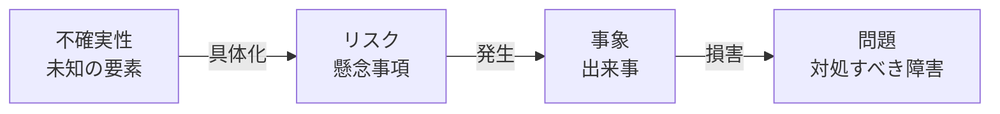

プロジェクトマネジメントの目的は、すべてのトラブルを事前に予言することではありません。不確実性を手際よく扱い、致命傷を避けて成功確率を引き上げることです。

本章では、混同されがちな「不確実性」「リスク」「問題」を明確に区別し、手戻りを最小化するリスク管理のダンドリを学びます。

# 概念の整理：不確実性・リスク・事象・問題

日々の会話で混ざりがちな 4 つの言葉を、次のように整理します。

- 不確実性（Uncertainty）：情報や理解が足りず、将来の結果を確実に言えない状態。「何が起きるか分からない」という状態です。
- リスク（Risk）：起きるかどうかは不確かだが、もし起きると目的に望ましくない（あるいは好機となる）影響を与える具体的な事象や条件。「〜が起きて、〜になるかもしれない」という懸念です。
- 事象（Event）：実際に発生した出来事。
- 問題（Issue/Problem）：すでに起きており、目的達成のために今すぐ対処しなければならない好ましくない状態。

現場では問題が突然発覚し、その原因を掘り下げてリスク管理の漏れに気づくこともよくあります。

# なぜタスク管理だけではプロジェクトが破綻するのか

多くの現場ではチケット一覧（タスク管理）だけで進行を管理しようとします。しかし、タスク一覧はすでに分かっている作業を追うための道具に過ぎません。

## 1. 遅延は「足し算」ではなく「掛け算」で広がる

1 つのタスクが半日遅れても、単純に全体が半日遅れるだけでは済みません。仕様の確定が半日遅れたことで API 開発の着手が遅れ、QA 担当者の空きスケジュールと合わなくなり、検証が来週にずれ込み、リリースが 1 週間遅れるといったように、依存関係を通じて遅延は掛け算で波及します。

## 2. 戻しにくい決定（One-way door）を後回しにしない

後から簡単に修正できること（Two-way door: 可逆な決定）は、小さく実装して後で直せば済みます。しかし、DB スキーマの設計や外部 API 連携の仕様、個人情報の保持ポリシーといった一度決めたら戻しにくい決定（One-way door: 不可逆な決定）を後回しにすると、プロジェクト終盤で手戻りが発生した際にチームが大きな打撃を受けます。

## 3. 現場の「違和感」を早期に吸い上げる

「この仕様、エッジケースで矛盾しないか」「このクエリ、データが増えたら重くなりそう」といった開発中の小さな違和感は、リスクのもっとも早い兆候です。懸念を声に出した人が責められない文化をつくり、事実と仮説を分けて早めにチケット等に記録します。

# 不確実性を具体的な「リスク」へ落とし込む

曖昧な不安を放置せず、「原因や条件 → 起こりうる事象 → 目的への影響」の構文で記述します。

- 曖昧な表現の例：「セキュリティがちょっと心配です」
- 具体的なリスクの例：「権限チェックの仕様が曖昧なため（原因）、一般ユーザーが他社の非公開データを CSV 出力できてしまい（事象）、重大な情報漏えい事故に発展する可能性がある（影響）」

ここまで具体化して初めて、具体的な予防策や検証方法を検討できるようになります。

# リスクに対する5つの対応戦略

リスクを特定したら、次の 5 つのうちどれで対処するかを選択します。

1. 回避（Avoid）：危険を伴う仕様や技術を採用しない（例：セキュリティ要件が厳しすぎるため、初回は個人情報を含む項目の出力を対象外にする）。
2. 軽減（Mitigate）：起きる確率、または起きたときの影響を減らす（例：事前スパイクで負荷検証を行う、入力バリデーションを厳格化する）。
3. 移転や分担（Transfer/Share）：外部サービスやマネージド基盤を利用してリスクを分散する（例：独自のファイル変換処理を自前実装せず、クラウド基盤の非同期処理に委譲する）。
4. 受容（Accept）：発生確率や影響度を考慮し、あらかじめリスクを許容する。その代わり、異常検知の監視、自動リトライ、ロールバック手順などの安全弁を用意しておく。
5. エスカレーション（Escalate）：自分たちの裁量や技術範囲を超えている場合、上位の責任者（EM、PdM、セキュリティ責任者など）に判断を仰ぐ。

# 段階的詳細化と意思決定記録（ADR）

プロジェクト初期にすべてを事前に見通すことは困難です。近い未来は具体的に、遠い未来は粗く計画する「段階的詳細化」を徹底します。

また、不確実性の中で下した重要な判断は、Architecture Decision Record（ADR）や課題チケットの決定事項欄に記録します。

- なぜその方式を選んだのか
- どんな選択肢を検討し、なぜ却下したのか
- どのような前提条件が崩れたら、この決定を見直すのか

これらを残しておくことで、後から参画したメンバーによる不要な蒸し返しを防ぎ、万一の前提崩壊時にも即座に方針転換できるようになります。

# CSV出力機能の例：リスクの具体化と対策

- 不確実性：数万行を超える大量データ出力時のサーバー負荷が未知数であること。
- リスク：月末の利用集中時に重い出力処理が走り、Web サーバーのリソースを食いつぶして通常業務画面がダウンする懸念。
- 事象：月末最終日の 17 時、本番環境で同時に複数ユーザーが出力リクエストを送信し、API サーバーのメモリが枯渇した出来事。
- 問題：他のユーザーも含めてサービス全体がタイムアウトし、緊急復旧対応が必要になった状態。
- ダンドリとしての対策：Web リクエストで直接 CSV を生成せず、キューを使ったバックグラウンド非同期処理にします（軽減）。また、1 リクエストあたりの上限件数を制限し、処理時間が 30 秒を超えたら安全に停止・リトライできる仕組みを仕込んでおきます（受容と安全弁）。
