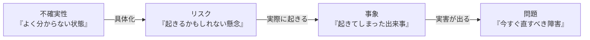

プロジェクトマネジメントの一番の目的は、未来を完全に予言してトラブルをゼロにすることではありません。

そもそも、ソフトウェア開発において「何が起きるか完全に予測できる」なんてことはあり得ません。未知のコード、変化する要件、新しいツールの海を泳ぐ以上、トラブルを完全に防ぐことは不可能です。

目指すべきは、**「致命傷を避けること」** です。

想定外のことが起きても、チームが即死せず、すばやく立て直せるように地雷を先回りして見つけておく。そのためのダンドリを考えてみましょう。

# 言葉の整理：不確実性・リスク・事象・問題

開発の会話で「リスク」という言葉は曖昧に使われがちです。「不確実性」「リスク」「事象」「問題」は、時間の流れに沿って次のように区別すると頭が整理されます。

1. **不確実性**：まだ情報が足りず、将来どうなるか確信が持てないモヤモヤした状態。「外部 API の仕様、まだドキュメントを読み込めていないな……」
2. **リスク**：起きるかどうかは分からないが、もし起きたら困る具体的な懸念。「外部 API に厳しいレート制限があったら、バッチ処理が終わらないかもしれない」
3. **事象**：実際に起きた出来事。「深夜バッチで外部 API を叩いたら、429 Too Many Requests が返ってきた」
4. **問題**：実害が出ており、今すぐ対応しなければならない状態。「バッチが停止して、今朝の顧客データが反映されていない」

この流れを見れば分かる通り、**「問題」になってから大慌てで火消しをするのが一番高くつきます。**
まだ実害が出ていない「不確実性」や「リスク」の段階で小さく手を打っておくことこそが、最もコストパフォーマンスの良いダンドリです。

# チケット管理だけでは見えない落とし穴

多くの現場では、チケット一覧やカンバンを見て「よし、進捗は順調だな」と安心しようとします。

ですが、チケット管理で見えているのは「すでに分かっている作業」に過ぎません。水面下に沈んでいる地雷は、チケットの行数には現れません。

## 遅延は足し算ではなく「掛け算」で広がる

タスクが半日遅れたとき、「半日の遅れだから明日取り戻せばいいか」と軽く考えて痛い目を見たことはないでしょうか。

開発の現場において、遅延は単純な足し算では済みません。
仕様の確定が半日遅れたことで、API 実装の着手が翌日にずれ込み、レビュワーの空き時間を逃して 2 日放置され、QA の検証スロットに間に合わずにテストが来週に回り、結果としてリリースが丸々 1 週間吹き飛ぶ――。

このように、タスク同士の依存関係を通じて遅延は連鎖します。クリティカルな箇所の小さな遅れほど、早めに手を打つ必要があります。

## 戻しにくい決定ほど、真っ先に白黒をつける

すべての決定を同じ重さで悩む必要はありません。

- **戻しやすい決定（行ったり来たりできる扉）**：間違ってもすぐに引き返せる決定。UI の文言、関数の命名、ログの形式など。これらは時間をかけて議論せず、現場のエンジニアの判断でサッと決めて前に進みます。
- **戻しにくい決定（一度通ったら戻れない扉）**：一度決めてしまうと、やり直すのに大きなコストがかかる決定。DB のテーブル設計、課金・決済のシーケンス、外部サービスとのデータ連携仕様など。

炎上しがちな開発では、「面倒だから」と戻しにくい決定を後回しにして、簡単な画面の実装ばかりを先に進めてしまいがちです。終盤になって戻しにくい決定のやり直しが発生すると、それまでに書いたコードの多くを捨てる羽目になります。

**「やり直すのが大変な決定ほど、一番最初に小さく試して白黒をつけておく」**。これが手戻りを防ぐ鉄則です。

## 胸のざわつき（違和感）は大事なセンサー

「この設計、後から破綻しそうな気がするな……」
「この仕様、データが増えたときに大丈夫だろうか？」

開発中にエンジニアがふと覚える胸のざわつきは、潜在的なリスクを知らせるセンサーです。
経験の浅いメンバーであっても、「ここ、なんとなく分からないです」という疑問は決して無視できません。

違和感を飲み込まず、チームの朝会や雑談で「ちょっと気になったんですけど」と口に出せる空気をつくることが、チーム全体で地雷を避ける一番の予防策になります。

# リスクを具体的に言葉にするコツ

漠然と「セキュリティが不安です」「負荷が心配です」と言っても、チームはどう動けばいいか分かりません。
リスクは、次の 3 つの要素に分解して書くと、具体的なアクションが見えてきます。

> **「（原因）〜のため、もし（事象）〜が起きたら、（影響）〜になってしまう」**

- **曖昧な不安**：「大量アクセスの負荷がちょっと心配です」
- **具体的なリスク**：「月末に顧客が一斉に CSV ダウンロードを実行した際（原因）、Web サーバーがメモリを使い果たして（事象）、一般ユーザーの画面までエラーで落ちてしまう可能性がある（影響）」

ここまで言葉になっていれば、「Web サーバーとは別プロセスで非同期に処理させよう」「1 ユーザーあたりの同時リクエスト数を絞ろう」といった具体的な対策が自然と決まります。

# リスクをさばく5つのアプローチ

リスクが見つかったら、次のどの手を取るかを考えます。

1. **危ない橋を渡らない（回避）**：リスクのある機能や技術そのものをやめる。「個人情報の漏洩リスクが高すぎるため、初回リリースでは個人情報を含む項目は CSV の出力対象外にする」。
2. **確率や被害を小さくする（軽減）**：事前に手を打ってショックを和らげる。「1 日の検証枠を取って負荷テストを実施する」「DB クエリにタイムアウトを設定しておく」。
3. **外部の仕組みに任せる（移転）**：自分たちだけで抱え込まずに外部サービスに任せる。「自前でファイル生成基盤を作らず、クラウドのマネージドな非同期ジョブ基盤を利用する」。
4. **覚悟を決めて安全弁をつける（受容）**：「発生確率は極めて低いし、今対策すると納期に間に合わない」と判断し、そのまま進める。ただし、放置するのではなく「異常を即座に検知するアラート」と「切り戻し手順」を必ずセットで用意しておく。
5. **判断を相談する（エスカレーション）**：現場の裁量を超えているなら、抱え込まずに即座に PdM やマネージャーに相談する。「納期を 3 日延ばすか、この機能を削るかの判断をお願いします」。

# 例で考える：CSV 出力機能のリスク対策

CSV 出力機能で、この考え方をどう使うかを見てみましょう。

- **不確実性（モヤモヤ）**：10 万件以上のデータを CSV 出力したとき、今のサーバーが耐えられるか分からない。
- **リスクの言語化**：月末の繁忙期に複数ユーザーが一斉に出力ボタンを押すことで、DB のコネクションが枯渇し、本番の業務画面まで巻き添えでダウンする恐れがある。
- **ダンドリ（打った手）**：
  - **軽減**：同期的にレスポンスを返さず、キューを使ったバックグラウンド非同期処理に切り替える。
  - **回避**：初回リリースでは「出力期間は最大 3 ヶ月分まで」という制限を入れ、超巨大なクエリが飛ぶこと自体を防ぐ。
  - **受容と安全弁**：処理が詰まったときのためにワーカーのメモリ上限を設定し、30 秒を超えた処理は自動停止して Slack にアラートを流す。

トラブルが起きてから徹夜で火消しをするのではなく、起きそうなことを先に安く潰しておく。これが開発者の身を守るダンドリです。
