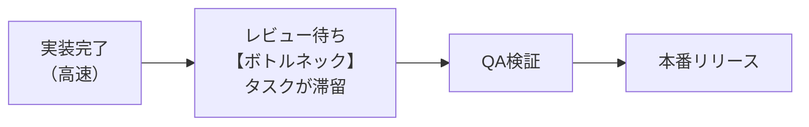

開発全体のスピードを上げたいとき、エンジニア個人の実装速度を上げたり残業を増やしたりしても、根本的な解決にはならない。

なぜなら、開発にかかる時間の大半を占めているのはコードを書く時間そのものではなく、**「レビュー待ち」「仕様確認待ち」「検証環境の空き待ち」といった工程間の待機時間**だからだ。

ここでは、製造業発祥の制約理論（TOC: Theory of Constraints）の考え方をソフトウェア開発に応用し、チーム全体のリードタイムを縮めるアプローチを見ていこう。

# スピードの評価軸：作業時間・リードタイム・価値

開発のスピードを考えるときは、次の 3 つの指標を分けて捉える必要がある。

1. 作業時間（Work Time）
   実際に手を動かしてコードを書き、テストしている純粋な時間。
2. リードタイム（Lead Time）
   タスクに着手してから、本番環境でユーザーが使えるようになるまでの総時間。
3. 価値（Value）
   リリースされた機能によって、ユーザーの課題解決やビジネス上の成果が達成された度合い。

いくら作業時間を短縮しても、工程間の待ち時間が長ければリードタイムは縮まらない。また、リードタイムを縮めても、届いた機能の価値が低ければ開発の投資対効果は得られない。ダンドリにおいて本当に短縮すべきなのは、**「着手から価値提供に至るまでのリードタイム」** だ。

# 制約理論（TOC）によるボトルネックの解消

## ボトルネックとは何か

ボトルネック（制約）とは、開発プロセス全体の中で処理能力がもっとも低く、チーム全体のアウトプット（完了速度）の上限を決めてしまっている工程のことだ。

ボトルネックは誰か特定の人の能力不足を責めるものではなく、流れ込んでくる仕事量と処理能力のアンバランスによって起きる。たとえば、次のような光景はどの現場でもよく見られる。

- コードレビューの詰まり（実装はどんどん終わるのに、シニアエンジニアのレビュー待ちで PR が何日も放置される）
- 仕様確認の滞留（PdM の予定が埋まっていて、仕様の質問に対する返信が数日返ってこない）
- 検証環境の取り合い（ステージング環境が 1 つしかなく、他チームのテストが終わるまでデプロイできない）

## TOC の 5 ステップを開発に活かす

ボトルネックを解消し、チーム全体のアウトプットを最大化するために、次の 5 つのステップを踏んでいこう。

1. ボトルネック（制約）を見つける
   カンバンボード上でタスクが一番溜まっている列や、日々の会話で「待ち」の原因としてよく名前が挙がる工程を特定する。
2. ボトルネックの能力を使い倒す（無駄な負担を減らす）
   ボトルネックになっている工程に、付加価値の低い作業や確認の手間をかけさせない。たとえばレビューが滞留しているなら、PR を小さく分割し、動作確認の証跡やテスト実行ログを添えて、レビュワーの読む負担を最小限に抑える。
3. 他のすべての工程をボトルネックに合わせる（WIP 制限）
   ボトルネックの処理スピードを超えて、前工程が新しいタスクを次々に作り出すのを止める。手元のタスク（WIP: Work In Progress）が増えすぎると、レビュー待ちの列がさらに伸び、全体のリードタイムが悪化する。手が空いたメンバーは、新規タスクに手を出すのではなく、ボトルネックの支援（ペアプロ、レビューの補助、自動テストの作成）に回る。
4. ボトルネックの処理能力を引き上げる
   ボトルネック自体の処理能力を底上げする。レビューの観点をドキュメント化して権限を委譲する、静的解析や CI の自動テストを増やして人間が見る範囲を絞る、検証環境をコンテナ化して誰でもすぐ立ち上げられるようにする。
5. 次のボトルネックへ移る
   レビュー待ちが解消されると、次は「QA 検証」や「リリース手順」が新たなボトルネックになる。1 つの改善で満足せず、新しく現れたボトルネックを見つけて改善のサイクルを回し続けよう。

# クリティカルパスとボトルネックの違い

この 2 つは混同されやすいが、見ている視点が異なる。

| 概念 | 着目点 | 意味 |
| :--- | :--- | :--- |
| ボトルネック | 工程やリソースの処理能力 | 仕事がどこで滞留しているかを表す |
| クリティカルパス | タスクの順序関係と所要時間 | 全体の完了期日を決めている最長経路を表す |

クリティカルパスの上にあるタスクがボトルネックの工程に差し掛かったとき、全体の遅延リスクは跳ね上がる。この重なりを意識し、クリティカルパスに乗っているタスクを最優先でボトルネックに通し、絶対に待たせないように動くことが肝心だ。

# 自律的なチームをつくる 3 つの要素

リーダーが細かく指示を出さなくても、自然と開発がスムーズに進むチームには、次のような環境が整っている。

1. やり直しやすさ（可逆性）の共通認識
   すぐやり直せる決定（Two-way door）は現場のエンジニアがその場で即決し、後戻りできない決定（One-way door）だけを関係者で慎重に話し合うルールが徹底されている。
2. 背景と目的の透明性
   タスクの仕様だけでなく、「なぜこの機能が必要なのか」「どんなリスクを警戒しているのか」という文脈が共有されているため、エンジニアが実装中に自律的な設計判断を下せる。
3. 日常プラクティスでの「待ち」の早期解消
   毎日のスタンドアップでは単なる完了報告ではなく、「誰の返事待ちか」「何が進行をブロックしているか」を共有し、その場で障害を取り除く。ふりかえりでは個人の作業の遅れを責めるのではなく、「どの工程で待ち時間が発生していたか」をプロセスの構造から見直し、次の改善につなげる。

# CSV 出力機能における適用例

| 項目 | 内容 |
| :--- | :--- |
| 直面した課題 | CSV 出力機能の実装が終わったものの、PR の変更量が 2,000 行に達し、シニアエンジニアのレビュー待ちで 4 日間放置されてしまった。 |
| 改善アクション：PR の分割 | 関心事ごとに 4 つの PR（データ抽出クエリ 300 行、CSV 変換 400 行、API 200 行、画面のボタン 150 行）に細かく分割した。 |
| 改善アクション：確認コストの削減 | PR に 10 万件での EXPLAIN 実行計画や、画面操作とダウンロードの動作確認 GIF を添付した。 |
| 結果 | レビュワーがすきま時間でサクサク確認できるようになり、PR の滞留時間が 4 日間から半日へ短縮された。コードを書く時間は同じでも、リリースまでのリードタイムは大きく縮まった。 |
