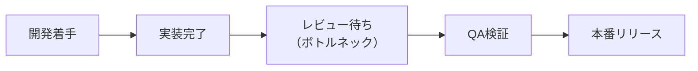

プロジェクトマネジメントの省力化とは、必要な確認やドキュメントをすべて省くことではありません。全体の流れを妨げている箇所（ボトルネック）に集中し、最小限の負担で成果を得ることです。

本章では、製造業由来の制約理論（TOC）をソフトウェア開発へ応用し、チームのデリバリー速度を引き上げるダンドリを学びます。

# 私たちは何を速くしたいのか

開発の高速化を議論する際、以下の 3 つの指標を区別して捉える必要があります。

1. リードタイム（Lead Time）：タスクの着手（またはバックログ選定）から、本番環境でユーザーに届くまでの総所要時間。
2. スループット（Throughput）：一定期間（例：1 スプリント）内に完了・リリースできた仕事の量。
3. 価値（Value）：リリースによってユーザーの課題が解決されたり、事業指標（売上、解約率等）が改善されたりした度合い。

個々のエンジニアの実装速度をどれだけ速くしても、レビュー待ちやデプロイ待ちが長ければリードタイムは縮まりません。目指すべきは価値が届くまでの全体のリードタイム短縮です。

# ボトルネックの正体と制約理論（TOC）

## ボトルネックとは何か

ボトルネックとは、要求される仕事量に対して処理能力が追いつかず、全体の流量（スループット）を制限している工程を指します。

仕事が遅い人を指す言葉ではありません。「レビュー依頼が 1 日 5 本届くのに、承認できるシニアエンジニアが 1 日 3 本しか見られない」といった仕組みと負荷のアンバランスを指します。典型的な例として、コードレビュー待ち、QA 検証環境の順番待ち、PdM の仕様確認待ち、属人化した本番リリース作業などが挙げられます。

## 制約理論（TOC）の5ステップを開発に適用する

1. 制約（ボトルネック）を見つける：カンバンボード上でカードがもっとも山積みになっている列、または待ち時間で作業が止まっている箇所を観察します。
2. 制約の能力を最大限に活かす：ボトルネックになっている工程に、不要な割り込みや雑務をさせないようにします（例：レビュワーが迷わないよう、PR に変更理由やテスト証跡を揃えて提出する）。
3. すべての工程を制約に従属させる（WIP 制限）：ボトルネックの処理能力を超えて、上流工程が新しいタスクに次々と着手するのを防ぎます。「全員の稼働率 100%」を目指すと仕掛かり品（WIP）が溢れかえり、全体のリードタイムは悪化します。
4. 制約の能力を増強する：ボトルネックを根本的に広げます（例：レビュー基準を言語化して他のメンバーへ権限委譲する、自動テストを拡充して手動 QA を減らす、CI パイプラインを高速化する）。
5. 次の制約へ移る（惰性の打破）：1 つの制約が解消されると、別の工程が新たなボトルネックになります。古いルールに縛られず、次の制約を特定して改善を繰り返します。

# クリティカルパスとボトルネックの違い

混同されやすい 2 つの概念ですが、着目している対象が異なります。

- ボトルネック：リソースの処理能力に着目した概念です。仕事の流れがどこで滞留しているかを表します。
- クリティカルパス：タスクの依存関係と所要時間に着目した概念です。完了予定日を決定づける最長のタスク経路を表します。

クリティカルパス上にあるタスクがボトルネック工程を通る場合、プロジェクトの遅延リスクが高まります。この重なりを意識してスケジュールとリソースを調整します。

# 自律的なチーム（セルフマネジメント）の条件

専任管理者がいなくても現場が滞りなく動くチームには、共通する 3 つの環境条件があります。

## 1. 決定の可逆性（One-way door と Two-way door）の明確化

- Two-way door（可逆な判断）：間違ってもすぐにロールバックできる決定（UI 文言の微修正、内部関数のリファクタリングなど）。会議を開かず現場のエンジニアが即決します。
- One-way door（不可逆な判断）：一度進めると後戻りが困難な決定（DB マイグレーション、外部契約、コアアーキテクチャ選定など）。関係者を巻き込んで慎重にレビューし合意形成します。

## 2. 目的と判断コンテキストのオープン化

決定事項だけでなく、「なぜその仕様にしたのか」「どんなリスクを懸念しているのか」という文脈が共有されていれば、担当者が独断で仕様の細部を適切に詰められます。

## 3. アジャイルプラクティスとの連動

- バックログリファインメント：次に着手するタスクの目的、完了条件、未知の難所を事前に揃えておきます。
- 朝会（スタンドアップ）：単なる進捗報告ではなく、ブロックされていること（待ち時間）を共有し、解消を手助けする場にします。
- ふりかえり（レトロスペクティブ）：「なぜ作業が遅れたのか」ではなく、「どこで待ち時間が発生していたか」を仕組みの観点から見直し、次スプリントで 1 つだけ改善を試します。

# CSV出力機能の例：レビュー待ちボトルネックの解消

- 現状の課題：CSV 出力機能の実装が完了したものの、PR の差分が 2,000 行に達し、シニアエンジニアのレビュー待ちで 4 日間放置されている状態。
- ダンドリ改善のアクション：
  1. PR の分割：データ抽出クエリの PR（500 行）、CSV フォーマッタの PR（400 行）、UI ダウンロードボタンの PR（200 行）に分割します。
  2. 判断コストの削減：各 PR に実行計画（EXPLAIN）の結果と、テストケースごとの実行ログを添付し、レビュワーの手間を省きます。
- 結果の検証：レビュー待ち時間が 4 日から半日に減少し、トータルのリードタイムが短縮されました。
