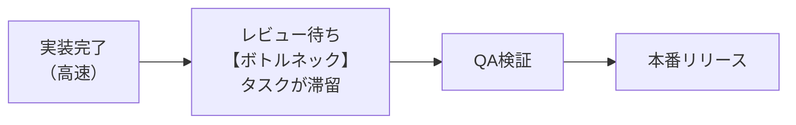

開発速度を上げる際、個人のコーディング速度や残業時間に頼っても効果は薄い。開発時間の大半を占めるのは、**「レビュー待ち」「仕様確認待ち」「検証環境の空き待ち」といった工程間の待機時間**だからだ。

ここでは、制約理論（TOC: Theory of Constraints）を応用し、チーム全体のリードタイムを縮めるアプローチを整理する。

# スピードの評価軸：作業時間・リードタイム・価値

開発スピードは次の 3 指標で捉える。

1. 作業時間（Work Time）：コードを書き、テストする実作業時間
2. リードタイム（Lead Time）：着手から本番リリースまでの総時間
3. 価値（Value）：機能がもたらす課題解決や事業成果

作業時間を削っても、待ち時間が長ければリードタイムは縮まらない。ダンドリで最適化すべきは**「着手から価値提供までのリードタイム」**だ。

# 制約理論（TOC）によるボトルネックの解消

## ボトルネックとは何か

ボトルネック（制約）とは、開発プロセス全体で処理能力がもっとも低く、チームのアウトプット上限を決めている工程だ。

個人の能力不足ではなく、仕事量と処理能力のアンバランスによって生じる。

- レビュー待ち（実装は終わるが、シニアエンジニアのレビュー待ちで PR が数日止まる）
- 仕様確認待ち（PdM の稼働が逼迫し、質問の返答が数日止まる）
- 検証環境の取り合い（ステージング環境が 1 つしかなく、他案件のテスト完了まで待機になる）

## TOC の 5 ステップを開発に活かす

ボトルネックを解消し、チームのスループットを最大化するには次の 5 ステップを踏む。

1. ボトルネックを特定する
   カンバン上でタスクがもっとも溜まっている列や、日々の会話で頻出する「待ち」の原因を特定する。
2. ボトルネックの能力を使い倒す
   ボトルネック工程に余計な負担をかけさせない。レビューが詰まっているなら、PR を小さく分割し、動作確認ログを添えてレビュワーの認知負荷を下げる。
3. 他の工程をボトルネックに従属させる（WIP 制限）
   ボトルネックの処理速度を超えて新規タスクを着手しない。手が空いたメンバーは新規着手ではなく、ボトルネックの支援（ペアプロ、レビュー補助、自動テスト作成）に回る。
4. ボトルネックの処理能力を引き上げる
   レビュー基準をドキュメント化して権限を委譲する、自動テストを拡充して人間の確認を減らす、検証環境をコンテナ化してオンデマンドで作れるようにする。
5. 次のボトルネックへ移行する
   レビュー詰まりが解消すれば、次は QA やデプロイが制約になる。新たなボトルネックを見つけて改善を続ける。

# クリティカルパスとボトルネックの違い

両者は混同されやすいが、着眼点が異なる。

| 概念 | 着目点 | 意味 |
| :--- | :--- | :--- |
| ボトルネック | 処理能力 | 仕事がどこで滞留しているか |
| クリティカルパス | 所要時間と順序 | 全体の完了期日を決める最長経路 |

クリティカルパス上のタスクがボトルネックを通過する際、遅延リスクが最大化する。クリティカルパス上のタスクを最優先でボトルネックに通し、滞留させない運用が必要だ。

# 自律的なチームをつくる 3 つの条件

指示待ちにならず自律的に動くチームには、次の環境が整っている。

1. 可逆性（Two-way/One-way door）の共通認識
   やり直せる決定は現場で即決し、後戻りできない決定のみ慎重に合意する。
2. 背景と目的の透明性
   仕様だけでなく「なぜ作るのか」「何を警戒しているのか」が共有されており、現場で設計判断ができる。
3. 日常プラクティスでの「待ち」の早期解消
   スタンドアップで「誰の返事待ちか」を共有してブロックを解除し、ふりかえりで待ち時間が発生したプロセスを改善する。

# CSV 出力機能における適用例

| 項目 | 内容 |
| :--- | :--- |
| 直面した課題 | CSV 出力機能の実装後、PR が 2,000 行に達し、レビュー待ちで 4 日間止まった。 |
| 改善アクション：PR の分割 | クエリ（300 行）、CSV 変換（400 行）、API（200 行）、画面（150 行）の 4 つに分割した。 |
| 改善アクション：確認コストの削減 | PR に EXPLAIN 実行計画や動作確認 GIF を添付した。 |
| 結果 | すきま時間でレビュー可能になり、滞留時間が 4 日から半日へ短縮された。 |
