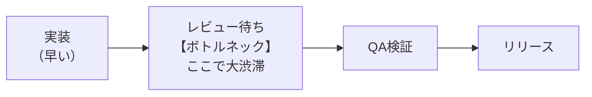

「開発を高速化しよう！」と号令がかかると、多くのチームは「もっと手を速く動かそう」「残業して実装時間を増やそう」と考えがちだ。

だが、それは大きな間違いだ。

個人の作業スピードをいくら上げても、チーム全体のリリース速度はほとんど変わらない。
なぜなら、開発の現場で一番時間を食っているのは「コードを書いている時間」ではなく、**「誰かの返事を待っている時間」「レビューされるのを待っている時間」「デプロイされるのを待っている時間」** だからだ。

本章では、エリヤフ・ゴールドラットの名著『ザ・ゴール』で知られる「制約理論（TOC）」を開発現場に応用し、最小限のエネルギーでチームのスピードを劇的に引き上げるダンドリを考える。

# 私たちが本当に速くしたいものは何か

まず、チーム内で「スピード」の定義を揃えておこう。開発の現場には 3 つの異なる「速さ」がある。

1. **作業時間（Work Time）**：エディタを開いてコードを書いている時間（例：3 時間）。
2. **リードタイム（Lead Time）**：タスクに着手してから、本番環境でユーザーが使えるようになるまでの総時間（例：1 週間）。
3. **価値（Value）**：リリースした機能によって、実際にユーザーの課題が解決された度合い。

どれだけ 1（作業時間）を縮めても、2（リードタイム）が縮まらなければ意味がない。そして、どれだけ速くリリースしても、3（価値）が伴わなければただのゴミを作っただけだ。

私たちがダンドリによって速くしたいのは、作業時間ではなく**「着手してからユーザーに価値が届くまでのリードタイム」** だ。

# ボトルネックの正体と制約理論（TOC）

## ボトルネックとは何か

ボトルネックとは、仕事全体の流れの中で「もっとも処理能力が低く、全体のスピードを決めてしまっている箇所」のことだ。

道路の渋滞を思い出してほしい。3 車線ある高速道路でも、途中で 1 箇所だけ 1 車線に絞られている工事区間があれば、全体の車の流れる速度はその工事区間の通過スピードで決まってしまう。手前の 3 車線でどれだけアクセルを踏んでも、渋滞が伸びるだけだ。

ソフトウェア開発における典型的なボトルネックは次のようなものだ。

- **コードレビュー待ち**：実装は半日で終わるのに、PR が 3 日間放置されている。
- **仕様の確認待ち**：PdM が会議詰めで、仕様の相談ができるのが 2 日後になる。
- **QA・検証環境の順番待ち**：検証環境が 1 つしかなく、他チームのテストが終わるまでデプロイできない。

ここで重要なのは、**ボトルネックは「仕事が遅い人」のことではない**ということだ。「レビュー依頼が 1 日に 10 件届くのに、承認できるシニアエンジニアが 1 日 3 件しか見られない」という、仕事量と仕組みのアンバランスによって起きている。

## 制約理論（TOC）の5つのステップ

このボトルネックを解消するために、TOC の 5 つのステップを現場に当てはめてみよう。

1. **ボトルネックを見つける**
   カンバンボード上で、カードが一番山積みになって滞留している列はどこか。メンバーが「〇〇さん待ちで止まっています」と一番口にしている箇所はどこかを観察する。
2. **ボトルネックを徹底活用する（無駄な仕事をさせない）**
   ボトルネックになっている人に、余計な雑用や割り込みをさせてはいけない。たとえばシニアエンジニアのレビューが詰まっているなら、レビュワーに質問させないくらい PR の説明を丁寧に書く。テスト結果やスクリーンショットを揃えて、「確認の負担」を極限まで減らしてあげる。
3. **他のすべての工程をボトルネックに合わせる（WIP 制限）**
   ここが一番勇気のいるポイントだ。ボトルネックが詰まっているのに、上流のエンジニアが「自分の手が空いたから」と新しいチケットに次々と手をつけてはいけない。仕掛かり（WIP）が増えれば増えるほど、レビュー待ちの列が伸びて全員のリードタイムが悪化する。手が空いたら、新しいコードを書くのではなく「詰まっているレビューを自分ができる範囲で手伝う」「テストを自動化する」など、ボトルネックの支援に回る。
4. **ボトルネックを根本から広げる**
   レビュー基準をドキュメント化して他のメンバーに権限を委譲する。CI の静的解析や自動テストを拡充して、人間が見るべき観点を減らす。検証環境をコンテナ化して誰でもオンデマンドで作れるようにする。
5. **次のボトルネックへ移る**
   レビュー詰まりが解消されると、次は「QA 検証待ち」や「本番リリース作業」が新たなボトルネックになる。改善を 1 度で終わらせず、次の詰まりポイントを見つけて同じサイクルを繰り返す。

# クリティカルパスとボトルネックの違い

混同しやすい 2 つの言葉だが、見ている視点が違う。

- **ボトルネック（人・工程の処理能力）**：仕事の流れがどこで滞留しているか（例：レビュワーのキャパシティ不足）。
- **クリティカルパス（タスクの順序と依存関係）**：タスクの鎖の中で、全体の納期を決定づけている最長の経路（例：仕様確定 → API 実装 → フロント実装 → E2E テスト）。

最悪なのは、**「クリティカルパス上にある重要なタスクが、ボトルネック工程に突入して大渋滞に巻き込まれること」** だ。
全体の納期を縮めたいなら、クリティカルパス上にあるタスクを最優先でボトルネックに流し込み、関係者全員でその通過をサポートする。

# 自律的なチーム（セルフマネジメント）をつくるダンドリ

専任の PM がいなくても、現場が滞りなく自走しているチームには共通点がある。

## 1. 「戻せるか戻せないか」の合意ができている

前の章でも触れたが、間違ってもすぐに引き返せる決定（Two-way door）に時間をかけてはいけない。
「軽微な UI 変更やリファクタリングは、エンジニア自身の判断で即マージしてよい」「DB スキーマ変更や課金周りは必ず 2 人以上のシニアの合意を取る」といった共通認識が揃っていれば、いちいち会議を開かずに済む。

## 2. 背景（Why）と判断の材料をオープンにしておく

「何を実装するか」という仕様だけでなく、「なぜその仕様にしたのか」「どんなリスクを恐れているのか」という前提や文脈（コンテキスト）が共有されていれば、現場のエンジニアが作業中に迷ったときも、その場で適切な判断を下せる。

## 3. 日常のアジャイルプラクティスを「待ち時間の解消」に使う

- **朝会（スタンドアップ）**：「昨日やったこと」「今日やること」の報告会にしてはいけない。「今、何にブロックされているか（誰の返事待ちか）」を告白し、その場でブロッカーを外す場にする。
- **ふりかえり（KPT 等）**：「誰がミスしたか」を反省するのではなく、「今週、どこで一番待ち時間が発生していたか」「どの手戻りが一番もったいなかったか」を仕組みの観点から話し合い、来週 1 つだけカイゼンを試す。

# CSV出力機能の例：レビュー詰まりをダンドリで解消する

- **直面した問題**：
  CSV 出力機能の実装が完了し、意気揚々と PR を出した。しかし、差分が 2,000 行に膨らんでおり、忙しいシニアエンジニアが後回しにして 4 日間放置されてしまった。
- **ダンドリの改善**：
  1. **PR を関心ごとに分割する**：
     - PR 1：データ抽出用クエリの追加（300 行）
     - PR 2：CSV 変換ロジックと単体テスト（400 行）
     - PR 3：ダウンロード用 API エンドポイント（200 行）
     - PR 4：管理画面のボタン UI（150 行）
  2. **レビュワーの脳のメモリを節約する**：
     PR 1 には「10 万件での実行計画（EXPLAIN）の結果」を貼り、PR 4 には「実際に画面でボタンを押してダウンロードされる様子の GIF アニメ」を添付した。
- **結果**：
  シニアエンジニアが隙間時間の 15 分でレビューできるようになり、放置時間が 4 日から半日に激減した。コードを書く時間は変わっていないのに、リリースまでのリードタイムは圧倒的に速くなった。
