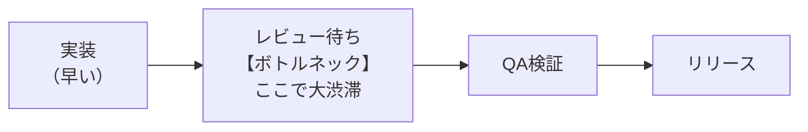

「開発を高速化しよう！」と号令がかかると、多くのチームは「もっと手を速く動かそう」「実装時間を増やそう」と考えがちです。

ですが、個人の作業スピードをいくら上げても、チーム全体のリリース速度はほとんど変わりません。
なぜなら、開発の現場で一番時間が消えているのは「コードを書いている時間」ではなく、**「誰かの返事を待っている時間」「レビューされるのを待っている時間」「デプロイされるのを待っている時間」** だからです。

この章では、全体の流れを妨げている「詰まり（ボトルネック）」に目を向け、チームのデリバリー速度を引き上げるダンドリを考えます。

# 私たちが本当に速くしたいものは何か

まず、チーム内で「スピード」の意味を揃えておく必要があります。開発の現場には 3 つの異なる「速さ」があります。

1. **作業時間**：エディタを開いてコードを書いている時間（例：3 時間）
2. **リードタイム**：タスクに着手してから、本番環境でユーザーが使えるようになるまでの総時間（例：1 週間）
3. **価値**：リリースした機能によって、実際にユーザーの課題が解決された度合い

どれだけ作業時間を縮めても、待ち時間が長くてリードタイムが縮まらなければ意味がありません。そして、どれだけ速くリリースしても、価値が伴わなければ無駄な仕事になってしまいます。

私たちがダンドリによって速くしたいのは、作業時間ではなく**「着手してからユーザーに価値が届くまでのリードタイム」** です。

# ボトルネックの正体と付き合い方

## ボトルネックとは何か

ボトルネックとは、仕事全体の流れの中で「もっとも処理能力が低く、全体のスピードを決めてしまっている箇所」のことです。

道路の渋滞を思い出してください。3 車線ある高速道路でも、途中で 1 箇所だけ 1 車線に絞られている工事区間があれば、全体の通過スピードはその工事区間の速度で決まります。手前の 3 車線でどれだけアクセルを踏んでも、渋滞の列が伸びるだけです。

開発現場における典型的なボトルネックは次のようなものです。

- **コードレビュー待ち**：実装は半日で終わるのに、PR が 3 日間放置されている
- **仕様の確認待ち**：PdM が会議詰めで、仕様の相談ができるのが 2 日後になる
- **検証環境の順番待ち**：検証環境が 1 つしかなく、他チームのテストが終わるまでデプロイできない

ここで重要なのは、**ボトルネックは「仕事が遅い人」のことではない**ということです。「レビュー依頼が 1 日に 10 件届くのに、承認できるシニアエンジニアが 1 日 3 件しか見られない」というように、仕事量と体制のアンバランスによって発生します。

## ボトルネックをどう扱うか

1. **ボトルネックを見つける**
   カンバンボード上でカードが一番山積みになっている列はどこか。メンバーが「〇〇さん待ちで止まっています」と一番口にしている箇所はどこかを観察します。
2. **ボトルネックに余計な負担をかけない**
   ボトルネックになっている人に、余計な確認の手間をかけさせてはいけません。たとえばシニアエンジニアのレビューが詰まっているなら、PR の説明を丁寧に書き、テスト結果やスクリーンショットを揃えて「確認の負担」を極限まで減らします。
3. **上流で勝手に新しいタスクを始めない（仕掛かり制限）**
   ボトルネックが詰まっているのに、上流のエンジニアが「自分の手が空いたから」と新しいチケットに次々と手をつけてはいけません。仕掛かりタスクが増えれば増えるほど、レビュー待ちの列が伸びて全体のリードタイムが悪化します。手が空いたら、新しいコードを書くのではなく「詰まっているレビューを自分ができる範囲で手伝う」「テストを自動化する」など、ボトルネックの支援に回ります。
4. **ボトルネックを根本から広げる**
   レビュー基準を文章化して他のメンバーに権限を委譲する。CI の静的解析や自動テストを拡充して人間が見るべき観点を減らす。検証環境をコンテナ化して誰でも手元で作れるようにする。

# 自走するチームをつくるための工夫

専任の PM がいなくても、現場が滞りなく動いているチームには共通した工夫があります。

## 背景（Why）と判断の材料をオープンにしておく

「何を実装するか」という仕様だけでなく、「なぜその仕様にしたのか」「どんなリスクを懸念しているのか」という前提や文脈が共有されていれば、現場のエンジニアが作業中に迷ったときも、その場で適切な判断を下せます。

## 朝会やふりかえりを「待ち時間の解消」に使う

- **朝会（スタンドアップ）**：「昨日やったこと」「今日やること」の単なる報告会にするのではなく、「今、何にブロックされているか（誰の返事待ちか）」を共有し、その場でブロッカーを外す場にします。
- **ふりかえり**：「誰がミスしたか」を反省するのではなく、「今週、どこで一番待ち時間が発生していたか」「どの手戻りが一番もったいなかったか」を仕組みの観点から話し合い、来週 1 つだけ改善を試します。

# 例で考える：CSV 出力機能のレビュー詰まりを解消する

- **直面した問題**：
  CSV 出力機能の実装が完了し、意気揚々と PR を出しました。しかし、差分が 2,000 行に膨らんでおり、忙しいシニアエンジニアが後回しにして 4 日間放置されてしまいました。
- **ダンドリの改善**：
  1. **PR を関心ごとに分割する**：
     - PR 1：データ抽出用クエリの追加（300 行）
     - PR 2：CSV 変換ロジックと単体テスト（400 行）
     - PR 3：ダウンロード用 API エンドポイント（200 行）
     - PR 4：管理画面のボタン UI（150 行）
  2. **レビュワーの確認コストを減らす**：
     PR 1 には「10 万件での実行計画（EXPLAIN）の結果」を貼り、PR 4 には「実際に画面でボタンを押してダウンロードされる様子の GIF アニメ」を添付しました。
- **結果**：
  シニアエンジニアが隙間時間の 15 分でレビューできるようになり、放置時間が 4 日から半日に減りました。コードを書く時間は変わっていませんが、リリースまでのリードタイムは大幅に短縮されました。
