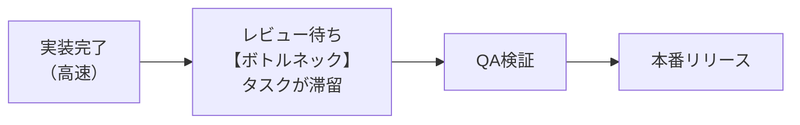

開発速度の向上を図る際、エンジニア個人の実装速度向上や稼働時間の延長だけに注力しても、チーム全体のデリバリー速度は改善しない。

開発現場における所要時間の大部分を占めているのは、コード記述の時間ではなく、**「レビュー待ち」「仕様確認待ち」「検証環境の順番待ち」といった工程間の待機時間**であるためである。

本章では、製造業由来の制約理論（TOC: Theory of Constraints）をソフトウェア開発へ適用し、チーム全体のリードタイムを短縮するための手法を解説する。

# 速度の評価軸：作業時間・リードタイム・価値

開発速度の議論においては、以下の 3 つの指標を区別して定義する必要がある。

1. **作業時間（Work Time）**：コードを記述・検証している純粋な作業時間。
2. **リードタイム（Lead Time）**：タスクの着手（またはバックログ選定）から、本番環境でユーザーが利用可能になるまでの総所要時間。
3. **価値（Value）**：リリースされた機能により、ユーザーの課題解決や事業指標の改善が達成された度合い。

作業時間を短縮しても、工程間の待ち時間が長ければリードタイムは短縮されない。また、リードタイムを短縮しても、提供された機能の価値が低ければ開発投資の回収はできない。ダンドリにおいて最適化すべき対象は、**「着手から価値提供に至るまでのリードタイム」** である。

# 制約理論（TOC）によるボトルネックの解消

## ボトルネックの定義

ボトルネック（制約）とは、開発プロセス全体の中で処理能力がもっとも低く、システム全体のスループット（完了速度）を決定づけている工程を指す。

ボトルネックは特定個人の能力不足を意味するものではなく、投入される仕事量と処理能力の構造的な不均衡によって発生する。典型例として、以下が挙げられる。

- **コードレビュー工程の滞留**：実装は完了しているが、シニアエンジニアのレビュー待ちで PR が数日間放置される。
- **仕様確認の滞留**：PdM の稼働が逼迫しており、仕様に関する質疑応答が数日単位で停滞する。
- **検証環境の競合**：ステージング環境が 1 面しか存在せず、他案件のテスト完了までデプロイが待機となる。

## TOCの5ステップの開発への適用

ボトルネックを解消し、システム全体のスループットを最大化するために、以下の 5 ステップを適用する。

1. **制約（ボトルネック）を特定する**
   カンバンボード上でタスクがもっとも滞留している列、またはチーム内で待機理由として頻出している工程を特定する。
2. **制約の処理能力を最大限に活用する（不要な負荷の排除）**
   ボトルネック工程に対して、付加価値の低い作業や確認の手間をかけさせない。たとえばレビューが滞留している場合、PR を小さく分割し、動作確認の証跡やテスト実行ログを添付して、レビュワーの認知負荷を最小化する。
3. **他のすべての工程を制約に従属させる（WIP制限）**
   ボトルネックの処理能力を超えて、上流工程が新しいタスクに次々と着手することを禁止する。仕掛かりタスク（WIP: Work In Progress）が過大になると、レビュー待ちの列がさらに伸長し、全体のリードタイムが悪化する。手が空いたメンバーは、新規タスクの着手ではなく、ボトルネック工程の支援（ペアプロ、レビュー補助、自動テスト作成）に回る。
4. **制約の処理能力を増強する**
   ボトルネック自体の処理能力を恒久的に引き上げる。レビュー基準をドキュメント化して権限を委譲する、静的解析や CI の自動テストを拡充して人間の確認範囲を狭める、検証環境をコンテナ化してオンデマンドで生成可能にする。
5. **次の制約へ移行する**
   レビュー工程の滞留が解消されると、次は「QA 検証」や「デプロイ手順」が新たな制約となる。過去の改善に満足せず、新たなボトルネックを特定して改善サイクルを継続する。

# クリティカルパスとボトルネックの違い

両者はプロジェクト管理において混同されやすいが、対象とする観点が異なる。

- **ボトルネック**：工程やリソースの**処理能力**に着目した概念。仕事がどこで滞留しているかを表す。
- **クリティカルパス**：タスクの依存関係と所要時間の**順序関係**に着目した概念。完了期日を決定づける最長経路を表す。

クリティカルパス上にあるタスクがボトルネック工程を通過する際、全体の遅延リスクが最大化する。この重複を認識し、クリティカルパス上のタスクを最優先でボトルネックへ投入し、滞留させずに通過させる運用が必要となる。

# 自律的なチーム運用の条件

専任管理者が常時指示を出さなくても開発が円滑に進行するチームには、以下の環境が整っている。

1. **意思決定の可逆性の共通認識**
   可逆な決定（Two-way door）は現場のエンジニアが即決し、不可逆な決定（One-way door）のみを関係者間で慎重に合意形成するルールが徹底されている。
2. **コンテキスト（背景と目的）の透明性**
   タスクの仕様だけでなく、「なぜその機能が必要なのか」「どのようなリスクを想定しているのか」という文脈が共有されているため、エンジニアが実装中に自律的な設計判断を行える。
3. **定期プラクティスによる待機の早期排除**
   - **スタンドアップ**：完了報告ではなく、「誰の返事待ちか」「何が進行をブロックしているか」を共有し、即座に障害を取り除く場として機能させる。
   - **レトロスペクティブ**：個人の作業遅れを追及するのではなく、「どの工程で待ち時間が発生していたか」をプロセス構造の観点から見直し、次サイクルの改善策を決定する。

# CSV出力機能における適用例

- **直面した課題**：
  CSV 出力機能の実装が完了したものの、PR の変更行数が 2,000 行に達し、シニアエンジニアのレビュー待ちで 4 日間滞留した。
- **TOC に基づく改善アクション**：
  1. **PR の関心事による分割**：
     - PR 1：データ抽出用クエリの追加（300 行）
     - PR 2：CSV フォーマット変換ロジックと単体テスト（400 行）
     - PR 3：ダウンロード用 API エンドポイント（200 行）
     - PR 4：管理画面のボタン UI（150 行）
  2. **レビュワーの確認コスト低減**：
     PR 1 には「10 万件での EXPLAIN 実行計画結果」を記載し、PR 4 には「画面操作とダウンロードの動作確認 GIF」を添付した。
- **結果**：
  レビュワーが空き時間で順次レビュー可能となり、PR 滞留時間が 4 日間から 0.5 日間へ短縮された。実装作業時間自体は変わらないが、リリースリードタイムは大幅に短縮された。
