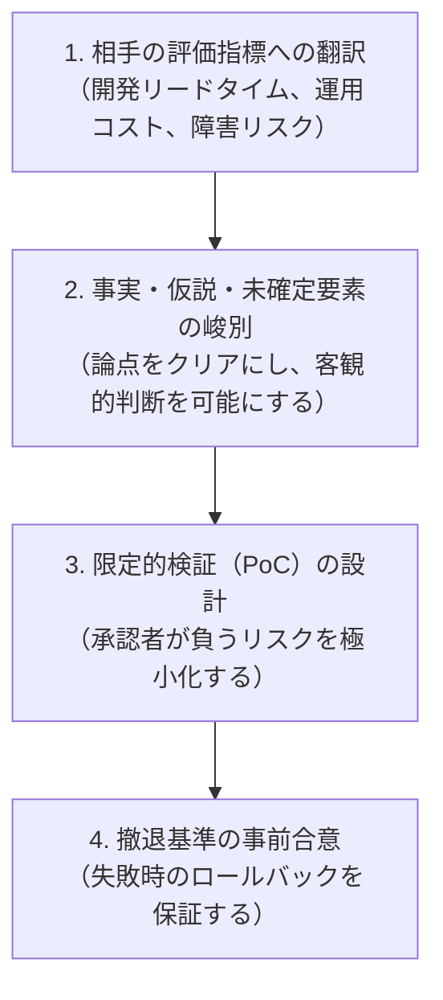

プロジェクトマネジメントの価値は、大規模な計画書の策定だけでなく、エンジニアの日々の開発判断やコミュニケーションの設計において発揮される。

第 1 章で述べたように、ダンドリとは「目的達成までの無駄な損失を排除し、不確実性を制御すること」である。また、ダンドリは「技術提案を組織に通し、合意を形成するための技術」でもある。

本章では、開発現場における主要な損失の排除手法と、ステークホルダーとの合意形成を迅速に行うための提案設計手法を解説する。

# 開発プロセスにおける主要な損失とその排除

開発速度を低下させる主な要因は、以下の 4 つの損失に分類できる。

| 損失の分類 | 主な発生原因 | ダンドリによる排除手法 |
| :--- | :--- | :--- |
| **判断・返事の待機損失** | 「どうしましょう？」という丸投げの相談により、相手側の思考・調査時間が発生する | 状況、選択肢、推奨案と理由、回答期日をセットで提示する。「異論がなければ A 案で進める」というオプトアウト形式を活用する。 |
| **仕様齟齬による手戻り損失** | 実装完了後に受け入れ基準を満たしていないことが発覚する | 実装着手前に、受け入れ条件（Acceptance Criteria）を箇条書きで定義し、PdM や QA と合意する。不確実な技術要素は半日のスパイクで検証する。 |
| **情報探索の損失** | 過去の仕様や設計判断の経緯が Slack のタイムラインに埋没し、特定に時間を要する | 決定事項およびその背景・却下理由は、Issue、PR、ADR（Architecture Decision Record）に記録する。陳腐化したドキュメントは削除またはアーカイブする。 |
| **ボトルネック放置の損失** | 自身の実装完了後、チーム全体の滞留を無視して新規タスクに着手し、WIP を肥大化させる | カンバンボード全体の滞留を確認し、レビュー待ちやテスト待ちのタスク解消を優先支援する。 |

# 技術提案が却下される構造

リファクタリング、ライブラリ刷新、テスト自動化といったエンジニアからの改善提案が却下される主な原因は、提案内容の技術的妥当性ではなく、**「承認者側から見た不確実性（コスト、納期影響、障害リスク）が定量化されていないこと」** にある。

非エンジニアや事業責任者から見れば、内部設計の複雑性は不可視領域である。「リファクタリングを実施したい」という要求に対して、「どの程度の工数がかかるのか」「他の機能開発が遅延しないか」「本番障害のリスクはないか」という不確実性が払拭できない以上、責任ある立場として提案を承認することは困難となる。

すなわち、技術提案を通すためのダンドリとは、**「承認者側が背負う不確実性を先回りで極小化する技術」** である。

# 提案を迅速に合意形成するための設計

提案を承認されやすい形にパッケージ化するためには、以下の 4 つの設計を行う。

## 1. 相手の評価指標への翻訳

技術的な利点を、相手の関心事（評価指標）の言語へ翻訳して提示する。

- **PdM に対する提案**：「アーキテクチャが老朽化している」ではなく、「対象箇所の結合度を疎にすることで、来期予定している新機能開発の着手リードタイムを 1 週間短縮できる」と提示する。
- **事業責任者に対する提案**：「ライブラリのバージョンが古い」ではなく、「セキュリティサポート終了に伴う脆弱性リスクを回避するとともに、CI ビルド時間を半減させて開発待機工数を月間 20 時間削減できる」と提示する。

## 2. 事実・仮説・未確定要素の峻別

提案内容を感情論や希望的観測と分離し、以下の 3 区分で整理する。

- **事実（客観的な現状データ）**：「現在、CI の実行に 1 回 40 分を要しており、1 日平均 8 回の完了待ちが発生している」
- **仮説（改善による期待効果）**：「テスト並列化とキャッシュ機構の導入により、実行時間を 10 分に短縮でき、チーム全体で毎日 4 時間の待機時間を削減できる見込みである」
- **未確定要素（発生する追加費用や懸念）**：「並列実行ランナーの追加により、月額約 5,000 円のインフラ費用増が発生する」

これらを峻別して提示することで、承認者は投資対効果を客観的・合理的に判断できるようになる。

## 3. スコープを限定した検証（PoC）の設計

最初からシステム全体を置換する大規模な提案を行うと、承認リスクが過大となり却下されやすい。「まずは影響範囲が最も小さい 1 画面に限定し、2 日間のタイムボックスで試験導入を行う」というように、相手が承認しやすい低リスクな選択肢を提示する。

## 4. 撤退基準の事前明示

試行が不調に終わった場合の安全弁をあらかじめ定義しておく。「もし 2 日間の検証で所期の性能が出ない場合は、既存の実装に切り戻して作業を終了する」という撤退基準（Two-way door であることの保証）を合意しておくことで、承認側の心理的障壁を取り除くことができる。

## 5. 検証の結果としての「見送り」の価値

PoC を実施した結果、「費用対効果が合わない」「想定外の運用リスクがある」と判明して施策を見送る判断に至ることは失敗ではない。最小限のコストでリスクを特定し、大規模な損失投資を未然に防いだという観点において、有効なダンドリの成果である。
