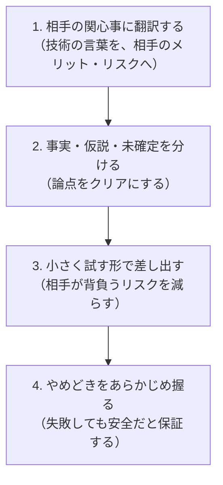

ここまで、プロジェクトマネジメントの基本的な考え方、不確実性やボトルネックの扱い方を見てきました。

第 1 章で、「ダンドリとは目的達成までの『もったいない』を減らすこと」、そして「ダンドリが身につくと自分の提案が通りやすくなる」とお話ししました。

この章では、日々の開発現場で起きている「もったいない」を具体的にどう削ぎ落とし、周囲を味方につけて自分のやりたい開発を前に進めるかを考えていきます。

# 現場に転がっている「もったいない」を削る

開発を遅らせている大きな要因は、特別なツールや技術の不足ではなく、日常で無自覚に発生している「もったいない」です。

- **判断待ち・返事待ちのもったいない**
  「どうしましょう？」と相手に丸投げすると、相手が考える時間分だけ待たされることになります。「状況はこうで、選択肢は A と B があります。理由から A を推奨しますが、よろしいですか？（明日の 12 時までに異論がなければ A で進めます）」と、相手が「Yes」と言えばすぐ動ける形に整えて投げます。
- **確認不足による手戻りのもったいない**
  コードを書き終えてから「そうじゃない」と差し戻されるのが一番つらいロスです。着手前に「どんな画面になって、どんなデータが出れば合格か」を数行でいいから書き出し、関係者と合意しておきます。技術的に不安な箇所は、半日の検証枠を取って小さく試します。
- **情報探索のもったいない**
  「あの仕様、Slack のどこに書いてあったっけ……」とタイムラインを遡る時間は、まるまる無駄になってしまいます。重要な決定事項は Issue やチケット、ADR に残します。逆に、更新が止まった古いドキュメントは混乱を招くだけなので、思い切ってアーカイブします。
- **自分のタスクしか見ないもったいない**
  自分が実装を終えて手が空いたからといって、次のタスクを勝手に掘り起こして着手してはいけません。チームのカンバンを見て、レビュー待ちやテスト待ちで誰かが困っているなら、その解消に手を貸します。

これらを意識して減らすだけでも、開発の体感スピードは大きく変わってきます。

# なぜエンジニアの提案は通りにくいのか？

「技術的負債を返済したい」
「古くなったライブラリをアップデートしたい」
「テストコードを書く時間を確保したい」

エンジニアなら誰しも、プロダクトを良くするための改善提案を持っているはずです。しかし、PdM や事業責任者に相談して「今は機能開発を優先したいから後にして」と却下された経験はないでしょうか。

提案が通らないのは、その提案が間違っているからではありません。
**「相手にとって、その提案を受け入れるための不安（不確実性）が大きすぎるから」** です。

非エンジニアから見れば、コードや設計の内部事情はブラックボックスです。
「リファクタリングをします」と言われても、「どのくらい時間がかかるの？」「本当に安全なの？」「他の機能開発が止まるんじゃないの？」という不安が先に立ちます。不安がある以上、責任ある立場の人ほど「No」と言わざるを得ません。

つまり、**プロジェクトマネジメントとは「人に何かを受け入れてもらうための技術」そのもの**なのです。

# 提案をスムーズに通すためのダンドリ

自分のアイデアに気持ちよく賛同してもらうために、相手の頭の中にある不安を先回りして小さく潰しておきます。

## 1. 相手の関心事の言葉に翻訳する

技術的にどれほど優れていても、相手の関心事と結びついていなければ納得してもらえません。

- **PdM に対する提案**：「〇〇のコードが汚い」ではなく、「ここを整理しておくと、来月予定している新機能の追加が 1 週間早く着手できます」と伝えます。
- **ビジネス側に対する提案**：「ライブラリのバージョンが古い」ではなく、「サポート終了に伴いセキュリティ脆弱性のリスクがあります。また、ビルド時間を短縮して月 20 時間分の開発時間を削減できます」と伝えます。

## 2. 事実・仮説・未確定をきれいに分ける

提案書やチケットで、思いついたことをごちゃ混ぜに書いてはいけません。

- **事実（客観的なデータ）**：「現在、CI の実行に毎回 40 分かかっており、1 日平均 8 回の待機が発生している」
- **仮説（期待できる効果）**：「テストを並列化すれば、1 回 10 分に短縮でき、チーム全体で毎日 4 時間の開発時間が浮く見込みです」
- **未確定（まだ分かっていない懸念や費用）**：「CI の実行マシンを増やすため、月額約 5,000 円の追加費用が発生する」

このように分けて提示されると、承認者は費用対効果を冷静に判断できるようになります。

## 3. 「小さく試す」形で差し出す

「システム全体を一新したいので、1 ヶ月開発を止めさせてください」と言われたら、どんなマネージャーでも躊躇します。
相手が「Yes」と言いやすいように、提案のサイズを小さくします。

- 「まずは影響の少ない 1 画面だけで、来週の 2 日間を使って試験導入させてください」
- 「そこで問題がないことを確認してから、全体に広げるかどうかを改めて相談させてください」

相手が背負うリスクを小さくしてあげることが、提案を通すための最大のダンドリです。

## 4. やめどき（撤退基準）をあらかじめ握る

「もしやってみてダメだったらどうするの？」という不安を先回りして潰します。

「もし 2 日間で期待した性能が出なかった場合は、元の実装のまま切り戻して終了します。深追いはしません」

引き返すラインを先に伝えておけば、相手は安心して背中を押してくれます。

## 5. 「見送り（やらない判断）」も立派な成果

小さく試した結果、「思ったほど効果が出なかった」「別のリスクが大きいことが分かった」と判明して提案を取り下げることもあります。

これは失敗ではありません。「危ない道にチーム全員で突っ込む前に、最小のコストで地雷を見つけて撤退できた」ということです。無駄な投資を防いだという点で、立派なダンドリの成果として捉えましょう。
