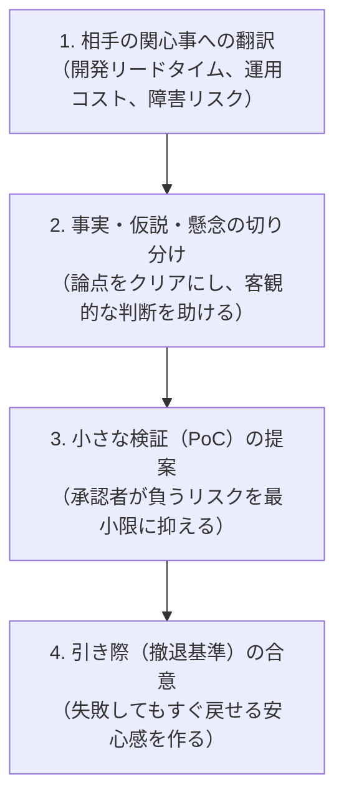

プロジェクトマネジメントの真価は、分厚い計画書ではなく、日々の開発判断やコミュニケーションのダンドリにある。

ダンドリとは「損失を削り、不確実性を制御すること」であり、「技術提案を組織に通して合意を得る技術」でもある。

ここでは、現場の損失をなくすコツと、提案をスムーズに通す設計を整理する。

# 開発現場の 4 つの損失と防ぎ方

開発スピードを落とす要因は、主に次の 4 つの損失だ。

| 損失の分類 | 主な原因 | ダンドリによる解決策 |
| :--- | :--- | :--- |
| 判断待ち・返事待ち | 「どうしましょう？」と丸投げし、相手の検討時間が長引く | 状況、選択肢、推奨案と理由、回答期日をセットで伝える。「異論がなければ A 案で進める」オプトアウト方式を使う。 |
| 仕様ズレによる手戻り | 作り終わってから要件の食い違いが発覚する | 実装前に受け入れ条件（Acceptance Criteria）を箇条書きで合意する。未知の技術要素は半日のスパイクで検証する。 |
| 情報探索 | 決定の経緯が Slack に埋もれて探せない | 決定事項と却下理由を Issue、PR、ADR に残す。古い文書はアーカイブする。 |
| ボトルネック放置 | 自分の実装完了後、チームの詰まりを無視して新規タスクに着手し WIP を増やす | ボード全体を見て、レビュー待ちやテスト待ちの解消を優先支援する。 |

# なぜ技術提案は却下されるのか

リファクタリングやライブラリ更新が却下される理由は、技術的な妥当性の不足ではない。**「承認者から見て工数・納期影響・障害リスクが読めないから」**だ。

非エンジニアや事業責任者から内部設計は見えない。「どれくらい時間がかかるか」「他機能の開発が遅れないか」「障害リスクはないか」が不透明なままでは承認できない。

技術提案を通すダンドリとは、**「承認者が抱える不確実性を先回りで小さくする技術」**だ。

# 提案を合意に導く 4 つのステップ

提案を相手が受け入れやすい形に整えるため、次の 4 点を設計する。

## 1. 相手の関心事に翻訳する

技術的なメリットを、相手の評価指標に翻訳して伝える。

| 提案相手 | エンジニアのよくある言い方 | 相手の関心事に翻訳した伝え方 |
| :--- | :--- | :--- |
| PdM | アーキテクチャが古く結合度が高い | 結合度を下げておくと、来期の新機能開発にすぐ着手でき、納期を 1 週間短縮できる |
| 事業責任者 | ライブラリのバージョンが古い | サポート切れの脆弱性リスクを防ぎ、CI 時間半減でチームの待機時間を月 20 時間削れる |

## 2. 事実・仮説・懸念を切り分ける

感情論を排し、次の 3 つに分けて整理する。

| 区分 | 意味 | 伝え方の例 |
| :--- | :--- | :--- |
| 事実 | 現状の客観データ | CI の実行に毎回 40 分かかり、1 日平均 8 回の待ち時間が発生している |
| 仮説 | 改善による期待効果 | 並列化とキャッシュで 10 分に短縮でき、毎日約 4 時間の待機工数を削減できる見込み |
| 懸念 | 費用やリスク | 並列ランナー追加で月額約 5,000 円のインフラ費用が増加する |

客観的事実、期待効果、コストを切り分けて提示することで、承認者は投資対効果を判断しやすくなる。

## 3. 小さな検証（PoC）から始める

最初から大規模な置換を提案するとリスクが高く却下されやすい。「影響がもっとも小さい 1 画面で、2 日間のタイムボックスで試す」のように、低リスクな選択肢を提示する。

## 4. 引き際（撤退基準）を合意しておく

うまくいかなかったときの安全弁を用意する。「2 日間の検証で期待通りの性能が出なければ、現行実装に戻して終了する」と撤退基準（Two-way door である保証）を握れば、承認の心理的障壁は下がる。

## 5. 検証の結果としての「見送り」は立派な成果

PoC の結果「費用対効果が合わない」と判明して見送る判断に至っても、それは失敗ではない。少額の投資でリスクを特定し、将来の大きな損失を防いだのだから、ダンドリとして成功だ。
