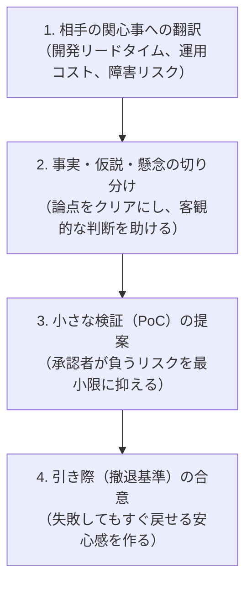

プロジェクトマネジメントの真価は、分厚い計画書を作ることではなく、日々のちょっとした開発判断やコミュニケーションのダンドリにある。

第 1 章で触れたように、ダンドリとは「目的を達成するまでの無駄な損失を削り、不確実性を手なずけること」だ。そしてもうひとつ、ダンドリには「技術的な提案をチームや会社に通し、気持ちよく合意を取りつけるための技術」という重要な側面がある。

ここでは、開発現場でよくある「もったいない損失」をなくすコツと、やりたい技術提案をスムーズに通すための伝え方を見ていこう。

# 開発現場でよくある 4 つの損失と、その防ぎ方

開発のスピードを落とす原因は、主に次の 4 つの損失に分類できる。

| 損失の分類 | 主な原因 | ダンドリによる解決策 |
| :--- | :--- | :--- |
| 判断待ち・返事待ちの損失 | 「どうしましょう？」と丸投げしてしまい、相手側の検討に時間がかかる | 状況、選択肢、おすすめの案と理由、回答期日をセットで伝える。「特に異論がなければ、明日の朝から A 案で進めます」というオプトアウト方式を使う。 |
| 仕様のズレによる手戻り損失 | 作り終わってから「そうじゃない」と受け入れ基準の食い違いが発覚する | 実装に入る前に、受け入れ条件（Acceptance Criteria）を箇条書きで整理し、PdM や QA と合意する。未知の技術要素は半日のスパイクで確かめておく。 |
| 情報探しの損失 | 設計の判断理由や仕様の経緯が Slack の波に流され、探すのに時間を取られる | 決定事項と「なぜそうしたか（却下した案）」を、Issue や PR、ADR（Architecture Decision Record）に残す。古いドキュメントは迷わずアーカイブする。 |
| ボトルネック放置の損失 | 自分の作業が終わったからと、チームの詰まりを無視して次のタスクに着手し、仕掛かりを増やす | ボード全体を見て、レビュー待ちやテスト待ちになっているタスクの解消を優先して手伝う。 |

# なぜ技術提案は却下されてしまうのか

リファクタリング、ライブラリの更新、テスト自動化など、エンジニアなら誰もがやりたい改善提案が却下されてしまうのはなぜだろうか。その理由は、技術的な正しさが足りないからではなく、**「承認者の目線から見た不確実性（工数、納期への影響、障害リスク）が解消されていないから」** だ。

非エンジニアや事業責任者から見ると、コードや内部設計の複雑さは外からは見えない。「リファクタリングをしたい」と言われても、「どれくらい時間がかかるのか」「他の機能開発が遅れないか」「バグが出る危険はないのか」という不安が消えない限り、責任ある立場として「いいよ」と首を縦には振れない。

つまり、技術提案を通すためのダンドリとは、**「承認者が抱える不安や不確実性を、先回りで小さくしてあげる技術」** にほかならない。

# 提案をスムーズに通すための 4 つのステップ

提案を相手が安心して受け入れられる形に整えるために、次の 4 つを意識してみよう。

## 1. 相手の関心事（評価指標）に翻訳する

技術的なメリットを、そのまま語るのではなく相手の言葉に翻訳して伝える。

| 提案相手 | エンジニアのよくある言い方 | 相手の関心事に翻訳した伝え方 |
| :--- | :--- | :--- |
| PdM | アーキテクチャが古くてコードがスパゲッティです | この部分の依存関係を整理しておくと、来期予定している新機能の開発にすぐ着手でき、納期を 1 週間早められます |
| 事業責任者 | ライブラリのバージョンが古いです | セキュリティサポート終了に伴う事故リスクを防げるだけでなく、CI のビルド時間を半分にでき、チームの開発待ち時間を月間 20 時間削れます |

## 2. 事実・仮説・懸念をきちんと切り分ける

提案するときは、感情論や希望的観測を交えず、次の 3 つに分けて整理すると説得力が増す。

| 区分 | 意味 | 伝え方の例 |
| :--- | :--- | :--- |
| 事実 | 客観的な現状のデータ | 現在、CI の実行に毎回 40 分かかっており、1 日に平均 8 回の待ち時間が発生しています |
| 仮説 | 改善によって見込める効果 | テストの並列化とキャッシュを使えば 10 分に短縮でき、チーム全体で毎日約 4 時間の待ち時間を削減できる見通しです |
| 懸念・不確定要素 | 発生する費用やリスク | 並列ランナーを追加するため、月額約 5,000 円のインフラ費用が余計にかかります |

このように客観的な事実と期待される効果、発生するコストを切り分けて提示すれば、承認者も費用対効果を冷静に判断できるようになる。

## 3. まずは小さな検証（PoC）から持ちかける

いきなり「システム全体を書き直します」と提案すると、リスクが大きすぎてまず通らない。「まずは一番影響の小さい 1 画面だけで、2 日間のタイムボックスを切って試してみます」のように、相手が「それくらいならやってみて」と言いやすい小さな一歩を提示しよう。

## 4. 引き際（撤退基準）をあらかじめ握っておく

試してみてうまくいかなかったときの安全弁を用意しておく。「もし 2 日間の検証で期待通りの性能が出なかった場合は、今のコードに戻して作業を終えます」という撤退基準（Two-way door であること）を約束しておけば、承認者側の心理的ハードルは一気に下がる。

## 5. 検証の結果としての「見送り」は立派な成果

PoC をやってみた結果、「思っていたより効果が出ない」「運用コストが見合わない」とわかって導入を見送ることになっても、それは失敗ではない。わずかな工数でリスクを洗い出し、将来の大きな無駄遣いを防いだのだから、ダンドリとしては大成功なのだ。
