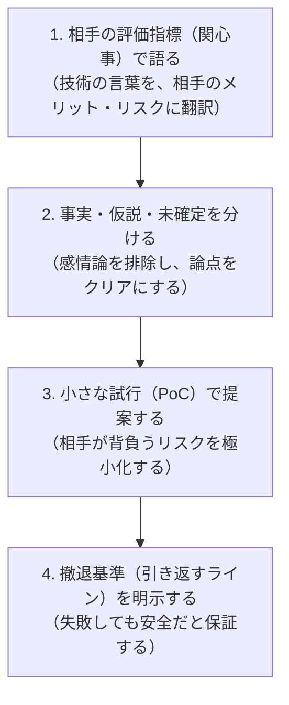

ここまで、プロジェクトマネジメントの骨格、不確実性、ボトルネックの扱い方を見てきた。

第 1 章で「ダンドリとは、目的達成までの『もったいない』を減らし、見通しを立てて動けるようにすること」だと書いた。
そしてもうひとつ、**「ダンドリを身につけると、自分のアイデアや提案がすんなり通るようになる」** とも伝えた。

本章ではその伏線を回収しよう。
エンジニアの日々の開発現場で起きている「もったいない」を削ぎ落とし、周囲を味方につけて自分のやりたい開発を前に進めるための、実践的なダンドリの技術だ。

# 現場に転がっている「5つのもったいない」を削る

開発を遅らせている最大の犯人は、追加の予算でも最新のツールでもない。私たちが日常で無自覚に垂れ流している「もったいない」だ。

1. **待ち時間のもったいない（判断待ち・レビュー待ち・返事待ち）**
   「どうしましょう？」と相手にボールを丸投げすると、相手が考える時間分だけ待たされる。「状況はこうで、選択肢は A と B があります。理由から A を推奨しますが、よろしいですか？（明日の 12 時までに異論がなければ A で進めます）」と、相手が「Yes」とだけ言えばいい形に整えて投げる。
2. **手戻りのもったいない（仕様違い・考慮漏れ）**
   コードを書き終えてから「そうじゃない」と言われるのが一番つらい。着手前に「どんな画面になって、どんなデータが出れば合格か」を 3 行でいいから書き出し、関係者と合意する。不安な技術は半日のスパイクで小さく試す。
3. **情報探索のもったいない（過去の経緯・仕様の迷子）**
   「あの仕様、Slack のどこに書いてあったっけ……」とタイムラインを遡る時間は純度 100% の無駄だ。重要な決定は Issue や PR、ADR に残す。逆に、誰もメンテしていない古い Wiki ページは混乱を招くだけなので容赦なくアーカイブする。
4. **調整コストのもったいない（大人数での不毛な会議）**
   全員を集めて 1 時間話し合っても何も決まらない。「何を決めるための場なのか」「論点は何か」を事前に共有し、事前に合意できるところは非同期テキストで合意しておく。会議は「最後の意思決定」だけを行う場にする。
5. **ボトルネック放置のもったいない（自分の作業しか見ない）**
   自分が実装を終えて手が空いたからといって、次のタスクを勝手に掘り起こして着手しない。チームのカンバンを見て、レビュー待ちやテスト待ちで誰かが困っているなら、その解消に手を貸す。

この 5 つを意識して削るだけで、お金も工数もかけずに、開発の体感スピードは劇的に跳ね上がる。

# なぜあなたの提案は通らないのか？

「技術的負債を返済したい」
「古くなったフレームワークをアップグレードしたい」
「テストコードを書く時間を確保したい」

エンジニアなら誰しも、プロダクトを良くするための改善提案を持っているはずだ。しかし、PdM や事業責任者に相談して「今は機能開発を優先したいから後にして」と却下された経験はないだろうか。

なぜ、良い提案なのに通らないのか？

それは、あなたの提案が間違っているからではない。
**「相手にとって、その提案を採用するための不確実性（不安）が大きすぎるから」** だ。

周囲の非エンジニアから見れば、技術の内部事情はブラックボックスだ。
「リファクタリングをします」と言われても、「どのくらい時間がかかるの？」「本当に安全なの？」「他の機能開発が止まるんじゃないの？」という疑問と恐怖が先に立つ。恐怖がある以上、責任ある立場の人ほど「No」と言わざるを得ない。

つまり、**プロジェクトマネジメントとは「人に何かを受け入れてもらうための技法」そのもの**なのだ。

# 提案をスルッと通す「5つのダンドリ」

自分のアイデアを気持ちよく快諾してもらうために、相手の脳内にある不確実性を先回りして小さく潰しておこう。

## 1. 相手の関心事（評価指標）の言葉に翻訳する

技術的にどれほど美しくても、相手の関心事と結びついていなければ刺さらない。

- **PdM に対する提案**：「〇〇のアーキテクチャが汚い」ではなく、「ここを整理すると、来月予定している新機能の追加が 2 週間前倒しできます」と伝える。
- **経営陣やビジネス側に対する提案**：「ライブラリのバージョンが古い」ではなく、「サポート終了に伴い、万一の脆弱性が出たときに顧客情報漏洩のリスクがあります。また、ビルド時間を短縮して月 30 時間のエンジニア工数を削減できます」と伝える。

## 2. 事実・仮説・未確定をきれいに分ける

提案書や Issue で、思いついたことをごちゃ混ぜに書いてはいけない。

- **事実（すでに起きている客観的なデータ）**：「現在、CI の実行に毎回 40 分かかっており、1 日平均 8 回の待機が発生している」
- **仮説（改善による期待効果）**：「テストを並列化すれば、1 回 10 分に短縮でき、チーム全体で毎日 4 時間の開発時間が浮く見込みです」
- **未確定（まだ分かっていない懸念やコスト）**：「CI の実行ランナーを増やすため、月額約 8,000 円の追加費用が発生する」

このように分けて提示されると、承認者は「費用対効果」を冷静に判断できるようになる。

## 3. 「小さく試す（PoC）」形で差し出す

「システム全体を一新したいので、1 ヶ月開発を止めさせてください」と言われたら、どんなマネージャーでも青ざめて拒絶する。

相手が「Yes」と言いやすいように、提案のサイズを小さくする。

- 「まずは影響の少ない 1 画面だけで、来週の 2 日間を使って試験導入させてください」
- 「そこで問題がないことを確認してから、全体に広げるかどうかを改めて相談させてください」

相手が背負うリスクを極限まで小さくしてあげることが、提案を通すための最大のダンドリだ。

## 4. やめどき（撤退基準）をあらかじめ握る

「もしやってみてダメだったらどうするの？」という不安を先回りして潰す。

「もし 2 日間で期待した性能が出なかった場合は、元の実装のまま切り戻して終了します。深追いはしません」

引き返すライン（Two-way door であることの保証）を先に伝えておけば、相手は安心して背中を押してくれる。

## 5. 「見送り（やらない判断）」も立派な前進

小さく試した結果、「思ったほど効果が出なかった」「別のリスクが大きいことが分かった」と判明して提案を取り下げることもある。

これは失敗ではない。
「危ない道にチーム全員で突っ込む前に、最小のコストで地雷を見つけて撤退できた」のだから、大成功だ。無駄な投資を防いだという点で、立派なダンドリの成果として胸を張っていい。
