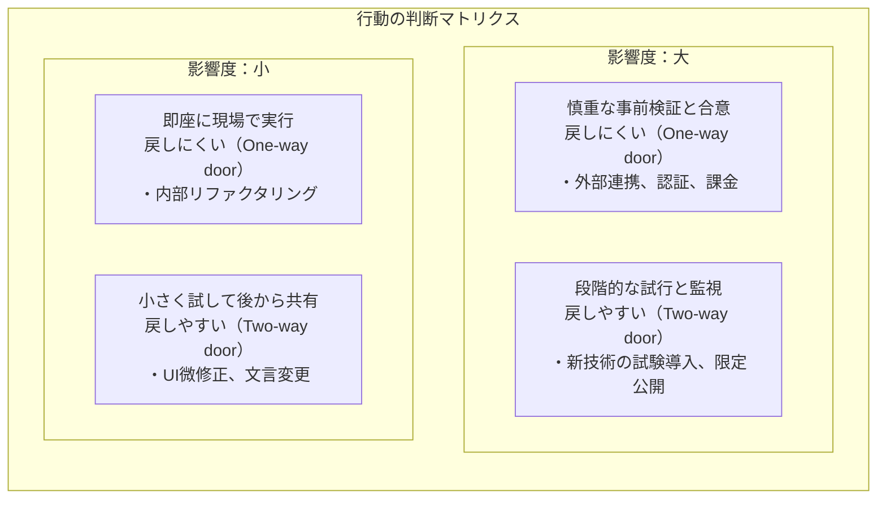

プロジェクトマネジメントの真価は、大規模な計画策定ではなく、エンジニアの日々の細かな判断や提案の中に宿ります。

ここまでの道具を使って、現場でよくある「もったいない損失」を減らし、関係者からの合意を最速で獲得する実践的なダンドリを解説します。

# 開発現場の「3M（ムリ・ムダ・ムラ）」を捉える

製造業のカイゼンで用いられる「3M」の視点は、ソフトウェアエンジニアの働き方にもそのまま当てはまります。

- ムリ（過負荷）：処理能力を超えた無理な締め切り、特定エンジニアへの依存。過負荷は品質低下とバーンアウトを招きます。
- ムダ（浪費）：使われない機能の開発、確認不足による巨大な手戻り、不毛な情報探索、誰も読まない会議資料。
- ムラ（ばらつき）：スプリントごとの作業量の激しい変動、巨大な PR によるレビュー負荷の集中。ムラは過負荷と手待ち時間を交互に生み出します。

作業速度を上げる前に、まずはこの「ムダな待ち」「手戻り」「情報の迷子」を削ぎ落とすことがダンドリの出発点です。

# よくある4つの困りごとに対する処方箋

現場で頻出する問題に対して、本書で扱った道具をどう適用するかを整理します。

## 1. レビューや判断の待ち時間が長い

相談するときに「どうしましょう？」と丸投げせず、論点、選択肢、推奨案と理由、回答期限をセットで提示します。また、レビュー範囲を単一の関心事に絞って PR を小さくし、前提条件と動作確認エビデンスを添付します。

## 2. 確認不足による手戻りが多い

実装に入る前に「どのような条件を満たせば合格か」という受け入れ基準（AC）と完了の定義（DoD）を PdM や QA と合意しておきます。技術的な不安がある箇所は、本実装の前にタイムボックス（例：半日）を区切ってスパイクを行い、最小限のコードで検証します。

## 3. 情報を探す時間が長い

チャットツールの流れるタイムラインで重要な決定を終わらせず、Issue やドキュメントツールに決定事項、理由、前提条件を記録します。また、更新が止まって陳腐化したドキュメントは混乱の元になるため、定期的に削除またはアーカイブします。

## 4. 開発の流れが詰まって進まない

新しいチケットを取るのを止め、チーム全体で詰まっているタスクの完了（ペアプロやモブレビューなど）を最優先で支援します。仕掛かり作業（WIP）の制限を設けることで、流れの詰まりを解消します。

# 行動の判断軸：影響度 × 戻しやすさ

何か新しい試みや仕様変更をする際、どれだけの準備や合意形成をするべきかは、次のマトリクスで判断します。

- 影響が小さく戻しやすい（Two-way door）：長時間の会議や広範な事前合意は不要です。現場のエンジニアが素早く実装し、動作を見て判断します。
- 影響が大きく戻しにくい（One-way door）：事前にスパイク、ステークホルダー合意、監視やロールバック手順に十分投資します。

# 提案をスムーズに通すためのダンドリ

技術的負債の返済や新ツールの導入など、エンジニアからの提案をチームや経営陣に快諾してもらうための技術です。

## 1. 相手の関心・懸念・評価指標から逆算する

技術的にどれほど優れていても、相手の関心と噛み合っていなければ却下されます。PdM なら「開発リードタイムやユーザー価値」、経営層なら「コストや事業リスク」の言葉に変換して提案します。

## 2. 事実、仮説、未確定を明確に分ける

- 事実の例：「現在、CI の実行に 1 回 45 分かかっており、1 日平均 6 回待機が発生している」
- 仮説の例：「キャッシュ機構を導入すれば、1 回 15 分に短縮でき、月間 30 時間のエンジニア工数が浮く」
- 未確定の例：「キャッシュストレージの追加コスト（月額約 5,000 円）が許容されるか」

これらを分けて提示することで議論が感情論にならず、建設的な意思決定が行えます。

## 3. 小さな試行（PoC）で判断のハードルを下げる

「全体を一気に置き換えます」という提案は、承認者に大きなリスクを背負わせるため通りにくくなります。「まずは 1 つのエンドポイントで 1 スプリントだけ試験運用し、問題がなければ拡大したい」というように、相手が低リスクで承認できる選択肢を設計します。

## 4. 見送り（やらない判断）も立派な成果

検討した結果、「費用対効果が合わない」「リスクが大きすぎる」と判明して見送ることは、失敗ではありません。無駄な投資を早い段階で防いだという点で、立派なダンドリの成果です。
